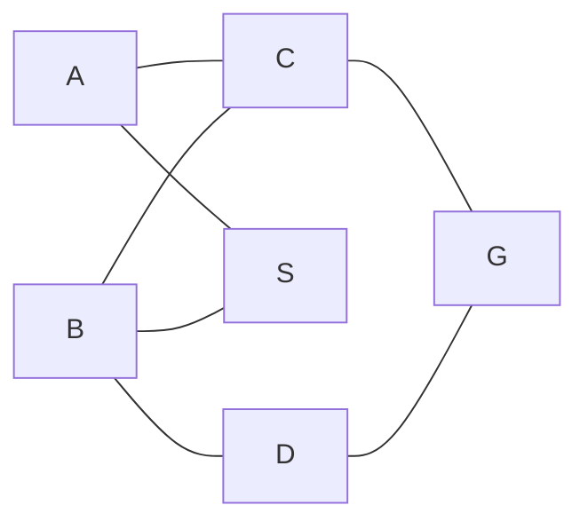
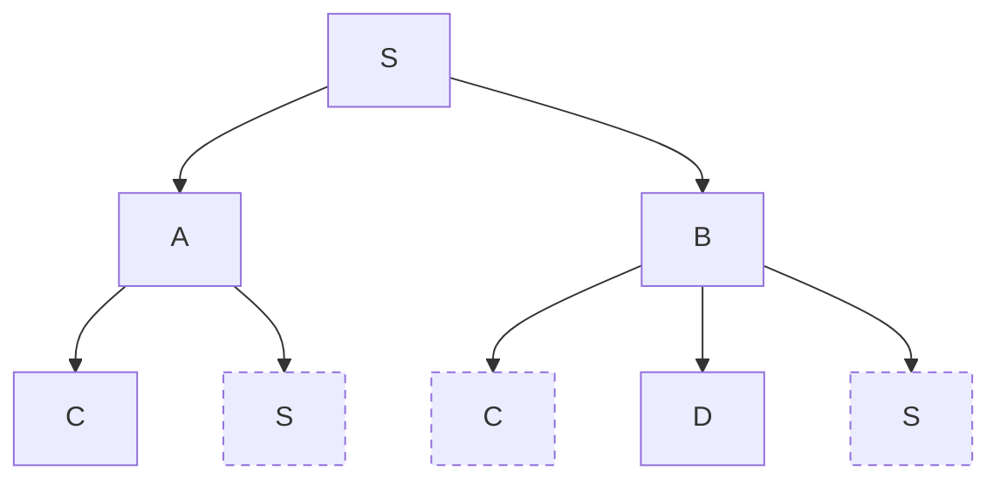
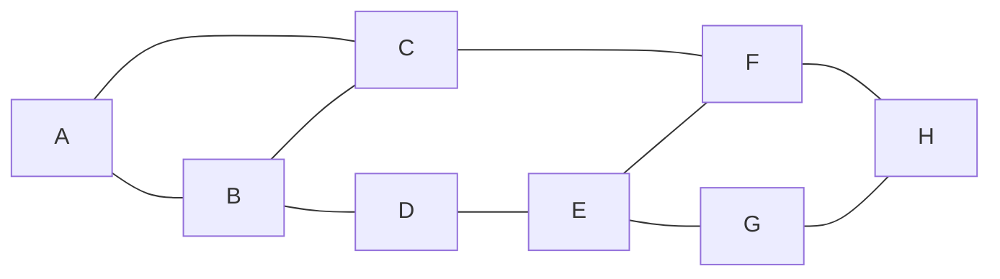

**English** | [Polski](README.pl.md)

# Lesson 2.1 — State spaces and search trees

**Core** · Requires: 1.3 Agent types and problem formulation (see the [course map](../../../COURSE_MAP.md)).

## Learning goals

After this lesson you will be able to:

- describe the state space of a problem as a graph;
- tell a node of the search tree apart from the state it holds;
- write your own `expand`, the basic operation of every search algorithm;
- explain where redundant paths and cycles in the tree come from, and count what they cost;
- tell tree search apart from graph search;
- use the general scheme of best-first search, from which lessons 2.2–2.4 derive their algorithms.

## The problem

In lesson 1.3 the warehouse robot got a problem formulation: an initial state, actions, a transition model, a goal test and a step cost. Take a small map:

```text
#######
#R..#.#
#.#...#
#...#D#
#######
```

There are only 12 free cells here, so there are also 12 states (robot positions). Yet there are more than 7 thousand routes of 12 steps, that is sequences of moves that never drive into an obstacle. Most of them drive back and forth along the same aisle. An algorithm that simply tries routes drowns in their number very quickly.

This lesson answers the question: **what does a search algorithm actually search, and how can it avoid counting the same thing many times?**

## Intuition

A state space is a **city map**: crossroads and the streets between them. A search tree is **a record of every walk** you can start from home. Each walk is a separate branch, even when two walks end at the same crossroads and a third one goes round and round one block.

The map is small and finite. There are infinitely many walks, because you can always walk one more block and come back. Every algorithm in this module builds part of the tree of walks. They differ only in which walk they extend next and whether they remember where they have already been.

## Formal model

### The state space as a graph

A problem formulation defines a **state space**: the set of all states reachable from the initial state. It is easiest to think of it as a directed graph:

- the **vertices** are states;
- there is an **edge** from `s` to `s2` when some action `a` in `problem.actions(s)` leads to `s2 = problem.result(s, a)`;
- the **weight** of the edge is the step cost `problem.action_cost(s, a, s2)`.

A solution is a path in this graph from the initial state to a state that passes the goal test. An **optimal** solution is a path with the smallest sum of step costs.

In the warehouse the vertices are free cells and the edges join neighbouring cells. Every aisle can be driven both ways, so each edge comes with a return edge. We then draw the pair as one edge without an arrow and speak of an undirected graph.

We rarely keep the whole state space graph in memory. It is usually too big: with a few parcels to pick up there are exponentially many states (lesson 1.3). The algorithm knows only the initial state and the functions `actions` and `result`, so it discovers the graph piece by piece as it searches.

### Nodes and states

A search algorithm builds a **search tree**. Its root stands for the initial state, and the children of a node stand for the states that the actions available in its state lead to. In the course code a node is a `Node` object with five fields:

| Field | Meaning |
|---|---|
| `state` | the state we are in |
| `parent` | the node we came from (`None` at the root) |
| `action` | the action that led from the parent to this node |
| `path_cost` | the cost of the whole path from the root, written *g*(*n*) |
| `depth` | the number of steps from the root |

**A state describes the world. A node describes a way of getting to that state.** Two different nodes can hold the same state if we reached it in two different ways. They then have different parents, and often different costs and depths too.

A node knows its parent, so the whole path can be rebuilt from it. `node.path()` returns the nodes from the root to `node`, `node.states()` returns their states and `node.solution()` the actions.

### Expanding a node

**Expanding** a node creates all of its children, one for each action:

```text
EXPAND(problem, node):
    children ← empty list
    for each action a in problem.actions(node.state), in order:
        s2 ← problem.result(node.state, a)
        cost ← node.path_cost + problem.action_cost(node.state, a, s2)
        add Node(s2, parent = node, action = a, cost, node.depth + 1) to children
    return children
```

Look at the cost. A child stores the cost of the **whole** path from the root, not just of the last step. Comparing two ways of reaching the same state then comes down to comparing two numbers.

In lessons 2.2–2.4 you will use the ready-made `expand` from `introai.search`. It does exactly the same and also reports every expansion to the trace (`introai.trace`), so tests and experiments can see which nodes your algorithm expands and in what order. In this lesson you write it yourself.

### The frontier

During a search part of the tree has already been expanded and part is still waiting its turn. The nodes that have been generated but not yet expanded form the **frontier**. The frontier separates the explored part of the state space from the unexplored part. Every search algorithm repeatedly takes a node off the frontier, checks whether it is a goal and, if not, expands it and adds its children to the frontier.

Algorithms differ above all in **which** node they take next.

### Redundant paths and cycles

The search tree contains every path, so the same state appears in it many times. There are two reasons:

- a **cycle**: a path returns to a state it has already passed through, for example the robot drives east and straight back west. In a graph with cycles the search tree is **infinite**, even though there are finitely many states;
- a **redundant path**: several different paths lead to a state. All of them except one cheapest path are redundant: whatever can be done next can be done from the cheapest one as well. In the warehouse grid a great many shortest routes lead to a cell a few steps to the side and a few steps down.

A cycle is a special case of a redundant path: with positive step costs, a path that came back to a state always costs more than the same path without the loop.

How fast does the tree grow? If every node has *b* children (*b* is the **branching factor**), there are *b*<sup>*d*</sup> nodes at depth *d*, and the whole tree down to depth *d* has:

$$1 + b + b^2 + \dots + b^d = \frac{b^{d+1} - 1}{b - 1} = O(b^d).$$

For *b* ≥ 2 the last level has more nodes than all the levels above it together. On the open warehouse floor *b* = 4, so at depth 10 the tree has more than a million nodes. Meanwhile at most 2·10·11 + 1 = 221 different cells can be reached in 10 steps, because they lie in a "diamond" around the start. Almost the whole tree consists of redundant paths.

### Tree search and graph search

There are three ways to deal with redundant paths:

1. **Graph search** remembers the reached states in a structure called **reached**, usually a dictionary `state → best known node`. A child whose state is already in reached at a cost that is not higher gets discarded. A state goes back onto the frontier only when a cheaper path to it is found, so usually once rather than exponentially many times. The price is memory: reached can grow to the size of the whole state space.
2. **Tree-like search** remembers nothing and expands every path separately. It needs little memory, but on a graph with cycles it may never stop, and redundant paths multiply its work exponentially.
3. **Checking for cycles on the current path**: a child is discarded only when its state already appears among the node's ancestors. This needs no extra memory (walking up the parents is enough) and removes cycles, but not the other redundant paths.

Tree search makes sense when there are no redundant paths, or very few. An example is placing queens on a chessboard column by column: each partial placement can be reached in only one way. In the warehouse redundant paths are everywhere, so the algorithms of lessons 2.2–2.4 are graph searches.

### The general scheme: best-first

Almost all algorithms in this module are variants of one scheme. **Best-first search** keeps the frontier as a priority queue ordered by an **evaluation function** *f*(*n*) and always expands the node with the smallest value of *f*:

```text
BEST-FIRST-SEARCH(problem, f):
    node ← Node(problem.initial)
    frontier ← a priority queue ordered by f, holding node
    reached ← {problem.initial: node}
    while the frontier is not empty:
        node ← take the node with the smallest f off the frontier
        if problem.is_goal(node.state): return node
        for each child in EXPAND(problem, node):
            s ← child.state
            if s ∉ reached or child.path_cost < reached[s].path_cost:
                reached[s] ← child
                add child to the frontier
    return None
```

Choosing *f* gives particular algorithms:

| Evaluation function *f*(*n*) | Algorithm | Lesson |
|---|---|---|
| the depth of the node | breadth-first search (BFS) | 2.2 |
| minus the depth of the node | depth-first search (DFS) | 2.2 |
| *g*(*n*), the path cost | uniform-cost search (UCS) | 2.3 |
| *h*(*n*), an estimate of the distance to the goal | greedy best-first search | 2.4 |
| *g*(*n*) + *h*(*n*) | A* | 2.4 |

BFS and DFS do not need a priority queue: a plain FIFO queue and a LIFO stack give the same order and are faster. In lesson 2.2 you will also see that BFS can test for the goal earlier, as soon as it generates a child. The skeleton stays the same, though: a frontier, reached, and the loop "take a node off, test it, expand it".

## Trace it by hand

### Worked example

Take the graph from lesson 2.2, from `S` to `G`. The neighbours of each state are considered in alphabetical order.

<!-- generated:graph example=worked_example -->

<!-- /generated -->

This is the search tree down to depth 2, with no states remembered at all. A dashed outline marks the nodes whose state has already appeared in the tree earlier (higher up, or further left on the same level):

<!-- generated:search-tree example=worked_example depth=2 -->

<!-- /generated -->

The same graph level by level, down to depth 3:

<!-- generated:tree-levels example=worked_example depth=3 lang=en -->
| Depth | Nodes (their states) | Nodes | Distinct states |
|---|---|---|---|
| 0 | S | 1 | 1 |
| 1 | A, B | 2 | 2 |
| 2 | C, S, C, D, S | 5 | 3 |
| 3 | A, B, G, A, B, A, B, G, B, G, A, B | 12 | 3 |
<!-- /generated -->

At depth 2 there are 5 nodes but only 3 different states:

- `S` appears twice, on the paths S → A → S and S → B → S. These are cycles: the robot came back to the start;
- `C` appears twice, on the paths S → A → C and S → B → C. These are redundant paths: two different paths of the same length to the same state.

At depth 3 there are already 12 nodes, and still only 3 different states. The state `G` appears there three times, so there are three different three-step paths to the goal. The tree does not stop at the goal, because the goal test belongs to the search algorithm, not to the tree.

### Your turn

Take the exercise graph, with the initial state `A`:

<!-- generated:graph example=exercise -->

<!-- /generated -->

Draw its search tree down to depth 2, without remembering any states: every path from `A` is a separate node, even when it comes back to a state that is already in the tree. The root is at depth 0. Then fill in Part A of `task.py`:

- `TREE_NODES_AT_DEPTH_2`: how many nodes lie at depth 2;
- `STATES_AT_DEPTH_2`: how many different states there are among those nodes.

## Properties

Notation: *b* is the branching factor, *d* is the depth, *n* is the number of states.

| | Tree search | Graph search |
|---|---|---|
| Expansions down to depth *d* | O(*b*<sup>*d*</sup>), every path separately | usually each state once, so of the order of *n* |
| Memory for remembered states | none | up to O(*n*) in reached |
| Stops on a finite graph with cycles | not necessarily | yes |
| Worth it when | there are hardly any redundant paths | there are many redundant paths (grids, maps) |

**Limitations.** Graph search assumes that a state can be stored and compared, which in Python means it is hashable (lesson 1.3). When the state space is huge, reached alone may not fit in memory. We then go back to tree search with cycle checking along the path, as in iterative deepening in lesson 2.6.

## Common mistakes

1. **Only the last step's cost.** A child gets a `path_cost` equal to the cost of its last step instead of the sum over the whole path. With steps that cost 1 nothing shows at depth 1, but two steps further the costs are wrong.
2. **Depth not increased.** A child gets its parent's depth. Algorithms that order nodes by depth then lose their bearings.
3. **A child without a parent.** Without a parent, `node.path()` ends at that node, so the route from the start cannot be rebuilt.
4. **A reached set in a tree.** Counting tree nodes with a reached set counts different states, not nodes. A search tree contains every path, redundant ones too.
5. **The forgotten root.** The list of counts starts at depth 1 and is one element short. The root is level 0.
6. **A goal test while counting.** The tree does not end at the goal: a goal node has children too. Stopping at the goal is a decision of the search algorithm, not a feature of the tree.

The lesson's tests catch each of these mistakes.

## Task

### Part A: counting by hand

Fill in two numbers in `task.py` for the graph in "Your turn": `TREE_NODES_AT_DEPTH_2` and `STATES_AT_DEPTH_2`.

### Part B: implementation

Implement two functions in `task.py`:

- `expand(problem, node)` returns the list of the node's children, one for each action, in the order of `problem.actions(node.state)`. Each child has a parent, an action, the cost of the whole path from the root and a depth one greater than its parent's. Write it yourself, without the ready-made `expand` from `introai.search`;
- `count_tree_nodes(problem, depth)` returns a list of `depth + 1` numbers: how many search tree nodes lie at depth 0, 1, …, `depth`. Build the tree level by level with your `expand`, without remembering states and without a goal test.

`task.py` does not import `introai.search.reference`.

### How to check

From the repository root:

```bash
uv run pytest modules/02_search/01_state_space
```

The failure messages say which property is broken and on which example.

### Acceptance criteria

- All the lesson's tests pass.
- You can answer the review questions before you look at the answers.

## What the tests do not check

- **Understanding.** Passing tests do not prove that you understand the difference between a node and a state. The review questions and the experiment are there for that.
- **Speed.** The tests count trees down to a small depth. A version that builds every node passes them, even though it is very slow at large depths. You will find a faster way in the alternative solution.
- **Style and readability.**
- **Getting around the import ban.** The test detects a plain import of `introai.search.reference` and calls to the ready-made `expand`, but not every trick. Such a workaround only cheats you.

## Experiments

Open [experiments.ipynb](experiments.ipynb). Before each experiment write down your prediction, then check it:

1. On the map with aisles: how many tree nodes lie at depth 12? And how many different cells?
2. Why does the number of different cells grow so slowly from one depth to the next, and sometimes even drop?
3. How do both numbers change on the open floor, where the robot can drive in four directions from almost every cell?

## Review questions

1. What is the difference between a node and a state? Can two different nodes hold the same state? Give an example from the warehouse.
2. Why is the search tree of the warehouse infinite, even though there are finitely many cells?
3. How many nodes does a full tree with branching factor *b* have down to depth *d*? Why does the last level make up the larger part of that number?
4. When is tree search, without remembering states, a sensible choice, and when does it lead to disaster?
5. Which evaluation function *f* do you have to put into best-first search to get uniform-cost search? Why does reached store a cost and not just "I have been here"?

## If you get stuck

<details>
<summary>Hint 1: how to build a child</summary>

For each action `a` in `problem.actions(node.state)` compute `s2 = problem.result(node.state, a)`, then create `Node(s2, node, a, cost, node.depth + 1)`. The cost is `node.path_cost` plus the step cost from `problem.action_cost(node.state, a, s2)`.

</details>

<details>
<summary>Hint 2: the tree level by level</summary>

Keep a list of the nodes of the current level. At the start it holds only the root `Node(problem.initial)`. The next level is all the children of all the nodes of the current level. After each level, record the length of the list.

</details>

<details>
<summary>Hint 3: the numbers come out too small</summary>

Check that you do not skip nodes whose state you have already seen, and that you do not stop at the goal. In a search tree every path counts.

</details>

## Key takeaways

- A state space is a graph: states are vertices, actions are edges, step costs are weights.
- A node is a state together with the way of getting to it: a parent, an action, a path cost and a depth.
- Expanding a node creates its children; the frontier is the nodes generated but not yet expanded.
- A search tree grows like *b*<sup>*d*</sup>, while the number of different states usually grows much more slowly. The difference is redundant paths and cycles.
- Graph search pays with memory for not repeating work.
- BFS, DFS, UCS, greedy and A* are the same best-first scheme with different evaluation functions.

## What next

- After your own attempt, compare with the solution and answers in [solutions/02_search/01_state_space/](../../../solutions/02_search/01_state_space/).
- The next lesson, 2.2, introduces the first two strategies for choosing a node from the frontier: breadth-first and depth-first search.

## References

- S. Russell, P. Norvig, *Artificial Intelligence: A Modern Approach*, 4th ed., Pearson, 2020, sections 3.1–3.3 (search problems, search trees, best-first search).
