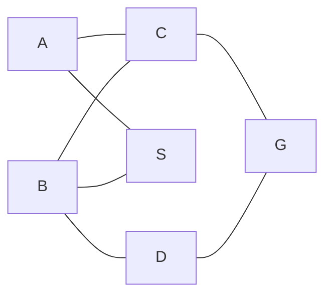
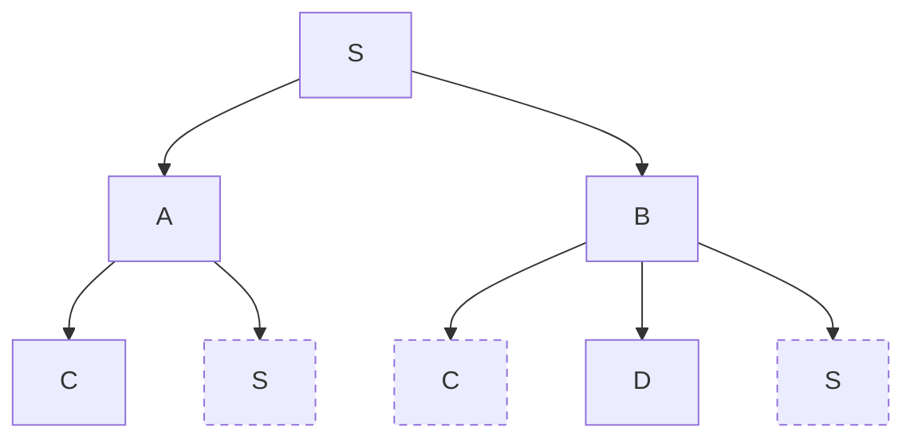
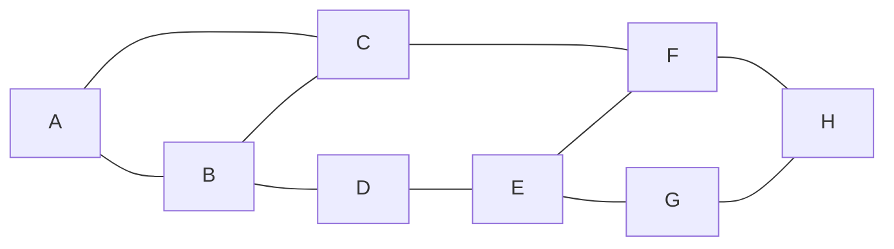

[English](README.md) | **Polski**

# Lekcja 2.1 — Przestrzeń stanów i drzewo przeszukiwania

**Core** · Wymagania: 1.3 Typy agentów i sformułowanie problemu (zobacz [mapę kursu](../../../COURSE_MAP.pl.md)).

## Cele lekcji

Po tej lekcji:

- przedstawisz przestrzeń stanów problemu jako graf;
- odróżnisz węzeł drzewa przeszukiwania od stanu, który ten węzeł przechowuje;
- napiszesz własną wersję `expand`, czyli podstawowej operacji każdego algorytmu przeszukiwania;
- wyjaśnisz, skąd w drzewie biorą się ścieżki nadmiarowe i cykle, i policzysz, ile kosztują;
- odróżnisz przeszukiwanie drzewa od przeszukiwania grafu;
- poznasz ogólny schemat przeszukiwania „najpierw najlepszy” (*best-first search*), z którego wyprowadzimy algorytmy z lekcji 2.2–2.4.

## Problem

W lekcji 1.3 robot w magazynie dostał sformułowanie problemu: stan początkowy, akcje, model przejść, test celu i koszt kroku. Weźmy małą mapę:

```text
#######
#R..#.#
#.#...#
#...#D#
#######
```

Wolnych pól jest tu tylko 12, więc stanów (pozycji robota) też jest 12. Tras o długości 12 kroków, czyli ciągów ruchów, które nie wjeżdżają w przeszkodę, jest jednak ponad 7 tysięcy. Większość z nich jeździ tam i z powrotem tą samą alejką. Algorytm, który po prostu wypróbowuje trasy, bardzo szybko utonie w ich liczbie.

Ta lekcja odpowiada na pytanie: **co właściwie przeszukuje algorytm przeszukiwania i jak uniknąć liczenia tego samego wiele razy?**

## Intuicja

Przestrzeń stanów to **mapa miasta**: skrzyżowania i ulice między nimi. Drzewo przeszukiwania to **zapis wszystkich spacerów**, które można zacząć od domu. Każdy spacer to osobna gałąź, nawet jeśli dwa spacery kończą się na tym samym skrzyżowaniu, a trzeci kręci się w kółko wokół jednego kwartału.

Mapa jest mała i skończona. Spacerów jest nieskończenie wiele, bo zawsze można przejść jeszcze jedną przecznicę i wrócić. Każdy algorytm z tego modułu buduje fragment drzewa spacerów, a różnią się one tylko tym, który spacer przedłużają jako następny i czy pamiętają, gdzie już byli.

## Model formalny

### Przestrzeń stanów jako graf

Sformułowanie problemu wyznacza **przestrzeń stanów**: zbiór wszystkich stanów osiągalnych ze stanu początkowego. Najwygodniej myśleć o niej jak o grafie skierowanym:

- **wierzchołki** to stany;
- **krawędź** z `s` do `s2` istnieje, gdy jakaś akcja `a` z `problem.actions(s)` prowadzi do `s2 = problem.result(s, a)`;
- **waga** krawędzi to koszt kroku `problem.action_cost(s, a, s2)`.

Rozwiązanie to ścieżka w tym grafie od stanu początkowego do stanu, który spełnia test celu. Rozwiązanie **optymalne** to ścieżka o najmniejszej sumie kosztów kroków.

W magazynie wierzchołki to wolne pola, a krawędzie łączą sąsiednie pola. Każdą alejką można jechać w obie strony, więc z każdą krawędzią idzie krawędź powrotna. Rysujemy je wtedy jako jedną krawędź bez strzałki i mówimy o grafie nieskierowanym.

Graf przestrzeni stanów rzadko trzymamy w pamięci w całości. Zwykle jest za duży: przy kilku paczkach do odebrania stanów jest wykładniczo wiele (lekcja 1.3). Algorytm zna tylko stan początkowy i funkcje `actions` oraz `result`, więc odkrywa graf kawałek po kawałku, w miarę jak go przeszukuje.

### Węzeł a stan

Algorytm przeszukiwania buduje **drzewo przeszukiwania**. Jego korzeń odpowiada stanowi początkowemu, a dzieci węzła odpowiadają stanom, do których prowadzą akcje dostępne w jego stanie. W kodzie kursu węzeł to obiekt klasy `Node` z pięcioma polami:

| Pole | Znaczenie |
|---|---|
| `state` | stan, w którym jesteśmy |
| `parent` | węzeł, z którego tu przyszliśmy (`None` w korzeniu) |
| `action` | akcja, która doprowadziła z rodzica do tego węzła |
| `path_cost` | koszt całej ścieżki od korzenia, oznaczany *g*(*n*) |
| `depth` | liczba kroków od korzenia |

**Stan opisuje świat. Węzeł opisuje drogę do tego stanu.** Dwa różne węzły mogą mieć ten sam stan, jeśli dotarliśmy do niego dwiema różnymi drogami. Wtedy mają różnych rodziców, a często także różne koszty i głębokości.

Węzeł zna swojego rodzica, więc da się z niego odtworzyć całą ścieżkę. Wywołanie `node.path()` zwraca węzły od korzenia do `node`, `node.states()` zwraca ich stany, a `node.solution()` akcje.

### Rozwinięcie węzła

**Rozwinięcie** węzła (*expansion*) tworzy wszystkie jego dzieci, po jednym dla każdej akcji:

```text
EXPAND(problem, węzeł):
    dzieci ← pusta lista
    dla każdej akcji a w problem.actions(węzeł.state), po kolei:
        s2 ← problem.result(węzeł.state, a)
        koszt ← węzeł.path_cost + problem.action_cost(węzeł.state, a, s2)
        dodaj do dzieci Node(s2, rodzic = węzeł, akcja = a, koszt, węzeł.depth + 1)
    zwróć dzieci
```

Zwróć uwagę na koszt. Dziecko przechowuje koszt **całej** ścieżki od korzenia, a nie tylko ostatniego kroku. Dzięki temu porównanie dwóch dróg do tego samego stanu sprowadza się do porównania dwóch liczb.

W lekcjach 2.2–2.4 będziesz korzystać z gotowej funkcji `expand` z `introai.search`. Robi dokładnie to samo, a dodatkowo zgłasza każde rozwinięcie do śladu (`introai.trace`), żeby testy i eksperymenty widziały, które węzły i w jakiej kolejności rozwija Twój algorytm. W tej lekcji piszesz ją sam.

### Frontier

W trakcie przeszukiwania część drzewa jest już rozwinięta, a część dopiero czeka na swoją kolej. Węzły wygenerowane, ale jeszcze nierozwinięte, tworzą **frontier** (granicę). Frontier oddziela zbadany fragment przestrzeni stanów od niezbadanego. Każdy algorytm przeszukiwania w pętli zdejmuje z frontier jakiś węzeł, sprawdza, czy jest celem, i jeśli nie, rozwija go, a jego dzieci dodaje do frontier.

Algorytmy różnią się przede wszystkim tym, **który** węzeł zdejmują jako następny.

### Ścieżki nadmiarowe i cykle

Drzewo przeszukiwania zawiera każdą drogę, więc ten sam stan pojawia się w nim wiele razy. Są dwa powody:

- **cykl**: ścieżka wraca do stanu, przez który już przechodziła, na przykład robot jedzie na wschód i zaraz z powrotem na zachód. W grafie z cyklami drzewo przeszukiwania jest **nieskończone**, choć stanów jest skończenie wiele;
- **ścieżka nadmiarowa** (*redundant path*): do stanu prowadzi kilka różnych dróg. Wszystkie poza jedną najtańszą są nadmiarowe: cokolwiek da się zrobić dalej, da się zrobić także z tej najtańszej. W siatce magazynu do pola odległego o kilka kroków w bok i kilka w dół prowadzi bardzo wiele najkrótszych tras.

Cykl jest szczególnym przypadkiem ścieżki nadmiarowej: przy dodatnich kosztach kroków droga, która wróciła do stanu, jest zawsze droższa od tej samej drogi bez pętli.

Jak szybko rośnie drzewo? Jeśli każdy węzeł ma *b* dzieci (*b* to **współczynnik rozgałęzienia**), to na głębokości *d* jest *b*<sup>*d*</sup> węzłów, a w całym drzewie do głębokości *d*:

$$1 + b + b^2 + \dots + b^d = \frac{b^{d+1} - 1}{b - 1} = O(b^d).$$

Dla *b* ≥ 2 ostatni poziom ma więcej węzłów niż wszystkie poprzednie razem. Na otwartej podłodze magazynu *b* = 4, więc na głębokości 10 drzewo ma ponad milion węzłów. Różnych pól osiągalnych w 10 krokach jest tymczasem najwyżej 2·10·11 + 1 = 221, bo leżą w „rombie” wokół startu. Prawie całe drzewo to ścieżki nadmiarowe.

### Przeszukiwanie drzewa a przeszukiwanie grafu

Ścieżki nadmiarowe można traktować na trzy sposoby:

1. **Przeszukiwanie grafu** (*graph search*) zapamiętuje osiągnięte stany w strukturze **reached**, zwykle w słowniku `stan → najlepszy znany węzeł`. Dziecko, którego stan jest już w reached przy nie wyższym koszcie, zostaje odrzucone. Stan trafia do frontier ponownie tylko wtedy, gdy znajdzie się do niego tańsza droga, więc zwykle raz, a nie wykładniczo wiele razy. Ceną jest pamięć: reached może urosnąć do rozmiaru całej przestrzeni stanów.
2. **Przeszukiwanie drzewa** (*tree-like search*) nic nie zapamiętuje i rozwija każdą drogę osobno. Potrzebuje mało pamięci, ale na grafie z cyklami może się nigdy nie zatrzymać, a ścieżki nadmiarowe mnożą jego pracę wykładniczo.
3. **Sprawdzanie cykli na bieżącej ścieżce**: dziecko odrzucamy tylko wtedy, gdy jego stan występuje już wśród przodków węzła. To nie wymaga dodatkowej pamięci (wystarczy przejść po rodzicach) i usuwa cykle, ale nie usuwa innych ścieżek nadmiarowych.

Przeszukiwanie drzewa ma sens wtedy, gdy ścieżek nadmiarowych nie ma albo jest ich niewiele. Przykładem jest układanie hetmanów na szachownicy kolumna po kolumnie: każde częściowe ustawienie można osiągnąć tylko jedną drogą. W magazynie ścieżki nadmiarowe są wszędzie, więc algorytmy z lekcji 2.2–2.4 to przeszukiwanie grafu.

### Ogólny schemat: najpierw najlepszy

Prawie wszystkie algorytmy tego modułu to warianty jednego schematu. **Przeszukiwanie „najpierw najlepszy”** (*best-first search*) trzyma frontier jako kolejkę priorytetową uporządkowaną według **funkcji oceny** *f*(*n*) i zawsze rozwija węzeł o najmniejszej wartości *f*:

```text
BEST-FIRST-SEARCH(problem, f):
    węzeł ← Node(problem.initial)
    frontier ← kolejka priorytetowa według f, zawierająca węzeł
    reached ← {problem.initial: węzeł}
    dopóki frontier nie jest pusty:
        węzeł ← zdejmij z frontier węzeł o najmniejszym f
        jeśli problem.is_goal(węzeł.state): zwróć węzeł
        dla każdego dziecka w EXPAND(problem, węzeł):
            s ← dziecko.state
            jeśli s ∉ reached albo dziecko.path_cost < reached[s].path_cost:
                reached[s] ← dziecko
                dodaj dziecko do frontier
    zwróć None
```

Wybór funkcji *f* daje konkretne algorytmy:

| Funkcja oceny *f*(*n*) | Algorytm | Lekcja |
|---|---|---|
| głębokość węzła | przeszukiwanie wszerz (BFS) | 2.2 |
| minus głębokość węzła | przeszukiwanie w głąb (DFS) | 2.2 |
| *g*(*n*), koszt ścieżki | przeszukiwanie kosztowe (UCS) | 2.3 |
| *h*(*n*), oszacowanie odległości do celu | zachłanne przeszukiwanie „najpierw najlepszy” (*greedy*) | 2.4 |
| *g*(*n*) + *h*(*n*) | A* | 2.4 |

BFS i DFS nie potrzebują kolejki priorytetowej: zwykła kolejka FIFO i stos LIFO dają ten sam porządek, a działają szybciej. W lekcji 2.2 zobaczysz też, że BFS może sprawdzać cel wcześniej, już przy generowaniu dziecka. Szkielet pozostaje jednak ten sam: frontier, reached i pętla „zdejmij, sprawdź, rozwiń”.

## Prześledź ręcznie

### Przykład rozwiązany

Weźmy graf z lekcji 2.2, z `S` do `G`. Sąsiadów każdego stanu rozpatrujemy w kolejności alfabetycznej.

<!-- generated:graph example=worked_example -->

<!-- /generated -->

Tak wygląda drzewo przeszukiwania do głębokości 2, bez żadnego zapamiętywania stanów. Linią przerywaną obrysowano węzły, których stan pojawił się w drzewie już wcześniej (wyżej albo bardziej na lewo na tym samym poziomie):

<!-- generated:search-tree example=worked_example depth=2 -->

<!-- /generated -->

Ten sam graf poziom po poziomie, aż do głębokości 3:

<!-- generated:tree-levels example=worked_example depth=3 lang=pl -->
| Głębokość | Węzły (ich stany) | Liczba węzłów | Różne stany |
|---|---|---|---|
| 0 | S | 1 | 1 |
| 1 | A, B | 2 | 2 |
| 2 | C, S, C, D, S | 5 | 3 |
| 3 | A, B, G, A, B, A, B, G, B, G, A, B | 12 | 3 |
<!-- /generated -->

Na głębokości 2 jest 5 węzłów, ale tylko 3 różne stany:

- `S` występuje dwa razy, na ścieżkach S → A → S i S → B → S. To cykle: robot wrócił na start;
- `C` występuje dwa razy, na ścieżkach S → A → C i S → B → C. To ścieżki nadmiarowe: dwie różne drogi tej samej długości do tego samego stanu.

Na głębokości 3 jest już 12 węzłów, a wciąż tylko 3 różne stany. Stan `G` pojawia się tam trzy razy, czyli są trzy różne trzykrokowe drogi do celu. Drzewo nie zatrzymuje się na celu, bo test celu należy do algorytmu przeszukiwania, a nie do drzewa.

### Twoja kolej

Weź graf z ćwiczenia, ze stanem początkowym `A`:

<!-- generated:graph example=exercise -->

<!-- /generated -->

Narysuj jego drzewo przeszukiwania do głębokości 2, bez zapamiętywania stanów: każda droga z `A` to osobny węzeł, nawet jeśli wraca do stanu, który już jest w drzewie. Korzeń leży na głębokości 0. Potem wpisz w części A pliku `task.py`:

- `TREE_NODES_AT_DEPTH_2`: ile węzłów leży na głębokości 2;
- `STATES_AT_DEPTH_2`: ile różnych stanów jest wśród tych węzłów.

## Własności

Oznaczenia: *b* to współczynnik rozgałęzienia, *d* to głębokość, *n* to liczba stanów.

| | Przeszukiwanie drzewa | Przeszukiwanie grafu |
|---|---|---|
| Rozwinięcia do głębokości *d* | O(*b*<sup>*d*</sup>), każda droga osobno | zwykle każdy stan raz, czyli rzędu *n* |
| Pamięć na zapamiętane stany | brak | do O(*n*) w reached |
| Zatrzymanie na skończonym grafie z cyklami | niekoniecznie | tak |
| Kiedy się opłaca | ścieżek nadmiarowych prawie nie ma | ścieżek nadmiarowych jest dużo (siatki, mapy) |

**Ograniczenia.** Przeszukiwanie grafu zakłada, że stan da się zapamiętać i porównać, czyli że w Pythonie jest hashowalny (lekcja 1.3). Gdy przestrzeń stanów jest ogromna, samo reached może nie zmieścić się w pamięci. Wtedy wracamy do przeszukiwania drzewa ze sprawdzaniem cykli na ścieżce, jak w iteracyjnym pogłębianiu z lekcji 2.6.

## Częste błędy

1. **Koszt tylko ostatniego kroku.** Dziecko dostaje `path_cost` równy kosztowi ostatniego kroku zamiast sumy całej ścieżki. Przy krokach po 1 na głębokości 1 nic nie widać, ale już dwa kroki dalej koszty się nie zgadzają.
2. **Głębokość bez zmian.** Dziecko dostaje głębokość rodzica. Algorytmy, które porządkują węzły według głębokości, tracą wtedy orientację.
3. **Dziecko bez rodzica.** Bez rodzica `node.path()` kończy się na tym węźle, więc nie da się odtworzyć trasy od startu.
4. **Zbiór osiągniętych w drzewie.** Liczenie węzłów drzewa ze zbiorem reached liczy różne stany, a nie węzły. Drzewo przeszukiwania zawiera każdą drogę, także nadmiarową.
5. **Zapomniany korzeń.** Lista liczb zaczyna się od głębokości 1 i ma o jeden element za mało. Korzeń to poziom 0.
6. **Test celu przy liczeniu.** Drzewo nie kończy się na celu: węzeł celu też ma dzieci. Zatrzymanie się na celu to decyzja algorytmu przeszukiwania, a nie cecha drzewa.

Testy lekcji wykrywają każdy z tych błędów.

## Zadanie

### Część A: liczenie ręczne

Wypełnij w `task.py` dwie liczby dla grafu z sekcji „Twoja kolej”: `TREE_NODES_AT_DEPTH_2` i `STATES_AT_DEPTH_2`.

### Część B: implementacja

Zaimplementuj w `task.py` dwie funkcje:

- `expand(problem, node)` zwraca listę dzieci węzła, po jednym na każdą akcję, w kolejności `problem.actions(node.state)`. Każde dziecko ma rodzica, akcję, koszt całej ścieżki od korzenia i głębokość o jeden większą od rodzica. Napisz ją sam, bez gotowej `expand` z `introai.search`;
- `count_tree_nodes(problem, depth)` zwraca listę `depth + 1` liczb: ile węzłów drzewa przeszukiwania leży na głębokości 0, 1, …, `depth`. Drzewo budujesz poziom po poziomie swoją funkcją `expand`, bez zapamiętywania stanów i bez testu celu.

`task.py` nie importuje `introai.search.reference`.

### Jak sprawdzić

Z głównego katalogu repozytorium:

```bash
uv run pytest modules/02_search/01_state_space
```

Komunikaty błędów mówią, która własność jest złamana i na jakim przykładzie.

### Kryteria akceptacji

- Wszystkie testy lekcji przechodzą.
- Potrafisz odpowiedzieć na pytania kontrolne, zanim zajrzysz do odpowiedzi.

## Czego testy nie sprawdzają

- **Zrozumienia.** Przechodzące testy nie dowodzą, że rozumiesz różnicę między węzłem a stanem. Do tego służą pytania kontrolne i eksperyment.
- **Wydajności.** Testy liczą drzewa do niewielkiej głębokości. Wersja, która buduje każdy węzeł, przejdzie je, choć dla dużych głębokości jest bardzo wolna. Szybszy sposób znajdziesz w alternatywnym rozwiązaniu.
- **Stylu i czytelności kodu.**
- **Obejścia zakazu importu.** Test wykrywa zwykły import `introai.search.reference` i wywołanie gotowej `expand`, ale nie każdą sztuczkę. Takie obejście oszukuje tylko Ciebie.

## Eksperymenty

Otwórz [experiments.pl.ipynb](experiments.pl.ipynb). Przed każdym eksperymentem zapisz swoje przewidywanie, a potem je sprawdź:

1. Na mapie z alejkami: ile węzłów drzewa leży na głębokości 12? A ile różnych pól?
2. Dlaczego liczba różnych pól na kolejnych głębokościach rośnie tak wolno, a czasem nawet maleje?
3. Jak zmienią się obie liczby na otwartej podłodze, gdzie z prawie każdego pola można jechać w czterech kierunkach?

## Pytania kontrolne

1. Czym różni się węzeł od stanu? Czy dwa różne węzły mogą przechowywać ten sam stan? Podaj przykład z magazynu.
2. Dlaczego drzewo przeszukiwania magazynu jest nieskończone, choć pól jest skończenie wiele?
3. Ile węzłów ma pełne drzewo o współczynniku rozgałęzienia *b* do głębokości *d*? Dlaczego ostatni poziom stanowi większą część tej liczby?
4. Kiedy przeszukiwanie drzewa, bez zapamiętywania stanów, jest rozsądnym wyborem, a kiedy prowadzi do katastrofy?
5. Jaką funkcję oceny *f* trzeba wstawić do schematu „najpierw najlepszy”, żeby otrzymać przeszukiwanie kosztowe? Dlaczego reached przechowuje koszt, a nie tylko informację „byłem tu”?

## Jeśli utkniesz

<details>
<summary>Podpowiedź 1: jak zbudować dziecko</summary>

Dla każdej akcji `a` z `problem.actions(node.state)` oblicz `s2 = problem.result(node.state, a)`, a potem utwórz `Node(s2, node, a, koszt, node.depth + 1)`. Koszt to `node.path_cost` plus koszt kroku z `problem.action_cost(node.state, a, s2)`.

</details>

<details>
<summary>Podpowiedź 2: drzewo poziom po poziomie</summary>

Trzymaj listę węzłów bieżącego poziomu. Na początku jest w niej tylko korzeń `Node(problem.initial)`. Następny poziom to wszystkie dzieci wszystkich węzłów bieżącego poziomu. Po każdym poziomie zapisz długość listy.

</details>

<details>
<summary>Podpowiedź 3: liczby wychodzą za małe</summary>

Sprawdź, czy nie pomijasz węzłów, których stan już widziałeś, i czy nie zatrzymujesz się na celu. W drzewie przeszukiwania liczy się każda droga.

</details>

## Co zapamiętać

- Przestrzeń stanów to graf: stany są wierzchołkami, akcje krawędziami, koszty kroków wagami.
- Węzeł to stan wraz z drogą do niego: rodzicem, akcją, kosztem ścieżki i głębokością.
- Rozwinięcie węzła tworzy jego dzieci; frontier to węzły wygenerowane, ale jeszcze nierozwinięte.
- Drzewo przeszukiwania rośnie jak *b*<sup>*d*</sup>, a liczba różnych stanów zwykle znacznie wolniej. Różnica to ścieżki nadmiarowe i cykle.
- Przeszukiwanie grafu płaci pamięcią za to, że nie powtarza pracy.
- BFS, DFS, UCS, greedy i A* to ten sam schemat „najpierw najlepszy” z różnymi funkcjami oceny.

## Co dalej

- Po własnej próbie porównaj się z rozwiązaniem i odpowiedziami w [solutions/02_search/01_state_space/](../../../solutions/02_search/01_state_space/).
- Następna lekcja, 2.2, wprowadza dwie pierwsze strategie wyboru węzła z frontier: przeszukiwanie wszerz i w głąb.

## Bibliografia

- S. Russell, P. Norvig, *Artificial Intelligence: A Modern Approach*, 4th ed., Pearson, 2020, rozdz. 3.1–3.3 (problemy przeszukiwania, drzewo przeszukiwania, best-first search).
