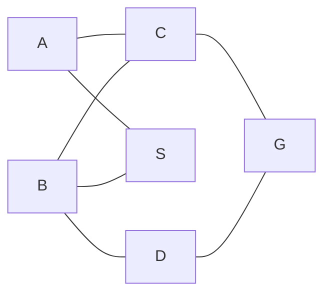
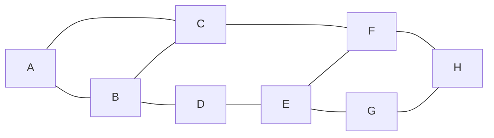

**English** | [Polski](README.pl.md)

# Lesson 2.2 — BFS and DFS

**Core** · Prerequisites: 1.3 Agent types and problem formulation, 2.1 State spaces and search trees (see the [course map](../../../COURSE_MAP.md)). The key ideas from those lessons are recapped briefly in the "Problem" section.

## Learning goals

After this lesson you will be able to:

- explain how breadth-first search (BFS) differs from depth-first search (DFS) and what decides the difference;
- trace both algorithms by hand on a small graph, step by step;
- implement both as graph searches that expand every state at most once;
- assess their completeness, optimality, and time and memory cost;
- predict, and then check in an experiment, how both algorithms behave in the warehouse.

## Problem

The robot stands on the cell `R` and has to reach the dock `D`. Obstacles, meaning walls and shelves, are marked `#`:

```text
#######
#R..#.#
#.#...#
#...#D#
#######
```

The robot can move north, east, south or west (`N`, `E`, `S`, `W`), and every move costs the same. How do we find a route? And if possible, the shortest one?

A computer does not "see" this map the way we do. It sees a **search problem**, which in the course's code is an object of the class `Problem`:

- `problem.initial` is the initial state; in the warehouse it is the cell `(row, col)` where the robot stands;
- `problem.actions(s)` returns the actions available in state `s`, that is, moves onto free cells;
- `problem.result(s, a)` returns the state that action `a` leads to (the transition model);
- `problem.is_goal(s)` says whether `s` is a goal (the goal test);
- `problem.action_cost(s, a, s2)` gives the cost of a step; in this lesson every step costs 1.

A search algorithm builds a **search tree** of nodes (`Node`). A node remembers its state, its parent, the action that led to it, the path cost (`path_cost`) and its depth (`depth`). Calling `node.states()` returns the states on the path from the root to that node. The function `expand(problem, node)` creates a node's children, one for each action. This is called **expanding** the node. The nodes waiting to be expanded form the **frontier**.

This whole lesson answers one question: **which node should we take from the frontier next?**

## Intuition

**BFS spreads like a ripple on water.** It first checks all cells one step from the start, then all cells two steps away, and so on. When the ripple first reaches the goal, it has travelled the smallest possible number of steps. That is why the first route BFS finds is the shortest.

**DFS explores a maze one corridor at a time.** It goes as far as it can, and when it hits a dead end it backs up to the last junction and tries again. It remembers little, but the route it finds can be long and winding.

The two strategies differ in a single decision. BFS keeps the frontier in a **FIFO queue** (first in, first out). DFS keeps the frontier on a **LIFO stack** (last in, first out).

## Formal model and pseudocode

### Graph search

The warehouse is not a tree: you can come back along the same aisle, and many cells can be reached in several ways. An algorithm that does not remember visited states expands the same states many times, and on a graph with cycles it may go round in circles forever. That is why both algorithms in this lesson are **graph searches**: they remember states and expand each of them at most once.

### BFS

```text
BFS(problem):
    root ← Node(problem.initial)
    if problem.is_goal(root.state): return root
    frontier ← FIFO queue containing root
    reached ← {problem.initial}
    while frontier is not empty:
        node ← remove the FIRST node from frontier
        for each child in expand(problem, node):
            if child.state ∉ reached:
                if problem.is_goal(child.state): return child
                add child.state to reached
                add child to the END of frontier
    return None
```

The **reached** set holds every state that has ever been put in the frontier. We test for the goal as soon as a child is generated. This is called the **early goal test**. The "Properties" section explains why it is safe.

### DFS

```text
DFS(problem):
    frontier ← stack containing Node(problem.initial)
    expanded ← ∅
    while frontier is not empty:
        node ← remove the LAST node from frontier
        if node.state ∈ expanded: skip it
        if problem.is_goal(node.state): return node
        add node.state to expanded
        push the children from expand(problem, node) onto frontier in REVERSE order,
            leaving out those whose state is already in expanded
    return None
```

DFS tests for the goal when it removes a node from the frontier. We push the children in reverse order so that the child of the first action is removed first. The same state can end up on the stack several times, because several paths lead to it. So a removed node whose state has already been expanded is simply skipped.

> **Recursion.** DFS can also be written recursively: the function expands a node and calls itself for each child. The Python call stack then plays the role of the stack. This version is short, but by default Python stops recursion deeper than about 1000 calls. On large maps the version with an explicit stack is safer.

> **`deque` instead of `list.pop(0)`.** A Python list removes its last element quickly (`pop()`), but removing the first one (`pop(0)`) shifts all the others. For a queue, use `collections.deque` with its `append` and `popleft` methods.

## Trace it by hand

### Worked example

We look for a path from `S` to `G`. The neighbours of every state are considered in alphabetical order.

<!-- generated:graph example=worked_example -->

<!-- /generated -->

**BFS** step by step. The frontier column lists the nodes in the order they will be removed:

<!-- generated:trace-table algorithm=bfs example=worked_example lang=en -->
| Step | Expanded node | Frontier (in removal order) | Reached set |
|---|---|---|---|
| 1 | S | A, B | A, B, S |
| 2 | A | B, C | A, B, C, S |
| 3 | B | C, D | A, B, C, D, S |
| 4 | C | D | A, B, C, D, S |

Goal **G** found while expanding **C**. Path: S → A → C → G.
<!-- /generated -->

In step 4 BFS expands `C` and generates `G`. The early goal test stops the search before `G` even enters the frontier. The path found has 3 steps and is the shortest.

**DFS** step by step. The "Outcome" column says what happened to the removed node:

<!-- generated:trace-table algorithm=dfs example=worked_example lang=en -->
| Step | Popped node | Outcome | Frontier (in removal order) | Expanded |
|---|---|---|---|---|
| 1 | S | expanded | A, B | S |
| 2 | A | expanded | C, B | A, S |
| 3 | C | expanded | B, G, B | A, C, S |
| 4 | B | expanded | D, G, B | A, B, C, S |
| 5 | D | expanded | G, G, B | A, B, C, D, S |
| 6 | G | goal | G, B | A, B, C, D, S |

Path: S → A → C → B → D → G.
<!-- /generated -->

After step 3 the stack holds two copies of `B`: the child of `C` on top and the child of `S` at the very bottom. DFS expands the one on top first. Had it ever reached the bottom one, it would have skipped it, because `B` had already been expanded. The path found has 5 steps, although a 3-step route exists: DFS does not look for the shortest route.

### Your turn

Trace both algorithms on the graph below, from `A` to `H`:

<!-- generated:graph example=exercise -->

<!-- /generated -->

The rules are exactly the same as in the example:

1. Consider neighbours in alphabetical order.
2. BFS tests for the goal when it generates a child and ignores states it has already reached.
3. Among the children, DFS first expands the one for the first neighbour (alphabetically). It tests for the goal when it removes a node from the frontier, and skips states it has already expanded.

Draw a table like the one in the example and write the results in Part A of `task.py`. The expansion order is the states in the order the algorithm expands them; the goal itself is not expanded. The path is the states from `A` to `H`.

## Properties

Notation: *b* is the branching factor (the largest number of children of a node), *d* is the depth of the shallowest goal, and *m* is the maximum depth of the state space.

| | BFS | DFS |
|---|---|---|
| Completeness | yes, if *b* is finite | yes on finite graphs; on infinite ones it may never stop |
| Optimality | yes, if every step costs the same | no |
| Time | O(*b*<sup>*d*</sup>) | O(*b*<sup>*m*</sup>); in graph search at most as many as there are states |
| Memory | O(*b*<sup>*d*</sup>): the whole "ripple" at once | O(*b*·*m*) without remembering states; with it, as many as were expanded |

**Why does the early goal test not break BFS's optimality?** BFS generates nodes in order of non-decreasing depth. Before it generates the first node at depth *k* + 1, it has already expanded every node at depth *k*. So the first goal node it generates lies at the smallest possible depth. This argument only works when every step costs the same. When steps have different costs, fewer steps do not mean a lower cost. Lesson 2.3 deals with that.

**Limitations.** BFS keeps the whole ripple in memory, so on large spaces it quickly runs out of memory. DFS uses little memory only when it does not remember visited states. Then, however, it can go round cycles, and on an infinite state space it can descend an infinitely long branch and never come back. A middle ground is a DFS that only checks whether a new state already lies on the current path. Such a DFS needs O(*b*·*m*) memory and stops on every finite graph, but it may expand a state reached along different paths many times.

## Common mistakes

1. **A stack instead of a queue in BFS.** With `pop()` instead of `popleft()` the algorithm still finds something, but it expands nodes in the wrong order and loses the guarantee of the shortest path.
2. **No record of visited states.** On a graph with cycles the algorithm keeps coming back to the same states. BFS expands them many times, and DFS may go round in circles forever.
3. **Skipping the goal test on the start state.** With the early goal test it is easy to forget that the initial state itself may be a goal. BFS then returns `None` or an unnecessarily longer route.
4. **A queue instead of a stack in DFS.** With `pop(0)` instead of `pop()`, DFS quietly turns into BFS.

The lesson's tests detect each of these mistakes.

## Task

### Part A: trace by hand

In `task.py`, fill in four lists for the graph in the "Your turn" section: `BFS_EXPANSION_ORDER`, `BFS_PATH`, `DFS_EXPANSION_ORDER` and `DFS_PATH`.

### Part B: implementation

Implement the functions `bfs(problem)` and `dfs(problem)` in `task.py`:

- both are graph searches: they expand every state at most once;
- they generate children only with `expand(problem, node)`, which lets the tests see which nodes you expand and in what order;
- they return the goal node, or `None` if no goal can be reached;
- `bfs` finds a path with the fewest steps;
- `task.py` does not import `introai.search.reference`, the reference versions of these algorithms.

In Part B the expansion order does not have to follow the Part A rules. The tests accept any correct implementation, for example a recursive DFS or a different order of children.

### How to check

From the repository's root directory:

```bash
uv run pytest modules/02_search/02_bfs_dfs
```

You can also go into the lesson's directory and run plain `uv run pytest`. The error messages say which property is broken and on which example, and they often hint at the typical mistake behind it.

### Acceptance criteria

- All the lesson's tests pass.
- You can answer the review questions before looking at the answers.

## What the tests do not check

- **Understanding.** Passing tests do not prove you know why the algorithm works. The review questions and experiments are there for that.
- **Efficiency.** A queue built on `list.pop(0)` passes the tests, although it is slower than `deque`.
- **Code style and readability.**
- **A particular DFS order.** Apart from DFS always continuing the current path, the tests accept any order. The Part A rules apply only to tracing by hand.
- **Ways around the import ban.** The test detects a plain import of `introai.search.reference`, but not tricks such as `importlib`. Such a workaround only fools you.

## Experiments

Open [experiments.ipynb](experiments.ipynb). Before each experiment, write down your prediction, then check it:

1. On the map with aisles: which method finds the shorter route, and which expands more cells?
2. What happens to the DFS route, and what to the BFS route, if the robot tries its moves in a different order?
3. How does the number of expansions of both methods change in open space compared with narrow aisles?

## Review questions

1. Why can BFS test for the goal as soon as it generates a child without losing the shortest path? What would break if steps had different costs?
2. In which situations does DFS use much less memory than BFS? When does that advantage disappear?
3. What happens if you run DFS on an infinite state space, for example when the state includes a count of collected parcels that can grow without limit?
4. Why do DFS routes in the warehouse wander around even when the goal is close?
5. On a tree (no cycles) the set of visited states changes nothing in the result. Why is it essential in the warehouse?

## If you get stuck

<details>
<summary>Hint 1: where to start</summary>

Translate the pseudocode line by line. The root is `Node(problem.initial)`, and `expand(problem, node)` gives you the children. Return the goal node; the tests read the path themselves by calling `node.states()`.

</details>

<details>
<summary>Hint 2: queues and stacks in Python</summary>

Queue: `from collections import deque`, then `frontier.append(x)` and `frontier.popleft()`. Stack: a plain list with `frontier.append(x)` and `frontier.pop()`. Set of states: `set()`.

</details>

<details>
<summary>Hint 3: the tests report too many expansions</summary>

Check that you remember states in a set and that you check it in the right place: in BFS before adding a child to the frontier, in DFS after removing a node from the frontier. States must be usable as set elements. In the warehouse they are tuples `(row, col)`.

</details>

## What to remember

- BFS and DFS differ only in the structure of the frontier: a FIFO queue versus a LIFO stack.
- BFS finds a path with the fewest steps, but keeps the whole ripple in memory.
- DFS goes deep: it needs little memory, but its path can be arbitrarily long, and on an infinite space it may never stop.
- A graph search remembers states so that it does not expand them more than once.
- The order in which children are generated does not change the length of the BFS path, but it can change the DFS route completely.

## What next

- After your own attempt, compare yourself with the solution and answers in [solutions/02_search/02_bfs_dfs/](../../../solutions/02_search/02_bfs_dfs/).
- The next lesson, 2.3, covers uniform-cost search: what to do when steps have different costs.

## References

- S. Russell, P. Norvig, *Artificial Intelligence: A Modern Approach*, 4th ed., Pearson, 2020, ch. 3 (uninformed search).
