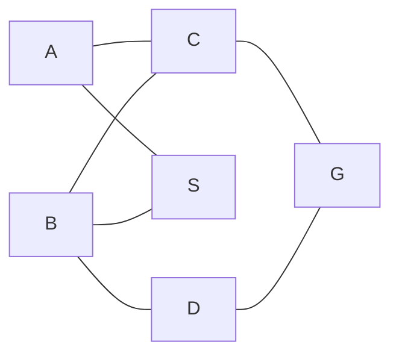
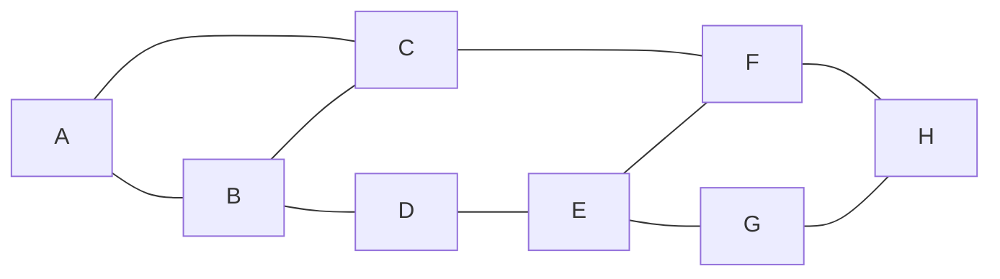

[English](README.md) | **Polski**

# Lekcja 2.2 — BFS i DFS

**Core** · Wymagania: 1.3 Typy agentów i sformułowanie problemu, 2.1 Przestrzeń stanów i drzewo przeszukiwania (zobacz [mapę kursu](../../../COURSE_MAP.pl.md)). Najważniejsze pojęcia z tych lekcji krótko przypominamy w sekcji „Problem”.

## Cele lekcji

Po tej lekcji:

- wyjaśnisz, czym różni się przeszukiwanie wszerz (BFS, *breadth-first search*) od przeszukiwania w głąb (DFS, *depth-first search*) i co o tej różnicy decyduje;
- prześledzisz oba algorytmy ręcznie na małym grafie, krok po kroku;
- zaimplementujesz oba jako przeszukiwanie grafu, które rozwija każdy stan co najwyżej raz;
- ocenisz ich kompletność, optymalność oraz koszt czasu i pamięci;
- przewidzisz, a potem sprawdzisz w eksperymencie, jak oba algorytmy zachowują się w magazynie.

## Problem

Robot stoi w polu `R` i ma dojechać do rampy `D`. Przeszkody, czyli ściany i regały, oznacza `#`:

```text
#######
#R..#.#
#.#...#
#...#D#
#######
```

Robot może jechać na północ, wschód, południe lub zachód (`N`, `E`, `S`, `W`), a każdy ruch kosztuje tyle samo. Jak znaleźć trasę? A jeśli się da, to najkrótszą?

Komputer nie „widzi” tej mapy tak jak my. Widzi **problem przeszukiwania**, który w kodzie kursu jest obiektem klasy `Problem`:

- `problem.initial` to stan początkowy; w magazynie jest to komórka `(wiersz, kolumna)`, w której stoi robot;
- `problem.actions(s)` zwraca akcje dostępne w stanie `s`, czyli ruchy na wolne pola;
- `problem.result(s, a)` zwraca stan, do którego prowadzi akcja `a` (to model przejść);
- `problem.is_goal(s)` mówi, czy `s` jest celem (test celu);
- `problem.action_cost(s, a, s2)` podaje koszt kroku; w tej lekcji każdy krok kosztuje 1.

Algorytm przeszukiwania buduje **drzewo przeszukiwania** z węzłów (`Node`). Węzeł pamięta stan, rodzica, akcję, która do niego doprowadziła, koszt ścieżki (`path_cost`) i głębokość (`depth`). Wywołanie `node.states()` zwraca stany na ścieżce od korzenia do tego węzła. Funkcja `expand(problem, node)` tworzy dzieci węzła, po jednym dla każdej akcji. Nazywamy to **rozwinięciem** węzła. Węzły, które czekają na rozwinięcie, tworzą **frontier**.

Cała ta lekcja odpowiada na jedno pytanie: **który węzeł zdjąć z frontier jako następny?**

## Intuicja

**BFS rozchodzi się jak fala na wodzie.** Najpierw sprawdza wszystkie pola odległe od startu o jeden krok, potem wszystkie odległe o dwa kroki i tak dalej. Kiedy fala pierwszy raz dotrze do celu, przebyła najmniejszą możliwą liczbę kroków. Dlatego pierwsza trasa znaleziona przez BFS jest najkrótsza.

**DFS zwiedza labirynt jednym korytarzem.** Idzie jak najdalej, a gdy trafi w ślepy zaułek, cofa się do ostatniego rozwidlenia i próbuje dalej. Pamięta niewiele, ale trasa, którą znajdzie, może być długa i kręta.

Obie strategie różnią się jedną decyzją. BFS trzyma frontier w **kolejce FIFO** (pierwszy przyszedł, pierwszy wychodzi). DFS trzyma frontier na **stosie LIFO** (ostatni przyszedł, pierwszy wychodzi).

## Model formalny i pseudokod

### Przeszukiwanie grafu

Magazyn nie jest drzewem: z pola można wrócić tą samą alejką, a do wielu pól prowadzi kilka dróg. Algorytm, który nie zapamiętuje odwiedzonych stanów, rozwija te same stany wiele razy, a na grafie z cyklami może krążyć w nieskończoność. Dlatego oba algorytmy w tej lekcji to **przeszukiwanie grafu**: zapamiętują stany i rozwijają każdy z nich co najwyżej raz.

### BFS

```text
BFS(problem):
    korzeń ← Node(problem.initial)
    jeśli problem.is_goal(korzeń.state): zwróć korzeń
    frontier ← kolejka FIFO zawierająca korzeń
    reached ← {problem.initial}
    dopóki frontier nie jest pusty:
        węzeł ← zdejmij PIERWSZY węzeł z frontier
        dla każdego dziecka w expand(problem, węzeł):
            jeśli dziecko.state ∉ reached:
                jeśli problem.is_goal(dziecko.state): zwróć dziecko
                dodaj dziecko.state do reached
                dodaj dziecko na KONIEC frontier
    zwróć None
```

Zbiór **reached** zawiera każdy stan, który kiedykolwiek trafił do frontier. Cel sprawdzamy już przy generowaniu dziecka. To tak zwany **wczesny test celu**. Dlaczego jest bezpieczny, wyjaśnia sekcja „Własności”.

### DFS

```text
DFS(problem):
    frontier ← stos zawierający Node(problem.initial)
    expanded ← ∅
    dopóki frontier nie jest pusty:
        węzeł ← zdejmij OSTATNI węzeł z frontier
        jeśli węzeł.state ∈ expanded: pomiń go
        jeśli problem.is_goal(węzeł.state): zwróć węzeł
        dodaj węzeł.state do expanded
        połóż na frontier dzieci z expand(problem, węzeł) w ODWROTNEJ kolejności,
            pomijając te, których stan jest już w expanded
    zwróć None
```

DFS sprawdza cel, gdy zdejmuje węzeł z frontier. Dzieci kładziemy na stos w odwrotnej kolejności, żeby jako pierwsze zdjąć dziecko pierwszej akcji. Ten sam stan może trafić na stos kilka razy, bo prowadzi do niego kilka dróg. Dlatego zdjęty węzeł, którego stan już rozwinęliśmy, po prostu pomijamy.

> **Rekurencja.** DFS da się też zapisać rekurencyjnie: funkcja rozwija węzeł i dla każdego dziecka wywołuje samą siebie. Rolę stosu gra wtedy stos wywołań Pythona. Taki zapis jest krótki, ale Python domyślnie przerywa rekurencję głębszą niż około 1000 wywołań. Na dużych mapach wersja ze stosem jest bezpieczniejsza.

> **`deque` zamiast `list.pop(0)`.** Lista Pythona szybko zdejmuje ostatni element (`pop()`), ale zdjęcie pierwszego (`pop(0)`) przesuwa wszystkie pozostałe. Do kolejki używaj `collections.deque` z metodami `append` i `popleft`.

## Prześledź ręcznie

### Przykład rozwiązany

Szukamy drogi z `S` do `G`. Sąsiadów każdego stanu rozpatrujemy w kolejności alfabetycznej.

<!-- generated:graph example=worked_example -->

<!-- /generated -->

**BFS** krok po kroku. Kolumna frontier pokazuje węzły w kolejności, w jakiej zostaną zdjęte:

<!-- generated:trace-table algorithm=bfs example=worked_example lang=pl -->
| Krok | Rozwijany węzeł | Frontier (w kolejności zdejmowania) | Zbiór osiągniętych (reached) |
|---|---|---|---|
| 1 | S | A, B | A, B, S |
| 2 | A | B, C | A, B, C, S |
| 3 | B | C, D | A, B, C, D, S |
| 4 | C | D | A, B, C, D, S |

Cel **G** znaleziony podczas rozwijania **C**. Ścieżka: S → A → C → G.
<!-- /generated -->

W kroku 4 BFS rozwija `C` i generuje `G`. Wczesny test celu kończy przeszukiwanie, zanim `G` trafi do frontier. Znaleziona ścieżka ma 3 kroki i jest najkrótsza.

**DFS** krok po kroku. Kolumna „Wynik” mówi, co stało się ze zdjętym węzłem:

<!-- generated:trace-table algorithm=dfs example=worked_example lang=pl -->
| Krok | Zdjęty węzeł | Wynik | Frontier (w kolejności zdejmowania) | Rozwinięte |
|---|---|---|---|---|
| 1 | S | rozwinięty | A, B | S |
| 2 | A | rozwinięty | C, B | A, S |
| 3 | C | rozwinięty | B, G, B | A, C, S |
| 4 | B | rozwinięty | D, G, B | A, B, C, S |
| 5 | D | rozwinięty | G, G, B | A, B, C, D, S |
| 6 | G | cel | G, B | A, B, C, D, S |

Ścieżka: S → A → C → B → D → G.
<!-- /generated -->

Po kroku 3 na stosie leżą dwie kopie `B`: dziecko `C` na wierzchu i dziecko `S` na samym dole. DFS najpierw rozwija tę z wierzchu. Gdyby kiedyś doszedł do tej dolnej, pominąłby ją, bo `B` jest już rozwinięty. Znaleziona ścieżka ma 5 kroków, choć istnieje trasa 3-krokowa: DFS nie szuka najkrótszej drogi.

### Twoja kolej

Prześledź oba algorytmy na poniższym grafie, z `A` do `H`:

<!-- generated:graph example=exercise -->

<!-- /generated -->

Zasady są dokładnie takie jak w przykładzie:

1. Sąsiadów rozpatrujesz w kolejności alfabetycznej.
2. BFS sprawdza cel przy generowaniu dziecka, a stany już osiągnięte pomija.
3. Spośród dzieci DFS jako pierwsze rozwija to, które odpowiada pierwszemu (alfabetycznie) sąsiadowi. Cel sprawdza przy zdejmowaniu węzła z frontier, a stany już rozwinięte pomija.

Narysuj tabelę taką jak w przykładzie i wpisz wyniki w części A pliku `task.py`. Kolejność rozwijania to stany w kolejności, w jakiej algorytm je rozwija; sam cel nie jest rozwijany. Ścieżka to stany od `A` do `H`.

## Własności

Oznaczenia: *b* to współczynnik rozgałęzienia (największa liczba dzieci węzła), *d* to głębokość najpłytszego celu, a *m* to największa głębokość w przestrzeni stanów.

| | BFS | DFS |
|---|---|---|
| Kompletność | tak, jeśli *b* jest skończone | tak na skończonych grafach; na nieskończonych może się nie zatrzymać |
| Optymalność | tak, jeśli każdy krok kosztuje tyle samo | nie |
| Czas | O(*b*<sup>*d*</sup>) | O(*b*<sup>*m*</sup>); w przeszukiwaniu grafu najwyżej tyle, ile jest stanów |
| Pamięć | O(*b*<sup>*d*</sup>): cała „fala” naraz | O(*b*·*m*) bez zapamiętywania stanów; z nim tyle, ile stanów rozwinięto |

**Dlaczego wczesny test celu nie psuje optymalności BFS?** BFS generuje węzły w kolejności niemalejącej głębokości. Zanim wygeneruje pierwszy węzeł o głębokości *k* + 1, rozwinął już wszystkie węzły o głębokości *k*. Dlatego pierwszy wygenerowany węzeł celu leży na najmniejszej możliwej głębokości. Ten argument działa jednak tylko wtedy, gdy każdy krok kosztuje tyle samo. Gdy kroki mają różne koszty, mniej kroków nie oznacza niższego kosztu. Tym zajmuje się lekcja 2.3.

**Ograniczenia.** BFS trzyma w pamięci całą falę, więc na dużych przestrzeniach szybko brakuje mu pamięci. DFS zużywa mało pamięci tylko wtedy, gdy nie zapamiętuje odwiedzonych stanów. Wtedy jednak może krążyć po cyklach, a na nieskończonej przestrzeni stanów może zejść w nieskończenie długą gałąź i nigdy nie wrócić.

## Częste błędy

1. **Stos zamiast kolejki w BFS.** `pop()` zamiast `popleft()` sprawia, że algorytm nadal coś znajduje, ale rozwija węzły w złej kolejności i traci gwarancję najkrótszej ścieżki.
2. **Brak zbioru odwiedzonych stanów.** Na grafie z cyklami algorytm wraca do tych samych stanów. BFS rozwija je wielokrotnie, a DFS może krążyć w nieskończoność.
3. **Pominięte sprawdzenie stanu początkowego.** Przy wczesnym teście celu łatwo zapomnieć, że już stan początkowy może być celem. BFS zwraca wtedy `None` albo niepotrzebnie dłuższą trasę.
4. **Kolejka zamiast stosu w DFS.** `pop(0)` zamiast `pop()` po cichu zamienia DFS w BFS.

Testy lekcji wykrywają każdy z tych błędów.

## Zadanie

### Część A: ręczne śledzenie

Wypełnij w `task.py` cztery listy dla grafu z sekcji „Twoja kolej”: `BFS_EXPANSION_ORDER`, `BFS_PATH`, `DFS_EXPANSION_ORDER` i `DFS_PATH`.

### Część B: implementacja

Zaimplementuj w `task.py` funkcje `bfs(problem)` i `dfs(problem)`:

- obie to przeszukiwanie grafu: każdy stan rozwijają co najwyżej raz;
- dzieci generują wyłącznie funkcją `expand(problem, node)`, bo dzięki temu testy widzą, które węzły i w jakiej kolejności rozwijasz;
- zwracają węzeł celu albo `None`, jeśli celu nie da się osiągnąć;
- `bfs` znajduje ścieżkę o najmniejszej liczbie kroków;
- `task.py` nie importuje `introai.search.reference`, czyli wzorcowych wersji tych algorytmów.

Kolejność rozwijania w części B nie musi być identyczna z zasadami z części A. Testy przyjmą każdą poprawną implementację, na przykład rekurencyjny DFS albo inną kolejność dzieci.

### Jak sprawdzić

Z głównego katalogu repozytorium:

```bash
uv run pytest modules/02_search/02_bfs_dfs
```

Możesz też wejść do katalogu lekcji i uruchomić samo `uv run pytest`. Komunikaty błędów mówią, która własność jest złamana i na jakim przykładzie, a często podpowiadają też, jaki to typowy błąd.

### Kryteria akceptacji

- Wszystkie testy lekcji przechodzą.
- Potrafisz odpowiedzieć na pytania kontrolne, zanim zajrzysz do odpowiedzi.

## Czego testy nie sprawdzają

- **Zrozumienia.** Przechodzące testy nie dowodzą, że wiesz, dlaczego algorytm działa. Do tego służą pytania kontrolne i eksperymenty.
- **Wydajności.** Kolejka zrobiona z `list.pop(0)` przejdzie testy, choć jest wolniejsza od `deque`.
- **Stylu i czytelności kodu.**
- **Konkretnej kolejności DFS.** Poza tym, że DFS zawsze kontynuuje bieżącą ścieżkę, testy akceptują każdą kolejność. Zasady z części A obowiązują tylko przy ręcznym śledzeniu.
- **Obejścia zakazu importu.** Test wykrywa zwykły import `introai.search.reference`, ale nie sztuczki w rodzaju `importlib`. Takie obejście oszukuje tylko Ciebie.

## Eksperymenty

Otwórz [experiments.pl.ipynb](experiments.pl.ipynb). Przed każdym eksperymentem zapisz swoje przewidywanie, a potem je sprawdź:

1. Na mapie z alejkami: która metoda znajdzie krótszą trasę, a która rozwinie więcej pól?
2. Co się stanie z trasą DFS, a co z trasą BFS, jeśli robot będzie próbował ruchów w innej kolejności?
3. Jak zmienia się liczba rozwinięć obu metod na otwartej przestrzeni w porównaniu z wąskimi alejkami?

## Pytania kontrolne

1. Dlaczego w BFS można sprawdzać cel już przy generowaniu dziecka i nie stracić najkrótszej ścieżki? Co by się zepsuło, gdyby kroki miały różne koszty?
2. W jakich sytuacjach DFS zużywa znacznie mniej pamięci niż BFS? Kiedy ta przewaga znika?
3. Co się stanie, jeśli uruchomisz DFS na nieskończonej przestrzeni stanów, na przykład gdy stan zawiera licznik zebranych paczek, który może rosnąć bez końca?
4. Dlaczego trasy DFS w magazynie potrafią kluczyć, choć do celu jest blisko?
5. Na drzewie (bez cykli) zbiór odwiedzonych stanów niczego nie zmienia w wyniku. Dlaczego w magazynie jest niezbędny?

## Jeśli utkniesz

<details>
<summary>Podpowiedź 1: od czego zacząć</summary>

Przepisz pseudokod linijka po linijce. Korzeń to `Node(problem.initial)`, a dzieci daje `expand(problem, node)`. Zwracasz węzeł celu; ścieżkę testy odczytają same, wywołując `node.states()`.

</details>

<details>
<summary>Podpowiedź 2: kolejka i stos w Pythonie</summary>

Kolejka: `from collections import deque`, potem `frontier.append(x)` i `frontier.popleft()`. Stos: zwykła lista z `frontier.append(x)` i `frontier.pop()`. Zbiór stanów: `set()`.

</details>

<details>
<summary>Podpowiedź 3: testy zgłaszają za dużo rozwinięć</summary>

Sprawdź, czy zapamiętujesz stany w zbiorze i czy sprawdzasz go we właściwym miejscu: w BFS przed dodaniem dziecka do frontier, w DFS po zdjęciu węzła z frontier. Stany muszą dać się wstawić do zbioru. W magazynie są to krotki `(wiersz, kolumna)`.

</details>

## Co zapamiętać

- BFS i DFS różnią się tylko strukturą frontier: kolejka FIFO kontra stos LIFO.
- BFS znajduje ścieżkę o najmniejszej liczbie kroków, ale trzyma w pamięci całą falę.
- DFS idzie w głąb: potrzebuje mało pamięci, ale jego ścieżka może być dowolnie długa, a na nieskończonej przestrzeni może się nie zatrzymać.
- Przeszukiwanie grafu zapamiętuje stany, żeby nie rozwijać ich wielokrotnie.
- Kolejność generowania dzieci nie zmienia długości ścieżki BFS, ale potrafi całkowicie zmienić trasę DFS.

## Co dalej

- Po własnej próbie porównaj się z rozwiązaniem i odpowiedziami w [solutions/02_search/02_bfs_dfs/](../../../solutions/02_search/02_bfs_dfs/).
- Następna lekcja, 2.3, zajmuje się przeszukiwaniem kosztowym, czyli sytuacją, w której kroki mają różne koszty.

## Bibliografia

- S. Russell, P. Norvig, *Artificial Intelligence: A Modern Approach*, 4th ed., Pearson, 2020, rozdz. 3 (przeszukiwanie bez informacji).
