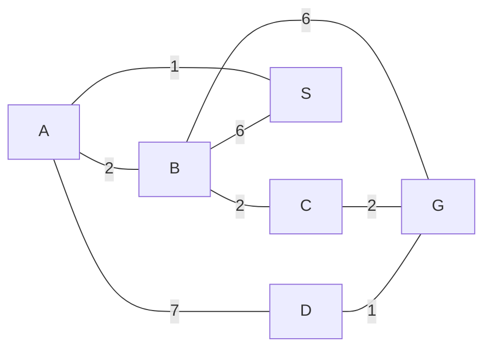
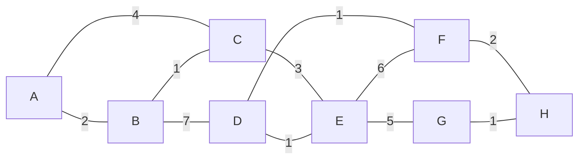

**English** | [Polski](README.pl.md)

# Lesson 2.3 — Uniform-cost search (UCS)

**Core** · Requires: 2.2 BFS and DFS (see the [course map](../../../COURSE_MAP.md)).

## Learning goals

After this lesson you will be able to:

- explain why the shortest route need not be the cheapest one, and why BFS then fails;
- trace uniform-cost search (UCS) by hand, step by step;
- use a priority queue from the `heapq` module;
- implement UCS and justify why the goal test has to happen when a node is removed from the frontier;
- compare UCS with BFS in a warehouse where steps have different costs.

## The problem

The warehouse now has **slow zones**, marked `~`. They are ordinary floor, but crowded, so driving onto such a cell costs 3 instead of 1. Look at the map `congested.txt`:

```text
##############################
#.........#..................#
#.........#.################.#
#.........R~~~~~~~~~~~~~~~~~D#
#.........#.################.#
#.........#..................#
##############################
```

The fewest steps are needed to drive straight along the corridor: 18 steps, but 17 of them go through the slow zone, so the route costs 17 · 3 + 1 = 52. The detour along the top or bottom aisle takes 22 steps but crosses only one slow cell, so it costs 24.

The BFS of lesson 2.2 counts steps, not cost, so it picks the corridor. How do we find the **cheapest** route?

## Intuition

BFS spreads like a wave that moves one cell further with every step. UCS also spreads like a wave, but one measured in **cost**, not in steps. Picture water poured out at the start: in a slow zone it flows three times more slowly. The water reaches first the cells with the cheapest way to them, in order of increasing cost. The first time it reaches the goal, it has travelled the cheapest possible way.

To work like that, UCS always expands the node with the **lowest path cost** *g*(*n*) among all the nodes in the frontier.

## Formal model and pseudocode

### Why BFS fails

Take a graph with weights. The number on an edge is the cost of the step. We look for a way from `S` to `G`:

<!-- generated:graph example=weighted_example -->

<!-- /generated -->

BFS on this graph, testing for the goal as soon as a child is generated, as in lesson 2.2:

<!-- generated:trace-table algorithm=bfs example=weighted_example lang=en -->
| Step | Expanded node | Frontier (in removal order) | Reached set |
|---|---|---|---|
| 1 | S | A, B | A, B, S |
| 2 | A | B, D | A, B, D, S |
| 3 | B | D, C | A, B, C, D, S |

Goal **G** found while expanding **B**. Path: S → B → G.
<!-- /generated -->

BFS finds the route S → B → G: 2 steps, but at a cost of 6 + 6 = 12. The route S → A → B → C → G has 4 steps and costs only 1 + 2 + 2 + 2 = 7. When steps have different costs, fewer steps does not mean cheaper.

### UCS

UCS is the best-first search of lesson 2.1 with the evaluation function *f*(*n*) = *g*(*n*), the cost of the path from the start to the node:

```text
UCS(problem):
    root ← Node(problem.initial)
    frontier ← a priority queue ordered by path_cost, holding root
    reached ← {problem.initial: 0}               # state → lowest known cost
    while the frontier is not empty:
        node ← take the node with the smallest path_cost off the frontier
        if node.path_cost > reached[node.state]: skip it
        if problem.is_goal(node.state): return node
        for each child in expand(problem, node):
            s ← child.state
            if s ∉ reached or child.path_cost < reached[s]:
                reached[s] ← child.path_cost
                add child to the frontier
    return None
```

Three things set UCS apart from BFS:

1. **The frontier is a priority queue.** We always take the node with the lowest path cost.
2. **Reached remembers a cost.** If we find a cheaper way to a state that has already been reached, we store the new cost and add a new node to the frontier.
3. **The goal is tested when a node is removed**, not when it is generated. The section "The early goal test" explains why.

**Out-of-date entries.** When we find a cheaper way to a state, the old node with that state is still in the frontier. A priority queue built with `heapq` offers no easy way to remove it. So we leave it there and skip it when it is finally removed: its cost is then higher than the best known one. Such a skipped entry **is not an expansion**.

### A priority queue in Python: `heapq`

The `heapq` module turns an ordinary list into a **heap**, a structure from which you can always quickly take the smallest element:

```python
import heapq

frontier = []
heapq.heappush(frontier, (5, "C"))
heapq.heappush(frontier, (1, "A"))
heapq.heappush(frontier, (3, "B"))
heapq.heappop(frontier)  # (1, "A"): the smallest element
heapq.heappop(frontier)  # (3, "B")
```

Both calls run in O(log *n*) time. Tuples are compared element by element: first the cost and, on a tie, the next element. `Node` objects cannot be compared, so on a tie in cost Python would raise `TypeError: '<' not supported between instances of 'Node' and 'Node'`. That is why we put a **counter** between the cost and the node:

```python
import itertools

counter = itertools.count()  # 0, 1, 2, ...
heapq.heappush(frontier, (node.path_cost, next(counter), node))
cost, _, node = heapq.heappop(frontier)
```

The counter is always different, so Python never gets as far as comparing nodes. When costs are equal, the node added first wins.

### The link to Dijkstra's algorithm

UCS is in essence **Dijkstra's algorithm** from graph theory. Dijkstra's algorithm usually computes the cheapest ways from the start to every vertex of a graph stored in memory. UCS stops when it removes the goal, and it discovers the graph while searching, through the functions `actions` and `result`. Skipping out-of-date entries instead of removing them from the heap is a popular technique called lazy deletion.

## Trace it by hand

### Worked example

UCS on the graph from "Why BFS fails". The neighbours of each state are considered in alphabetical order, and when costs are equal the node added earlier is removed first. For UCS the columns *g* and *f* are equal, because *f*(*n*) = *g*(*n*).

<!-- generated:trace-table algorithm=ucs example=weighted_example lang=en -->
| Step | Popped | g | f | Outcome | Frontier: state f, in removal order | Best known g |
|---|---|---|---|---|---|---|
| 1 | S | 0 | 0 | expanded | A 1, B 6 | A 1, B 6, S 0 |
| 2 | A | 1 | 1 | expanded | B 3, B 6, D 8 | A 1, B 3, D 8, S 0 |
| 3 | B | 3 | 3 | expanded | C 5, B 6, D 8, G 9 | A 1, B 3, C 5, D 8, G 9, S 0 |
| 4 | C | 5 | 5 | expanded | B 6, G 7, D 8, G 9 | A 1, B 3, C 5, D 8, G 7, S 0 |
| 5 | B | 6 | 6 | skipped | G 7, D 8, G 9 | A 1, B 3, C 5, D 8, G 7, S 0 |
| 6 | G | 7 | 7 | goal | D 8, G 9 | A 1, B 3, C 5, D 8, G 7, S 0 |

Goal **G** reached at cost 7. Path: S → A → B → C → G.
<!-- /generated -->

Let us follow the most interesting steps:

- **Step 2.** Expanding `A` finds a way to `B` that costs 1 + 2 = 3, cheaper than the direct edge S–B, which costs 6. Reached gets the new cost, and the frontier now holds two entries for `B`: B 3 and the out-of-date B 6.
- **Step 3.** Expanding `B` generates `G` at a cost of 3 + 6 = 9. The goal is now in the frontier, but UCS does not return it yet.
- **Step 4.** Expanding `C` gives a cheaper way to `G`, at a cost of 7.
- **Step 5.** The out-of-date entry B 6 is removed. The best known cost of `B` is 3, so the entry is skipped.
- **Step 6.** G 7 is removed, and it is the goal. UCS returns the path S → A → B → C → G with cost 7.

### Your turn

Trace UCS on the graph below, from `A` to `H`:

<!-- generated:graph example=weighted_exercise -->

<!-- /generated -->

The rules are exactly as in the example:

1. Consider neighbours in alphabetical order.
2. Always remove the node with the smallest path cost from the frontier; on a tie, the one added earlier.
3. Add a child to the frontier if its state is new or reached more cheaply than before.
4. Skip a removed node whose cost is higher than the best known cost of its state. This is not an expansion.
5. Test for the goal when a node is removed from the frontier. The goal itself is not expanded.

Draw a table like the one in the example and fill in Part A of `task.py`: `UCS_EXPANSION_ORDER` is the states in the order UCS expands them, and `UCS_PATH` is the states on the returned path, from `A` to `H`.

## The early goal test

In lesson 2.2 BFS tested for the goal as soon as it generated a child and lost nothing by it. In UCS this shortcut spoils the result. In the worked example, in step 3, expanding `B` generates `G` at a cost of 9. An early goal test would end the search and return the path S → A → B → G with cost 9. Yet going through `C` costs only 7.

The reason: at the moment a node is generated we do not know yet whether a cheaper way to the same state is waiting in the frontier. Only when the node is **removed** from the frontier do we know that every other node in the frontier costs at least as much, and step costs are positive, so no way through them can be cheaper.

## Properties

Notation: *b* is the branching factor, *C*\* is the cost of the optimal solution, and *ε* > 0 is the smallest step cost.

| | UCS |
|---|---|
| Complete | yes, if *b* is finite and every step costs at least *ε* > 0 |
| Optimal | yes, under the same conditions |
| Time | O(*b*<sup>1 + ⌊*C*\*/*ε*⌋</sup>) |
| Memory | O(*b*<sup>1 + ⌊*C*\*/*ε*⌋</sup>) |

**Why is UCS optimal?** UCS removes nodes in order of non-decreasing path cost. When it removes a goal with cost *C*, every node in the frontier costs at least *C*, and every way through such a node costs even more, because step costs are positive. There can be no cheaper way to the goal any more.

**Where does the exponent 1 + ⌊*C*\*/*ε*⌋ come from?** The optimal path costs *C*\*, and every step costs at least *ε*, so UCS may go down to a depth of about *C*\*/*ε*. When all steps cost the same, that depth is simply *d*, and UCS behaves almost like BFS. The only difference: it still expands nodes at depth *d*, because it tests for the goal only when a node is removed.

**Limitations.** When a step can cost 0, UCS can get stuck in an endless sequence of free steps. When a cost can be negative, it does not guarantee optimality at all. UCS also does not know where the goal is, so it spreads in every direction. Lesson 2.4 deals with that.

## Common mistakes

1. **The goal test from BFS.** Testing for the goal when a child is generated returns the first way to the goal that was found, not the cheapest one.
2. **A queue instead of a priority queue.** With a `deque` and `popleft()` the algorithm removes nodes in the order they were added, not by cost, and does not guarantee the cheapest route.
3. **No update for a cheaper path.** If a state reached once never goes back onto the frontier, a cheaper way found later is lost.
4. **The most expensive node first.** A heap from `heapq` always gives back the smallest element. Whoever pushes the cost with a minus sign or reverses the comparison gets an algorithm that runs along the most expensive ways.
5. **No tie-breaker in the heap.** Tuples `(cost, node)` work until two costs are equal. Then `heapq` tries to compare the nodes and raises a `TypeError`.

The lesson's tests catch each of these mistakes.

## Task

### Part A: tracing by hand

Fill in two lists in `task.py` for the graph in "Your turn": `UCS_EXPANSION_ORDER` and `UCS_PATH`.

### Part B: implementation

Implement the function `ucs(problem)` in `task.py`:

- the frontier is a priority queue ordered by path cost (`heapq`);
- generate children only with `expand(problem, node)`;
- test for the goal when a node is removed from the frontier;
- the function returns the goal node on the cheapest path, or `None` if the goal cannot be reached;
- `task.py` does not import `introai.search.reference`.

In Part B you do not have to skip out-of-date entries exactly as in Part A. The tests also accept, for example, the version from Russell and Norvig's textbook, which does not skip them, or a version with a set of expanded states.

### How to check

From the repository root:

```bash
uv run pytest modules/02_search/03_uniform_cost_search
```

The failure messages say which property is broken and on which example, and often also hint at which common mistake it is.

### Acceptance criteria

- All the lesson's tests pass.
- You can answer the review questions before you look at the answers.

## What the tests do not check

- **Understanding.** Passing tests do not prove that you know why UCS is optimal. The review questions and the experiments are there for that.
- **Speed.** A frontier made of a list from which you pick the minimum with `min` every time passes the tests, even though it is much slower than `heapq`.
- **A particular order on ties.** The tests check that the costs of expanded nodes never decrease and that the route is the cheapest. The tie-breaking rules of Part A apply only to tracing by hand.
- **Style and readability.**
- **Getting around the import ban.** The test detects a plain import of `introai.search.reference`, but not every trick. Such a workaround only cheats you.

## Experiments

Open [experiments.ipynb](experiments.ipynb). Before each experiment write down your prediction, then check it:

1. On the map `congested.txt`: which route will BFS choose, and which will UCS? How much will they cost, and how many cells will they expand?
2. How short does the slow zone in the corridor have to be for UCS to choose the corridor instead of the detour?
3. Why does UCS expand almost the whole map, even though the dock is at the other end of the corridor?

## Review questions

1. Why does BFS stop finding the best route when steps have different costs?
2. Why does UCS have to test for the goal when a node is removed from the frontier, not when it is generated? Show it on an example.
3. What is the counter between the cost and the node in the frontier for? What would happen without it?
4. What is an out-of-date entry in the frontier, and why is it safe to skip it?
5. How does UCS differ from BFS when all steps cost the same? Does one of them expand more nodes then?
6. What would happen to UCS if some steps cost 0? And if some had a negative cost?

## If you get stuck

<details>
<summary>Hint 1: where to start</summary>

Start from your BFS code from lesson 2.2. Replace the `deque` with a list handled by `heapq`, and the `reached` set with a dictionary `state → lowest known cost`. Move the goal test to just after a node is removed from the frontier.

</details>

<details>
<summary>Hint 2: what to put on the heap</summary>

Push tuples `(node.path_cost, next(counter), node)`, where `counter = itertools.count()`. Remove them with `cost, _, node = heapq.heappop(frontier)`.

</details>

<details>
<summary>Hint 3: the route comes out too expensive</summary>

Check two things. Does a child go onto the frontier also when its state has already been reached but the new way is cheaper? Do you test for the goal only after a node is removed from the frontier, not while generating children?

</details>

## Key takeaways

- When steps have different costs, the shortest route need not be the cheapest.
- UCS is best-first search with *f*(*n*) = *g*(*n*): it always expands the cheapest node in the frontier.
- The frontier is a priority queue; in Python, `heapq` with tuples `(cost, counter, node)`.
- Reached remembers the lowest known cost, and a cheaper way to a known state goes back onto the frontier.
- The goal is tested when a node is removed from the frontier. Then UCS is optimal, as long as step costs are positive.
- UCS is Dijkstra's algorithm stopped at the goal.

## What next

- After your own attempt, compare with the solution and answers in [solutions/02_search/03_uniform_cost_search/](../../../solutions/02_search/03_uniform_cost_search/).
- The next lesson, 2.4, gives the algorithm knowledge of where the goal lies: a heuristic. A* is built from it.

## References

- S. Russell, P. Norvig, *Artificial Intelligence: A Modern Approach*, 4th ed., Pearson, 2020, sections 3.3–3.4 (best-first search, uniform-cost search).
- E. W. Dijkstra, *A note on two problems in connexion with graphs*, Numerische Mathematik 1, 1959, pp. 269–271.
