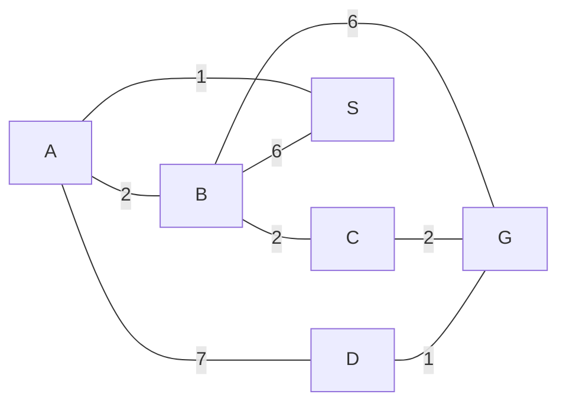
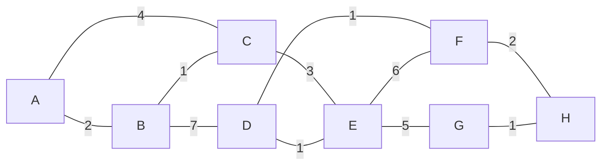

[English](README.md) | **Polski**

# Lekcja 2.3 — Przeszukiwanie kosztowe (UCS)

**Core** · Wymagania: 2.2 BFS i DFS (zobacz [mapę kursu](../../../COURSE_MAP.pl.md)).

## Cele lekcji

Po tej lekcji:

- wyjaśnisz, dlaczego najkrótsza trasa nie musi być najtańsza i dlaczego BFS wtedy zawodzi;
- prześledzisz przeszukiwanie kosztowe (UCS, *uniform-cost search*) ręcznie, krok po kroku;
- użyjesz kolejki priorytetowej z modułu `heapq`;
- zaimplementujesz UCS i uzasadnisz, dlaczego test celu musi nastąpić przy zdejmowaniu węzła z frontier;
- porównasz UCS z BFS w magazynie, w którym kroki mają różne koszty.

## Problem

W magazynie pojawiły się **strefy wolnego ruchu**, oznaczone `~`. To zwykła podłoga, ale jest na niej ciasno, więc wjazd na takie pole kosztuje 3 zamiast 1. Spójrz na mapę `congested.txt`:

```text
##############################
#.........#..................#
#.........#.################.#
#.........R~~~~~~~~~~~~~~~~~D#
#.........#.################.#
#.........#..................#
##############################
```

Najmniej kroków wymaga jazda prosto korytarzem: 18 kroków, ale 17 z nich prowadzi przez strefę wolnego ruchu, więc trasa kosztuje 17 · 3 + 1 = 52. Objazd górną albo dolną alejką ma 22 kroki, ale tylko jedno wolne pole, więc kosztuje 24.

BFS z lekcji 2.2 liczy kroki, a nie koszt, więc wybierze korytarz. Jak znaleźć trasę **najtańszą**?

## Intuicja

BFS rozchodzi się jak fala, która co krok przesuwa się o jedno pole. UCS też rozchodzi się falą, ale mierzoną **kosztem**, a nie liczbą kroków. Wyobraź sobie wodę wylaną w punkcie startu: w strefie wolnego ruchu płynie trzy razy wolniej. Woda najpierw dociera do pól, do których droga jest najtańsza, i to w kolejności rosnącego kosztu. Kiedy pierwszy raz dotrze do celu, przebyła najtańszą możliwą drogę.

Żeby tak działać, UCS zawsze rozwija węzeł o **najniższym koszcie ścieżki** *g*(*n*) spośród wszystkich węzłów we frontier.

## Model formalny i pseudokod

### Dlaczego BFS zawodzi

Weźmy graf z wagami. Liczba przy krawędzi to koszt kroku. Szukamy drogi z `S` do `G`:

<!-- generated:graph example=weighted_example -->

<!-- /generated -->

BFS na tym grafie, ze sprawdzaniem celu przy generowaniu dziecka, jak w lekcji 2.2:

<!-- generated:trace-table algorithm=bfs example=weighted_example lang=pl -->
| Krok | Rozwijany węzeł | Frontier (w kolejności zdejmowania) | Zbiór osiągniętych (reached) |
|---|---|---|---|
| 1 | S | A, B | A, B, S |
| 2 | A | B, D | A, B, D, S |
| 3 | B | D, C | A, B, C, D, S |

Cel **G** znaleziony podczas rozwijania **B**. Ścieżka: S → B → G.
<!-- /generated -->

BFS znajduje trasę S → B → G, czyli 2 kroki, ale o koszcie 6 + 6 = 12. Trasa S → A → B → C → G ma 4 kroki i kosztuje tylko 1 + 2 + 2 + 2 = 7. Przy różnych kosztach kroków mniej kroków nie znaczy taniej.

### UCS

UCS to przeszukiwanie „najpierw najlepszy” z lekcji 2.1 z funkcją oceny *f*(*n*) = *g*(*n*), czyli kosztem ścieżki od startu do węzła:

```text
UCS(problem):
    korzeń ← Node(problem.initial)
    frontier ← kolejka priorytetowa według path_cost, zawierająca korzeń
    reached ← {problem.initial: 0}               # stan → najniższy znany koszt
    dopóki frontier nie jest pusty:
        węzeł ← zdejmij z frontier węzeł o najmniejszym path_cost
        jeśli węzeł.path_cost > reached[węzeł.state]: pomiń go
        jeśli problem.is_goal(węzeł.state): zwróć węzeł
        dla każdego dziecka w expand(problem, węzeł):
            s ← dziecko.state
            jeśli s ∉ reached albo dziecko.path_cost < reached[s]:
                reached[s] ← dziecko.path_cost
                dodaj dziecko do frontier
    zwróć None
```

Trzy rzeczy odróżniają UCS od BFS:

1. **Frontier jest kolejką priorytetową.** Zawsze zdejmujemy węzeł o najniższym koszcie ścieżki.
2. **Reached pamięta koszt.** Jeśli znajdziemy tańszą drogę do stanu, który już był osiągnięty, zapisujemy nowy koszt i dodajemy nowy węzeł do frontier.
3. **Cel sprawdzamy przy zdejmowaniu węzła**, a nie przy jego generowaniu. Dlaczego, wyjaśnia sekcja „Wczesny test celu”.

**Nieaktualne wpisy.** Kiedy znajdziemy tańszą drogę do stanu, stary węzeł z tym stanem nadal leży we frontier. Kolejka priorytetowa z `heapq` nie pozwala go łatwo usunąć. Zostawiamy go więc i pomijamy, gdy w końcu zostanie zdjęty: jego koszt jest wtedy wyższy niż najlepszy znany. Taki pominięty wpis **nie jest rozwinięciem**.

### Kolejka priorytetowa w Pythonie: `heapq`

Moduł `heapq` zamienia zwykłą listę w **kopiec**, czyli strukturę, z której zawsze szybko zdejmiesz najmniejszy element:

```python
import heapq

frontier = []
heapq.heappush(frontier, (5, "C"))
heapq.heappush(frontier, (1, "A"))
heapq.heappush(frontier, (3, "B"))
heapq.heappop(frontier)  # (1, "A"): najmniejszy element
heapq.heappop(frontier)  # (3, "B")
```

Oba wywołania działają w czasie O(log *n*). Krotki są porównywane element po elemencie: najpierw koszt, a przy remisie kolejny element. Węzłów `Node` nie da się porównywać, więc przy remisie kosztów Python zgłosiłby błąd `TypeError: '<' not supported between instances of 'Node' and 'Node'`. Dlatego między koszt a węzeł wstawiamy **licznik**:

```python
import itertools

counter = itertools.count()  # 0, 1, 2, ...
heapq.heappush(frontier, (node.path_cost, next(counter), node))
cost, _, node = heapq.heappop(frontier)
```

Licznik jest zawsze inny, więc Python nigdy nie dojdzie do porównywania węzłów. Przy równych kosztach wygrywa węzeł dodany wcześniej.

### Związek z algorytmem Dijkstry

UCS to w istocie **algorytm Dijkstry**, znany z teorii grafów. Dijkstra zwykle liczy najtańsze drogi ze startu do wszystkich wierzchołków grafu zapisanego w pamięci. UCS zatrzymuje się, gdy zdejmie cel, a graf odkrywa w trakcie przeszukiwania, funkcjami `actions` i `result`. Pomijanie nieaktualnych wpisów zamiast usuwania ich z kopca to popularna technika, zwana leniwym usuwaniem (*lazy deletion*).

## Prześledź ręcznie

### Przykład rozwiązany

UCS na grafie z sekcji „Dlaczego BFS zawodzi”. Sąsiadów każdego stanu rozpatrujemy w kolejności alfabetycznej, a przy równych kosztach z frontier zdejmujemy węzeł dodany wcześniej. Dla UCS kolumny *g* i *f* są równe, bo *f*(*n*) = *g*(*n*).

<!-- generated:trace-table algorithm=ucs example=weighted_example lang=pl -->
| Krok | Zdjęty | g | f | Wynik | Frontier: stan f, w kolejności zdejmowania | Najlepsze znane g |
|---|---|---|---|---|---|---|
| 1 | S | 0 | 0 | rozwinięty | A 1, B 6 | A 1, B 6, S 0 |
| 2 | A | 1 | 1 | rozwinięty | B 3, B 6, D 8 | A 1, B 3, D 8, S 0 |
| 3 | B | 3 | 3 | rozwinięty | C 5, B 6, D 8, G 9 | A 1, B 3, C 5, D 8, G 9, S 0 |
| 4 | C | 5 | 5 | rozwinięty | B 6, G 7, D 8, G 9 | A 1, B 3, C 5, D 8, G 7, S 0 |
| 5 | B | 6 | 6 | pominięty | G 7, D 8, G 9 | A 1, B 3, C 5, D 8, G 7, S 0 |
| 6 | G | 7 | 7 | cel | D 8, G 9 | A 1, B 3, C 5, D 8, G 7, S 0 |

Cel **G** osiągnięty kosztem 7. Ścieżka: S → A → B → C → G.
<!-- /generated -->

Prześledźmy najciekawsze kroki:

- **Krok 2.** Rozwinięcie `A` znajduje drogę do `B` o koszcie 1 + 2 = 3, tańszą niż bezpośrednia krawędź S–B o koszcie 6. Reached dostaje nowy koszt, a we frontier leżą teraz dwa wpisy dla `B`: B 3 i nieaktualny B 6.
- **Krok 3.** Rozwinięcie `B` generuje `G` o koszcie 3 + 6 = 9. Cel jest już we frontier, ale UCS go jeszcze nie zwraca.
- **Krok 4.** Rozwinięcie `C` daje tańszą drogę do `G`, o koszcie 7.
- **Krok 5.** Zdjęty zostaje nieaktualny wpis B 6. Najlepszy znany koszt `B` to 3, więc wpis jest pomijany.
- **Krok 6.** Zdjęty zostaje G 7, czyli cel. UCS zwraca ścieżkę S → A → B → C → G o koszcie 7.

### Twoja kolej

Prześledź UCS na poniższym grafie, z `A` do `H`:

<!-- generated:graph example=weighted_exercise -->

<!-- /generated -->

Zasady są dokładnie takie jak w przykładzie:

1. Sąsiadów rozpatrujesz w kolejności alfabetycznej.
2. Z frontier zawsze zdejmujesz węzeł o najmniejszym koszcie ścieżki; przy remisie ten, który został dodany wcześniej.
3. Dziecko dodajesz do frontier, jeśli jego stan jest nowy albo osiągnięty taniej niż dotąd.
4. Zdjęty węzeł, którego koszt jest wyższy niż najlepszy znany koszt jego stanu, pomijasz. To nie jest rozwinięcie.
5. Cel sprawdzasz przy zdejmowaniu węzła z frontier. Sam cel nie jest rozwijany.

Narysuj tabelę taką jak w przykładzie i wpisz wyniki w części A pliku `task.py`: `UCS_EXPANSION_ORDER` to stany w kolejności, w jakiej UCS je rozwija, a `UCS_PATH` to stany na zwróconej ścieżce, od `A` do `H`.

## Wczesny test celu

W lekcji 2.2 BFS sprawdzał cel już przy generowaniu dziecka i nic na tym nie tracił. W UCS taki skrót psuje wynik. W przykładzie rozwiązanym, w kroku 3, rozwinięcie `B` generuje `G` o koszcie 9. Wczesny test celu zakończyłby przeszukiwanie i zwrócił ścieżkę S → A → B → G o koszcie 9. Tymczasem przez `C` da się dojechać za 7.

Powód: w chwili wygenerowania węzła nie wiemy jeszcze, czy we frontier nie czeka tańsza droga do tego samego stanu. Dopiero gdy węzeł zostaje **zdjęty** z frontier, wiemy, że każdy inny węzeł we frontier ma koszt co najmniej taki sam, a koszty kroków są dodatnie, więc żadna droga przez nie nie będzie tańsza.

## Własności

Oznaczenia: *b* to współczynnik rozgałęzienia, *C*\* to koszt optymalnego rozwiązania, a *ε* > 0 to najmniejszy koszt kroku.

| | UCS |
|---|---|
| Kompletność | tak, jeśli *b* jest skończone, a każdy krok kosztuje co najmniej *ε* > 0 |
| Optymalność | tak, przy tych samych warunkach |
| Czas | O(*b*<sup>1 + ⌊*C*\*/*ε*⌋</sup>) |
| Pamięć | O(*b*<sup>1 + ⌊*C*\*/*ε*⌋</sup>) |

**Dlaczego UCS jest optymalny?** UCS zdejmuje węzły w kolejności niemalejącego kosztu ścieżki. Gdy zdejmuje cel z kosztem *C*, każdy węzeł we frontier ma koszt co najmniej *C*, a każda droga przez niego jest jeszcze droższa, bo koszty kroków są dodatnie. Tańszej drogi do celu już być nie może.

**Skąd wykładnik 1 + ⌊*C*\*/*ε*⌋?** Optymalna ścieżka ma koszt *C*\*, a każdy krok kosztuje co najmniej *ε*, więc UCS może zejść na głębokość około *C*\*/*ε*. Gdy wszystkie kroki kosztują tyle samo, ta głębokość to po prostu *d*, a UCS zachowuje się prawie jak BFS. Jedyna różnica: rozwija jeszcze węzły z głębokości *d*, bo cel sprawdza dopiero przy zdejmowaniu.

**Ograniczenia.** Gdy koszt kroku może być zerowy, UCS może utknąć w nieskończonym ciągu darmowych kroków. Gdy koszt może być ujemny, w ogóle nie gwarantuje optymalności. UCS nie wie też, gdzie jest cel, więc rozchodzi się we wszystkich kierunkach. Tym zajmie się lekcja 2.4.

## Częste błędy

1. **Test celu jak w BFS.** Sprawdzanie celu przy generowaniu dziecka zwraca pierwszą znalezioną drogę do celu, a nie najtańszą.
2. **Zwykła kolejka zamiast priorytetowej.** Z `deque` i `popleft()` algorytm zdejmuje węzły w kolejności dodawania, a nie kosztu, i nie gwarantuje najtańszej trasy.
3. **Brak aktualizacji tańszą ścieżką.** Jeśli stan osiągnięty raz nigdy nie wraca do frontier, tańsza droga znaleziona później przepada.
4. **Najpierw najdroższy węzeł.** Kopiec z `heapq` zawsze oddaje najmniejszy element. Kto wstawi koszt z minusem albo odwróci porównanie, dostanie algorytm, który biegnie najdroższymi drogami.
5. **Brak licznika w kopcu.** Krotki `(koszt, węzeł)` działają, dopóki dwa koszty się nie zrównają. Wtedy `heapq` próbuje porównać węzły i zgłasza `TypeError`.

Testy lekcji wykrywają każdy z tych błędów.

## Zadanie

### Część A: ręczne śledzenie

Wypełnij w `task.py` dwie listy dla grafu z sekcji „Twoja kolej”: `UCS_EXPANSION_ORDER` i `UCS_PATH`.

### Część B: implementacja

Zaimplementuj w `task.py` funkcję `ucs(problem)`:

- frontier to kolejka priorytetowa uporządkowana według kosztu ścieżki (`heapq`);
- dzieci generujesz wyłącznie funkcją `expand(problem, node)`;
- cel sprawdzasz przy zdejmowaniu węzła z frontier;
- funkcja zwraca węzeł celu na najtańszej ścieżce albo `None`, jeśli celu nie da się osiągnąć;
- `task.py` nie importuje `introai.search.reference`.

W części B nie musisz pomijać nieaktualnych wpisów dokładnie tak jak w części A. Testy przyjmą też na przykład wersję z podręcznika Russella i Norviga, która ich nie pomija, albo wersję ze zbiorem rozwiniętych stanów.

### Jak sprawdzić

Z głównego katalogu repozytorium:

```bash
uv run pytest modules/02_search/03_uniform_cost_search
```

Komunikaty błędów mówią, która własność jest złamana i na jakim przykładzie, a często podpowiadają też, jaki to typowy błąd.

### Kryteria akceptacji

- Wszystkie testy lekcji przechodzą.
- Potrafisz odpowiedzieć na pytania kontrolne, zanim zajrzysz do odpowiedzi.

## Czego testy nie sprawdzają

- **Zrozumienia.** Przechodzące testy nie dowodzą, że wiesz, dlaczego UCS jest optymalny. Do tego służą pytania kontrolne i eksperymenty.
- **Wydajności.** Frontier zrobiony z listy, z której za każdym razem wybierasz minimum funkcją `min`, przejdzie testy, choć jest dużo wolniejszy od `heapq`.
- **Konkretnej kolejności przy remisach.** Testy sprawdzają, że koszty rozwijanych węzłów nie maleją i że trasa jest najtańsza. Zasady rozstrzygania remisów z części A obowiązują tylko przy ręcznym śledzeniu.
- **Stylu i czytelności kodu.**
- **Obejścia zakazu importu.** Test wykrywa zwykły import `introai.search.reference`, ale nie każdą sztuczkę. Takie obejście oszukuje tylko Ciebie.

## Eksperymenty

Otwórz [experiments.pl.ipynb](experiments.pl.ipynb). Przed każdym eksperymentem zapisz swoje przewidywanie, a potem je sprawdź:

1. Na mapie `congested.txt`: jaką trasę wybierze BFS, a jaką UCS? Ile będą kosztować i ile pól rozwiną?
2. Jak krótka musi być strefa wolnego ruchu w korytarzu, żeby UCS wybrał korytarz zamiast objazdu?
3. Dlaczego UCS rozwija prawie całą mapę, choć rampa jest po drugiej stronie korytarza?

## Pytania kontrolne

1. Dlaczego BFS przestaje znajdować najlepszą trasę, gdy kroki mają różne koszty?
2. Dlaczego w UCS cel trzeba sprawdzać przy zdejmowaniu węzła z frontier, a nie przy jego generowaniu? Pokaż to na przykładzie.
3. Po co we frontier licznik między kosztem a węzłem? Co by się stało bez niego?
4. Czym jest nieaktualny wpis we frontier i dlaczego można go bezpiecznie pominąć?
5. Czym UCS różni się od BFS, gdy wszystkie kroki kosztują tyle samo? Czy któryś z nich rozwinie wtedy więcej węzłów?
6. Co by się stało z UCS, gdyby niektóre kroki kosztowały 0? A gdyby niektóre miały koszt ujemny?

## Jeśli utkniesz

<details>
<summary>Podpowiedź 1: od czego zacząć</summary>

Zacznij od kodu BFS z lekcji 2.2. Zamień kolejkę `deque` na listę obsługiwaną przez `heapq`, a zbiór `reached` na słownik `stan → najniższy znany koszt`. Test celu przenieś na moment po zdjęciu węzła z frontier.

</details>

<details>
<summary>Podpowiedź 2: co wkładać do kopca</summary>

Wkładaj krotki `(node.path_cost, next(counter), node)`, gdzie `counter = itertools.count()`. Zdejmuj je przez `cost, _, node = heapq.heappop(frontier)`.

</details>

<details>
<summary>Podpowiedź 3: trasa wychodzi za droga</summary>

Sprawdź dwie rzeczy. Czy dziecko trafia do frontier także wtedy, gdy jego stan był już osiągnięty, ale nowa droga jest tańsza? Czy cel sprawdzasz dopiero po zdjęciu węzła z frontier, a nie przy generowaniu dzieci?

</details>

## Co zapamiętać

- Przy różnych kosztach kroków najkrótsza trasa nie musi być najtańsza.
- UCS to przeszukiwanie „najpierw najlepszy” z *f*(*n*) = *g*(*n*): zawsze rozwija najtańszy węzeł we frontier.
- Frontier to kolejka priorytetowa; w Pythonie `heapq` z krotkami `(koszt, licznik, węzeł)`.
- Reached pamięta najniższy znany koszt, a tańsza droga do znanego stanu wraca do frontier.
- Cel sprawdzamy przy zdejmowaniu węzła z frontier. Wtedy UCS jest optymalny, o ile koszty kroków są dodatnie.
- UCS to algorytm Dijkstry zatrzymany na celu.

## Co dalej

- Po własnej próbie porównaj się z rozwiązaniem i odpowiedziami w [solutions/02_search/03_uniform_cost_search/](../../../solutions/02_search/03_uniform_cost_search/).
- Następna lekcja, 2.4, daje algorytmowi wiedzę o tym, gdzie leży cel: heurystykę. Z niej powstaje A*.

## Bibliografia

- S. Russell, P. Norvig, *Artificial Intelligence: A Modern Approach*, 4th ed., Pearson, 2020, rozdz. 3.3–3.4 (best-first search, przeszukiwanie kosztowe).
- E. W. Dijkstra, *A note on two problems in connexion with graphs*, Numerische Mathematik 1, 1959, s. 269–271.
