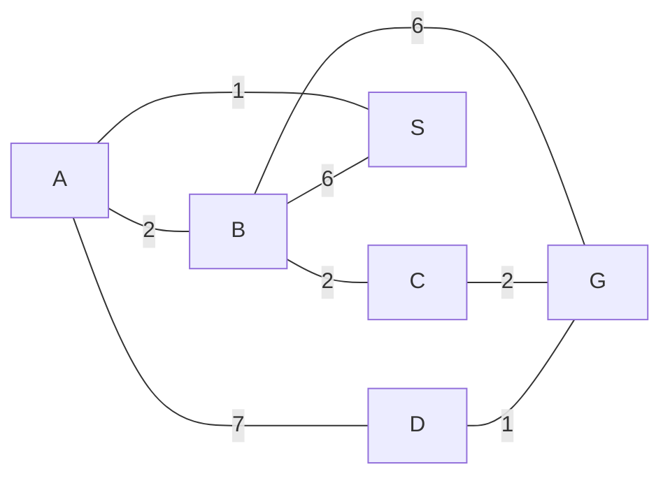
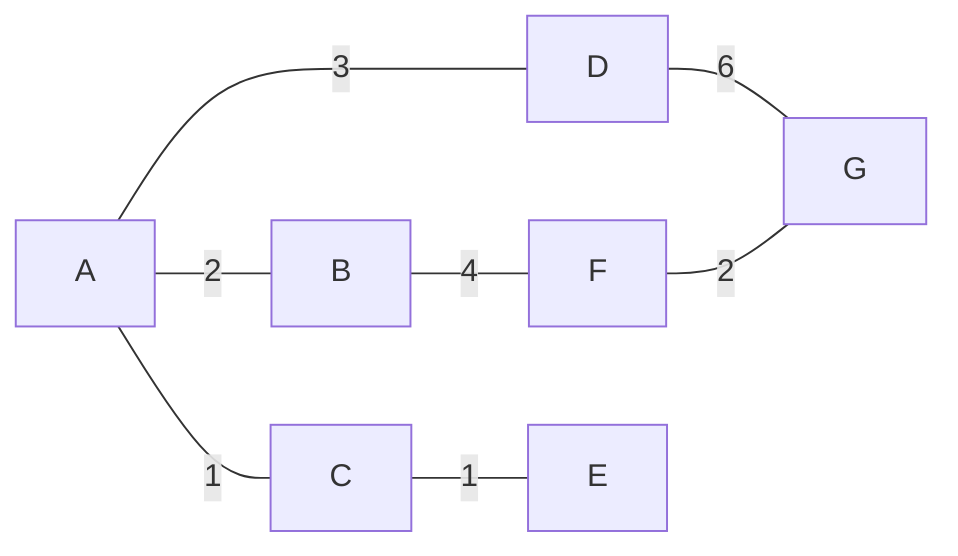

**English** | [Polski](README.pl.md)

# Lesson 2.4 — Heuristics, greedy best-first search and A*

**Core** · Requires: 2.3 Uniform-cost search (UCS) (see the [course map](../../../COURSE_MAP.md)).

## Learning goals

After this lesson you will be able to:

- explain what a heuristic is and compute the Manhattan distance in the warehouse;
- tell greedy best-first search apart from A*;
- check whether a heuristic is admissible and consistent, and justify why the Manhattan distance is both;
- trace greedy best-first search and A* by hand on a graph with given heuristic values;
- implement both algorithms and see how much work a good heuristic saves.

## The problem

In lesson 2.3 UCS found the cheapest route on the map `congested.txt`, but it expanded 94 of the 104 free cells. It even expanded all 45 cells of the storage area to the left of the start, although the dock lies to the right:

```text
##############################
#.........#..................#
#.........#.################.#
#.........R~~~~~~~~~~~~~~~~~D#
#.........#.################.#
#.........#..................#
##############################
```

UCS does not know where the goal is, so it spreads equally in every direction. Yet the robot knows where the dock is and can easily estimate how far it has to drive at least. How can we use such an estimate without losing the guarantee of the cheapest route?

## Intuition

A **heuristic** is a hint: a quick estimate of how much is still left to the goal. A driver who sees the church tower of the destination town on the horizon tends to turn into the road that leads towards it.

There are two ways to use such a hint:

- **greedy best-first search** always expands the node that seems closest to the goal. It is like a hiker who walks straight towards the visible tower and never looks at how far they have already walked. They often get there quickly, but they can end up in a bog or a dead end;
- **A\*** always expands the node with the smallest sum of how much the way to it has already cost plus how much, by the estimate, is left to the goal. So it keeps track of cost like UCS, but does not waste time on directions that the estimate calls hopeless.

## Formal model and pseudocode

### Heuristics

A **heuristic function** *h*(*n*) estimates the cost of the cheapest way from the state of node *n* to a goal. It depends only on the state, not on the way we got there. At a goal *h* = 0. The true cost of the cheapest way to a goal is written *h*\*(*n*). If we knew it, we would not need to search at all.

In the course code a heuristic is an ordinary function of a state, for example `h(state)`. The algorithms `greedy_best_first(problem, h)` and `a_star(problem, h)` take it as an argument.

### The Manhattan distance

In the warehouse the robot drives only vertically and horizontally. The cell `(r1, c1)` is at least

$$h_{\text{Manhattan}} = |r_1 - r_2| + |c_1 - c_2|$$

moves away from the cell `(r2, c2)`, because every move changes the row or the column number by exactly 1. The name comes from the streets of Manhattan, laid out in a rectangular grid. On the map `congested.txt` the start `R` is at `(3, 10)` and the dock `D` at `(3, 28)`, so *h*(`R`) = 0 + 18 = 18. The true lowest cost is 24, because driving straight does not pay.

### Greedy best-first search

Greedy best-first search is the best-first search of lesson 2.1 with the evaluation function

$$f(n) = h(n).$$

The skeleton is the same as in UCS: a priority queue, reached with the lowest known costs, the goal test on removal. Only the priority in the frontier changes.

### A*

A\* (read "A star") is best-first search with the evaluation function

$$f(n) = g(n) + h(n),$$

where *g*(*n*) is the cost of the path from the start to *n*. The value *f*(*n*) estimates the cost of the cheapest solution that goes through *n*.

```text
A*(problem, h):
    root ← Node(problem.initial)
    frontier ← a priority queue ordered by f = path_cost + h(state), holding root
    reached ← {problem.initial: 0}               # state → lowest known cost g
    while the frontier is not empty:
        node ← take the node with the smallest f off the frontier
        if node.path_cost > reached[node.state]: skip it
        if problem.is_goal(node.state): return node
        for each child in expand(problem, node):
            s ← child.state
            if s ∉ reached or child.path_cost < reached[s]:
                reached[s] ← child.path_cost
                add child to the frontier with priority child.path_cost + h(s)
    return None
```

This is the UCS of lesson 2.3 with only the priority changed. Note that reached still compares costs *g*, not *f*: for two nodes with the same state *h* is the same, so the cheaper way is simply the smaller *g*.

### Admissible and consistent heuristics

A heuristic is **admissible** if it never overestimates:

$$h(n) \le h^*(n) \text{ for every } n.$$

A heuristic is **consistent** if for every node *n* and every child *n′* that an action *a* leads to:

$$h(n) \le c(n, a, n') + h(n').$$

This is the triangle inequality: the estimate from *n* cannot be greater than the cost of one step plus the estimate from where that step leads. Every consistent heuristic (with *h* = 0 at the goal) is admissible. The converse does not always hold, but in practice most admissible heuristics are also consistent.

**In the warehouse the Manhattan distance is admissible and consistent.** Every move changes the row or the column by 1, so it changes the Manhattan distance to the dock by at most 1. Every move costs at least 1, including driving into a slow zone, which costs 3. Hence *h*(*n*) ≤ *h*(*n′*) + 1 ≤ *h*(*n′*) + *c*(*n*, *a*, *n′*), and that is exactly consistency. Consistency gives admissibility. Slow zones only raise the true cost, so the estimate exceeds it even less.

With a consistent heuristic *f* never decreases along a path: *f*(*n′*) = *g*(*n*) + *c* + *h*(*n′*) ≥ *g*(*n*) + *h*(*n*) = *f*(*n*). That is why A\* expands nodes in order of non-decreasing *f*, just as UCS expands them in order of non-decreasing *g*.

### Why A* is optimal

Let *C*\* be the cost of the cheapest solution, and let the heuristic be admissible. Suppose A\* removes a goal with cost *C* > *C*\* from the frontier. Some node *n* on the cheapest path to the goal is still in the frontier (the start certainly lies on that path). For it

$$f(n) = g(n) + h(n) \le g(n) + h^*(n) = C^* < C.$$

So node *n* has a smaller *f* than the goal being removed, and it should have been removed earlier. A contradiction: A\* does not return a more expensive goal. The version in this lesson goes back to a state when it finds a cheaper way to it, so an admissible heuristic is enough for it. A version that expands each state at most once and ignores it afterwards (with a set of expanded states) needs a consistent heuristic: only consistency guarantees that a state removed for the first time already has its cheapest way.

### How the heuristic affects the work

- *h* = 0 gives *f* = *g*, that is UCS.
- *h* = *h*\* gives *f* = *C*\* to the nodes on the cheapest paths and a larger *f* to all others, so A\* hardly strays from the cheapest route.
- In between: the larger the heuristic, while still admissible, the fewer nodes A\* expands. With a consistent heuristic A\* expands every node with *f*(*n*) < *C*\*, and a larger *h* reduces the number of such nodes. Comparing heuristics is the topic of lesson 2.7.
- An overestimating heuristic can speed up the search, but A\* then loses the guarantee of the cheapest route.

## Trace it by hand

### Worked example

The graph from lesson 2.3, from `S` to `G`, and the heuristic value of each state:

<!-- generated:graph example=weighted_example -->

<!-- /generated -->

<!-- generated:heuristic example=weighted_example lang=en -->
| State | A | B | C | D | G | S |
|---|---|---|---|---|---|---|
| h | 5 | 3 | 2 | 1 | 0 | 5 |
<!-- /generated -->

The neighbours of each state are considered in alphabetical order, and when *f* values are equal the node added earlier is removed first.

**Greedy best-first search.** Here the column *f* holds *h* alone:

<!-- generated:trace-table algorithm=greedy example=weighted_example lang=en -->
| Step | Popped | g | f | Outcome | Frontier: state f, in removal order | Best known g |
|---|---|---|---|---|---|---|
| 1 | S | 0 | 5 | expanded | B 3, A 5 | A 1, B 6, S 0 |
| 2 | B | 6 | 3 | expanded | G 0, C 2, A 5 | A 1, B 6, C 8, G 12, S 0 |
| 3 | G | 12 | 0 | goal | C 2, A 5 | A 1, B 6, C 8, G 12, S 0 |

Goal **G** reached at cost 12. Path: S → B → G.
<!-- /generated -->

After expanding `S`, greedy chooses `B`, because *h*(`B`) = 3 is smaller than *h*(`A`) = 5, even though the edge S–B costs as much as 6. Then it reaches the goal right away. It expanded only two nodes, but the route costs 12 and the cheapest one 7.

**A\*.** The column *f* holds *g* + *h*:

<!-- generated:trace-table algorithm=astar example=weighted_example lang=en -->
| Step | Popped | g | f | Outcome | Frontier: state f, in removal order | Best known g |
|---|---|---|---|---|---|---|
| 1 | S | 0 | 5 | expanded | A 6, B 9 | A 1, B 6, S 0 |
| 2 | A | 1 | 6 | expanded | B 6, B 9, D 9 | A 1, B 3, D 8, S 0 |
| 3 | B | 3 | 6 | expanded | C 7, B 9, D 9, G 9 | A 1, B 3, C 5, D 8, G 9, S 0 |
| 4 | C | 5 | 7 | expanded | G 7, B 9, D 9, G 9 | A 1, B 3, C 5, D 8, G 7, S 0 |
| 5 | G | 7 | 7 | goal | B 9, D 9, G 9 | A 1, B 3, C 5, D 8, G 7, S 0 |

Goal **G** reached at cost 7. Path: S → A → B → C → G.
<!-- /generated -->

A\* first expands `A`, with *f* = 1 + 5 = 6, not `B`, with *f* = 6 + 3 = 9. Step by step it finds a cheaper way to `B`, then `C`, and removes the goal with cost 7. In this small graph it expands the same nodes as UCS, but unlike UCS it does not have to remove the out-of-date entry of `B` with cost *g* = 6: its *f* = 6 + 3 = 9 exceeds the cost of the goal, so it stays in the frontier when the goal is returned. You will see real savings in the exercise and in the experiments.

### Your turn

Trace both algorithms on the graph below, from `A` to `G`, with the given heuristic values:

<!-- generated:graph example=astar_exercise -->

<!-- /generated -->

<!-- generated:heuristic example=astar_exercise lang=en -->
| State | A | B | C | D | E | F | G |
|---|---|---|---|---|---|---|---|
| h | 7 | 6 | 8 | 4 | 9 | 2 | 0 |
<!-- /generated -->

The rules are exactly as in the example:

1. Consider neighbours in alphabetical order.
2. Always remove the node with the smallest *f* from the frontier: for greedy *f* = *h*, for A\* *f* = *g* + *h*. On a tie, remove the node added earlier.
3. Add a child to the frontier if its state is new or reached more cheaply (a smaller *g*) than before.
4. Skip a removed node whose *g* is higher than the best known cost of its state. This is not an expansion.
5. Test for the goal when a node is removed from the frontier. The goal itself is not expanded.

Fill in Part A of `task.py`: `GREEDY_PATH`, the path returned by greedy, and `ASTAR_EXPANSION_ORDER` and `ASTAR_PATH`, the expansion order and the path of A\*.

## Properties

Notation as in lesson 2.3: *b* is the branching factor, *m* is the maximum depth, *C*\* is the cost of the optimal solution.

| | Greedy best-first | A* |
|---|---|---|
| Complete | yes as a graph search on a finite state space | yes, if step costs are positive and *b* is finite |
| Optimal | no | yes, if the heuristic is admissible |
| Time | O(*b*<sup>*m*</sup>) in the worst case; very fast with a good heuristic | depends on the heuristic; expands every node with *f* < *C*\* |
| Memory | O(*b*<sup>*m*</sup>) in the worst case | all generated nodes, which is usually a lot |

**Limitations.** A\* keeps the whole frontier and reached in memory, so on huge state spaces it runs out of memory sooner than out of time. The quality of A\* depends on the heuristic: with *h* = 0 it is plain UCS. A good heuristic has to be found for every problem separately, which is the topic of lesson 2.7.

## Common mistakes

1. **A\* without g.** The priority *f* = *h* turns A\* into greedy best-first search. The algorithm is fast but does not guarantee the cheapest route.
2. **A\* without h.** The priority *f* = *g* turns A\* into UCS. Routes are correct and cheapest, but the heuristic speeds nothing up.
3. **An overestimating heuristic.** For example the Manhattan distance multiplied by 2. Such a heuristic is not admissible, so A\* can return a more expensive route.
4. **The early goal test.** As in UCS: the first goal generated need not lie on the cheapest path.
5. **Greedy with the path cost.** Adding *g* to the priority of greedy gives A\*. The algorithm stops being greedy and does not show what it was meant to show.

The lesson's tests catch each of these mistakes.

## Task

### Part A: tracing by hand

Fill in three lists in `task.py` for the graph in "Your turn": `GREEDY_PATH`, `ASTAR_EXPANSION_ORDER` and `ASTAR_PATH`.

### Part B: implementation

Implement three functions in `task.py`:

- `manhattan(cell, goal)` returns the Manhattan distance between two cells `(row, col)`;
- `greedy_best_first(problem, h)` is best-first search with the priority *h*(state);
- `a_star(problem, h)` is best-first search with the priority *g* + *h*(state).

Both search functions generate children only with `expand(problem, node)`, test for the goal when a node is removed from the frontier, and return the goal node or `None`. You can write one shared helper function that takes the priority as an argument and call it from both. `task.py` does not import `introai.search.reference` or `introai.world.reference`.

### How to check

From the repository root:

```bash
uv run pytest modules/02_search/04_heuristics_and_a_star
```

The failure messages say which property is broken and on which example, and often also hint at which common mistake it is.

### Acceptance criteria

- All the lesson's tests pass.
- You can answer the review questions before you look at the answers.

## What the tests do not check

- **Understanding.** Passing tests do not prove that you know why A\* is optimal. The review questions and the experiments are there for that.
- **The admissibility of any heuristic.** The tests check your `manhattan` function on particular cells. Whether another heuristic is admissible is for you to justify.
- **A particular order on ties.** The tests check that the *f* of expanded nodes never decreases and that the route of A\* is the cheapest. The tie-breaking rules of Part A apply only to tracing by hand.
- **Style and readability.**
- **Getting around the import ban.** The test detects a plain import of the reference modules, but not every trick. Such a workaround only cheats you.

## Experiments

Open [experiments.ipynb](experiments.ipynb). Before each experiment write down your prediction, then check it:

1. On the map `congested.txt`: which way will UCS, greedy and A\* go? How many cells will each of them expand?
2. What happens when you use the Euclidean distance instead of the Manhattan distance, and what when you multiply the Manhattan distance by 2 or by 3?
3. How much work does A\* save on the map with aisles and on the open floor?

## Review questions

1. How does greedy best-first search differ from A\*? Show on an example that greedy can return a more expensive route.
2. What does it mean for a heuristic to be admissible? Why is the Manhattan distance admissible in a warehouse with slow zones?
3. Would the Manhattan distance stay admissible if the robot could also drive diagonally, and a diagonal move cost 1? Why?
4. Why do the *f* values of expanded nodes never decrease with a consistent heuristic?
5. Which heuristic do you have to give A\* to make it behave exactly like UCS? And which would make it expand only the nodes on the cheapest path?
6. Why can an overestimating heuristic speed up the search? What is lost then?

## If you get stuck

<details>
<summary>Hint 1: where to start</summary>

Start from your `ucs` function from lesson 2.3. Turn it into a helper function that takes one more argument: a function that computes a node's priority. Greedy calls it with `lambda node: h(node.state)`, and A\* with `lambda node: node.path_cost + h(node.state)`.

</details>

<details>
<summary>Hint 2: what stays in reached</summary>

Reached still holds the lowest known cost *g*, that is `node.path_cost`, not the priority. The priority only orders the frontier.

</details>

<details>
<summary>Hint 3: A* expands too many cells</summary>

Check that the priority really is `node.path_cost + h(node.state)` and that you call `h` for the child's state, not the parent's. Also make sure the heuristic measures the distance to the goal, that is to the dock.

</details>

## Key takeaways

- A heuristic *h*(*n*) estimates the cost of the way from state *n* to a goal; in the warehouse the Manhattan distance is a good heuristic.
- Greedy best-first search expands the node with the smallest *h*: it can be very fast, but does not guarantee the cheapest route.
- A\* expands the node with the smallest *g* + *h*: with an admissible heuristic it always finds the cheapest route.
- A consistent heuristic satisfies the triangle inequality; then *f* never decreases along paths and A\* expands nodes in order of *f*.
- The better the admissible heuristic, the fewer nodes A\* expands. *h* = 0 gives UCS.

## What next

- After your own attempt, compare with the solution and answers in [solutions/02_search/04_heuristics_and_a_star/](../../../solutions/02_search/04_heuristics_and_a_star/).
- The next lesson, 2.5, compares all the strategies you have met on maps with costs.

## References

- S. Russell, P. Norvig, *Artificial Intelligence: A Modern Approach*, 4th ed., Pearson, 2020, section 3.5 (informed search, A*).
- P. E. Hart, N. J. Nilsson, B. Raphael, *A Formal Basis for the Heuristic Determination of Minimum Cost Paths*, IEEE Transactions on Systems Science and Cybernetics 4(2), 1968, pp. 100–107.
