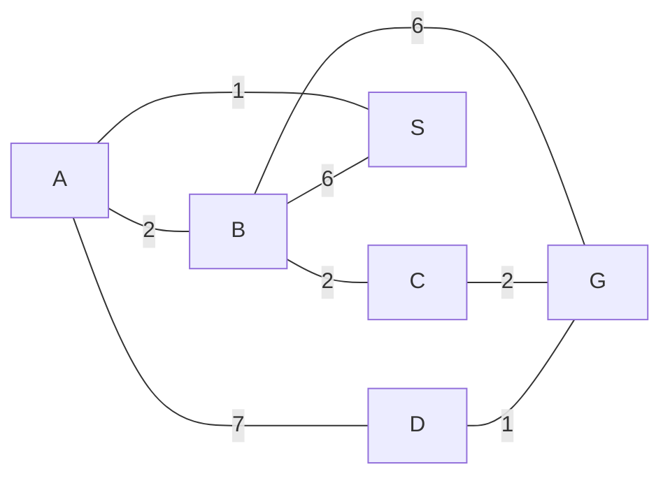
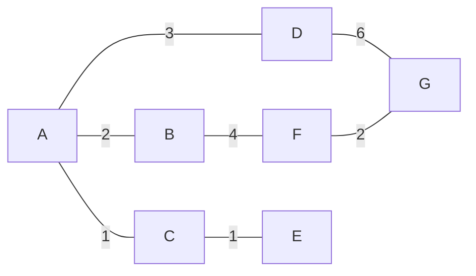

[English](README.md) | **Polski**

# Lekcja 2.4 — Heurystyki, greedy best-first i A*

**Core** · Wymagania: 2.3 Przeszukiwanie kosztowe (UCS) (zobacz [mapę kursu](../../../COURSE_MAP.pl.md)).

## Cele lekcji

Po tej lekcji:

- wyjaśnisz, czym jest heurystyka, i policzysz odległość Manhattan w magazynie;
- odróżnisz zachłanne przeszukiwanie „najpierw najlepszy” (*greedy best-first search*) od A*;
- sprawdzisz, czy heurystyka jest dopuszczalna i spójna, i uzasadnisz, dlaczego odległość Manhattan jest jedną i drugą;
- prześledzisz greedy i A* ręcznie na grafie z podanymi wartościami heurystyki;
- zaimplementujesz oba algorytmy i zobaczysz, ile pracy oszczędza dobra heurystyka.

## Problem

W lekcji 2.3 UCS znalazł najtańszą trasę na mapie `congested.txt`, ale rozwinął 94 ze 104 wolnych pól. Rozwinął nawet wszystkie 45 pól magazynu na lewo od startu, choć rampa leży na prawo:

```text
##############################
#.........#..................#
#.........#.################.#
#.........R~~~~~~~~~~~~~~~~~D#
#.........#.################.#
#.........#..................#
##############################
```

UCS nie wie, gdzie jest cel, więc rozchodzi się jednakowo we wszystkich kierunkach. A przecież robot zna położenie rampy i łatwo oszacuje, ile co najmniej musi do niej jechać. Jak wykorzystać takie oszacowanie, nie tracąc gwarancji najtańszej trasy?

## Intuicja

**Heurystyka** to podpowiedź: szybkie oszacowanie, ile jeszcze zostało do celu. Kierowca, który widzi na horyzoncie wieżę kościoła w docelowym mieście, skręca raczej w drogę prowadzącą w jej stronę.

Taką podpowiedź można wykorzystać na dwa sposoby:

- **greedy best-first** zawsze rozwija węzeł, który wydaje się najbliżej celu. Jest jak turysta, który idzie prosto na widoczną wieżę i nie patrzy, ile już przeszedł. Często dociera szybko, ale potrafi wpakować się w błoto albo w ślepy zaułek;
- **A\*** zawsze rozwija węzeł o najmniejszej sumie: ile już kosztowała droga do niego plus ile, według oszacowania, zostało do celu. Pilnuje więc kosztu jak UCS, ale nie marnuje czasu na kierunki, które oszacowanie uznaje za beznadziejne.

## Model formalny i pseudokod

### Heurystyka

**Funkcja heurystyczna** *h*(*n*) szacuje koszt najtańszej drogi ze stanu węzła *n* do celu. Zależy tylko od stanu, a nie od drogi, którą do niego dotarliśmy. W celu *h* = 0. Prawdziwy koszt najtańszej drogi do celu oznaczamy *h*\*(*n*). Gdybyśmy go znali, nie musielibyśmy niczego przeszukiwać.

W kodzie kursu heurystyka to zwykła funkcja stanu, na przykład `h(state)`. Algorytmy `greedy_best_first(problem, h)` i `a_star(problem, h)` dostają ją jako argument.

### Odległość Manhattan

W magazynie robot jedzie tylko w pionie i w poziomie. Pole `(w1, k1)` dzieli od pola `(w2, k2)` co najmniej

$$h_{\text{Manhattan}} = |w_1 - w_2| + |k_1 - k_2|$$

ruchów, bo każdy ruch zmienia numer wiersza albo kolumny dokładnie o 1. Nazwa pochodzi od ulic Manhattanu, ułożonych w prostokątną siatkę. Na mapie `congested.txt` start `R` leży w polu `(3, 10)`, a rampa `D` w polu `(3, 28)`, więc *h*(`R`) = 0 + 18 = 18. Prawdziwy najniższy koszt to 24, bo prosto jechać się nie opłaca.

### Greedy best-first

Greedy best-first to przeszukiwanie „najpierw najlepszy” z lekcji 2.1 z funkcją oceny

$$f(n) = h(n).$$

Szkielet jest taki sam jak w UCS: kolejka priorytetowa, reached z najniższymi znanymi kosztami, test celu przy zdejmowaniu. Zmienia się tylko priorytet we frontier.

### A*

A\* (czytaj: „A gwiazdka”) to przeszukiwanie „najpierw najlepszy” z funkcją oceny

$$f(n) = g(n) + h(n),$$

gdzie *g*(*n*) to koszt ścieżki od startu do *n*. Wartość *f*(*n*) szacuje koszt najtańszego rozwiązania, które prowadzi przez *n*.

```text
A*(problem, h):
    korzeń ← Node(problem.initial)
    frontier ← kolejka priorytetowa według f = path_cost + h(state), zawierająca korzeń
    reached ← {problem.initial: 0}               # stan → najniższy znany koszt g
    dopóki frontier nie jest pusty:
        węzeł ← zdejmij z frontier węzeł o najmniejszym f
        jeśli węzeł.path_cost > reached[węzeł.state]: pomiń go
        jeśli problem.is_goal(węzeł.state): zwróć węzeł
        dla każdego dziecka w expand(problem, węzeł):
            s ← dziecko.state
            jeśli s ∉ reached albo dziecko.path_cost < reached[s]:
                reached[s] ← dziecko.path_cost
                dodaj dziecko do frontier z priorytetem dziecko.path_cost + h(s)
    zwróć None
```

To jest UCS z lekcji 2.3, w którym zmienił się tylko priorytet. Zwróć uwagę, że reached nadal porównuje koszty *g*, a nie *f*: dla dwóch węzłów z tym samym stanem *h* jest takie samo, więc tańsza droga to po prostu mniejsze *g*.

### Heurystyka dopuszczalna i spójna

Heurystyka jest **dopuszczalna** (*admissible*), jeśli nigdy nie przeszacowuje:

$$h(n) \le h^*(n) \text{ dla każdego } n.$$

Heurystyka jest **spójna** (*consistent*), jeśli dla każdego węzła *n* i każdego jego dziecka *n′*, do którego prowadzi akcja *a*:

$$h(n) \le c(n, a, n') + h(n').$$

To nierówność trójkąta: oszacowanie z *n* nie może być większe niż koszt jednego kroku plus oszacowanie z miejsca, do którego ten krok prowadzi. Każda heurystyka spójna (z *h* = 0 w celu) jest dopuszczalna. Odwrotnie bywa różnie, ale w praktyce większość dopuszczalnych heurystyk jest też spójna.

**Odległość Manhattan w magazynie jest dopuszczalna i spójna.** Każdy ruch zmienia wiersz albo kolumnę o 1, więc zmienia odległość Manhattan do rampy najwyżej o 1. Każdy ruch kosztuje co najmniej 1, także wjazd w strefę wolnego ruchu, który kosztuje 3. Stąd *h*(*n*) ≤ *h*(*n′*) + 1 ≤ *h*(*n′*) + *c*(*n*, *a*, *n′*), a to jest właśnie spójność. Spójność daje dopuszczalność. Strefy wolnego ruchu tylko podnoszą prawdziwy koszt, więc oszacowanie tym bardziej go nie przekracza.

Dla spójnej heurystyki *f* nie maleje wzdłuż żadnej ścieżki: *f*(*n′*) = *g*(*n*) + *c* + *h*(*n′*) ≥ *g*(*n*) + *h*(*n*) = *f*(*n*). Dlatego A\* rozwija węzły w kolejności niemalejącego *f*, tak jak UCS rozwija je w kolejności niemalejącego *g*.

### Dlaczego A* jest optymalny

Niech *C*\* będzie kosztem najtańszego rozwiązania, a heurystyka dopuszczalna. Przypuśćmy, że A\* zdejmuje z frontier cel o koszcie *C* > *C*\*. Na najtańszej ścieżce do celu jakiś węzeł *n* wciąż leży we frontier (start na pewno do niej należy). Dla niego

$$f(n) = g(n) + h(n) \le g(n) + h^*(n) = C^* < C.$$

Węzeł *n* ma więc mniejsze *f* niż zdejmowany cel i powinien zostać zdjęty wcześniej. Sprzeczność: A\* nie zwróci droższego celu. Wersja z tej lekcji wraca do stanu, gdy znajdzie do niego tańszą drogę, więc wystarcza jej heurystyka dopuszczalna. Wersja, która każdy stan rozwija najwyżej raz i potem go ignoruje (ze zbiorem rozwiniętych stanów), potrzebuje heurystyki spójnej: dopiero spójność gwarantuje, że stan zdjęty po raz pierwszy ma już najtańszą drogę.

### Jak heurystyka wpływa na pracę

- *h* = 0 daje *f* = *g*, czyli UCS.
- *h* = *h*\* sprawia, że węzły na najtańszych ścieżkach mają *f* = *C*\*, a wszystkie inne większe *f*, więc A\* prawie nie zbacza z najtańszej trasy.
- Pomiędzy: im większa heurystyka, ale wciąż dopuszczalna, tym mniej węzłów rozwija A\*. Przy spójnej heurystyce A\* rozwija każdy węzeł o *f*(*n*) < *C*\*, a większe *h* zmniejsza liczbę takich węzłów. O porównywaniu heurystyk będzie lekcja 2.7.
- Heurystyka przeszacowująca może przyspieszyć przeszukiwanie, ale A\* traci wtedy gwarancję najtańszej trasy.

## Prześledź ręcznie

### Przykład rozwiązany

Graf z lekcji 2.3, z `S` do `G`, i wartości heurystyki dla każdego stanu:

<!-- generated:graph example=weighted_example -->

<!-- /generated -->

<!-- generated:heuristic example=weighted_example lang=pl -->
| Stan | A | B | C | D | G | S |
|---|---|---|---|---|---|---|
| h | 5 | 3 | 2 | 1 | 0 | 5 |
<!-- /generated -->

Sąsiadów każdego stanu rozpatrujemy w kolejności alfabetycznej, a przy równych wartościach *f* z frontier zdejmujemy węzeł dodany wcześniej.

**Greedy best-first.** Kolumna *f* zawiera tu samo *h*:

<!-- generated:trace-table algorithm=greedy example=weighted_example lang=pl -->
| Krok | Zdjęty | g | f | Wynik | Frontier: stan f, w kolejności zdejmowania | Najlepsze znane g |
|---|---|---|---|---|---|---|
| 1 | S | 0 | 5 | rozwinięty | B 3, A 5 | A 1, B 6, S 0 |
| 2 | B | 6 | 3 | rozwinięty | G 0, C 2, A 5 | A 1, B 6, C 8, G 12, S 0 |
| 3 | G | 12 | 0 | cel | C 2, A 5 | A 1, B 6, C 8, G 12, S 0 |

Cel **G** osiągnięty kosztem 12. Ścieżka: S → B → G.
<!-- /generated -->

Greedy po rozwinięciu `S` wybiera `B`, bo *h*(`B`) = 3 jest mniejsze niż *h*(`A`) = 5, choć krawędź S–B kosztuje aż 6. Potem od razu dociera do celu. Rozwinął tylko dwa węzły, ale trasa kosztuje 12, a najtańsza 7.

**A\*.** Kolumna *f* zawiera *g* + *h*:

<!-- generated:trace-table algorithm=astar example=weighted_example lang=pl -->
| Krok | Zdjęty | g | f | Wynik | Frontier: stan f, w kolejności zdejmowania | Najlepsze znane g |
|---|---|---|---|---|---|---|
| 1 | S | 0 | 5 | rozwinięty | A 6, B 9 | A 1, B 6, S 0 |
| 2 | A | 1 | 6 | rozwinięty | B 6, B 9, D 9 | A 1, B 3, D 8, S 0 |
| 3 | B | 3 | 6 | rozwinięty | C 7, B 9, D 9, G 9 | A 1, B 3, C 5, D 8, G 9, S 0 |
| 4 | C | 5 | 7 | rozwinięty | G 7, B 9, D 9, G 9 | A 1, B 3, C 5, D 8, G 7, S 0 |
| 5 | G | 7 | 7 | cel | B 9, D 9, G 9 | A 1, B 3, C 5, D 8, G 7, S 0 |

Cel **G** osiągnięty kosztem 7. Ścieżka: S → A → B → C → G.
<!-- /generated -->

A\* najpierw rozwija `A` z *f* = 1 + 5 = 6, a nie `B` z *f* = 6 + 3 = 9. Krok po kroku znajduje tańszą drogę do `B`, potem `C`, a cel zdejmuje z kosztem 7. W tym małym grafie rozwija te same węzły co UCS, ale w przeciwieństwie do UCS nie musi zdejmować nieaktualnego wpisu `B` o koszcie *g* = 6: jego *f* = 6 + 3 = 9 przekracza koszt celu, więc zostaje we frontier, gdy cel zostaje zwrócony. Prawdziwą oszczędność zobaczysz w zadaniu i w eksperymentach.

### Twoja kolej

Prześledź oba algorytmy na poniższym grafie, z `A` do `G`, z podanymi wartościami heurystyki:

<!-- generated:graph example=astar_exercise -->

<!-- /generated -->

<!-- generated:heuristic example=astar_exercise lang=pl -->
| Stan | A | B | C | D | E | F | G |
|---|---|---|---|---|---|---|---|
| h | 7 | 6 | 8 | 4 | 9 | 2 | 0 |
<!-- /generated -->

Zasady są dokładnie takie jak w przykładzie:

1. Sąsiadów rozpatrujesz w kolejności alfabetycznej.
2. Z frontier zawsze zdejmujesz węzeł o najmniejszym *f*: dla greedy *f* = *h*, dla A\* *f* = *g* + *h*. Przy remisie zdejmujesz węzeł dodany wcześniej.
3. Dziecko dodajesz do frontier, jeśli jego stan jest nowy albo osiągnięty taniej (mniejsze *g*) niż dotąd.
4. Zdjęty węzeł, którego *g* jest wyższe niż najlepszy znany koszt jego stanu, pomijasz. To nie jest rozwinięcie.
5. Cel sprawdzasz przy zdejmowaniu węzła z frontier. Sam cel nie jest rozwijany.

Wpisz w części A pliku `task.py`: `GREEDY_PATH`, czyli ścieżkę zwróconą przez greedy, oraz `ASTAR_EXPANSION_ORDER` i `ASTAR_PATH`, czyli kolejność rozwijania i ścieżkę A\*.

## Własności

Oznaczenia jak w lekcji 2.3: *b* to współczynnik rozgałęzienia, *m* to największa głębokość, *C*\* to koszt optymalnego rozwiązania.

| | Greedy best-first | A* |
|---|---|---|
| Kompletność | tak w przeszukiwaniu grafu na skończonej przestrzeni stanów | tak, jeśli koszty kroków są dodatnie, a *b* skończone |
| Optymalność | nie | tak, jeśli heurystyka jest dopuszczalna |
| Czas | O(*b*<sup>*m*</sup>) w najgorszym razie; z dobrą heurystyką bardzo szybki | zależy od heurystyki; rozwija każdy węzeł o *f* < *C*\* |
| Pamięć | O(*b*<sup>*m*</sup>) w najgorszym razie | wszystkie wygenerowane węzły, czyli zwykle dużo |

**Ograniczenia.** A\* trzyma w pamięci cały frontier i reached, więc na ogromnych przestrzeniach stanów pamięć kończy się szybciej niż czas. Jakość A\* zależy od heurystyki: z *h* = 0 jest zwykłym UCS. Dobrej heurystyki trzeba poszukać dla każdego problemu osobno, o czym jest lekcja 2.7.

## Częste błędy

1. **A\* bez g.** Priorytet *f* = *h* zamienia A\* w greedy best-first. Algorytm działa szybko, ale nie gwarantuje najtańszej trasy.
2. **A\* bez h.** Priorytet *f* = *g* zamienia A\* w UCS. Trasy są poprawne i najtańsze, ale heurystyka niczego nie przyspiesza.
3. **Przeszacowująca heurystyka.** Na przykład odległość Manhattan pomnożona przez 2. Taka heurystyka nie jest dopuszczalna, więc A\* może zwrócić droższą trasę.
4. **Wczesny test celu.** Tak jak w UCS: cel wygenerowany jako pierwszy nie musi leżeć na najtańszej ścieżce.
5. **Greedy z kosztem ścieżki.** Dodanie *g* do priorytetu w greedy daje A\*. Algorytm przestaje być zachłanny i nie pokazuje tego, co miał pokazać.

Testy lekcji wykrywają każdy z tych błędów.

## Zadanie

### Część A: ręczne śledzenie

Wypełnij w `task.py` trzy listy dla grafu z sekcji „Twoja kolej”: `GREEDY_PATH`, `ASTAR_EXPANSION_ORDER` i `ASTAR_PATH`.

### Część B: implementacja

Zaimplementuj w `task.py` trzy funkcje:

- `manhattan(cell, goal)` zwraca odległość Manhattan między dwoma polami `(wiersz, kolumna)`;
- `greedy_best_first(problem, h)` to przeszukiwanie „najpierw najlepszy” z priorytetem *h*(stan);
- `a_star(problem, h)` to przeszukiwanie „najpierw najlepszy” z priorytetem *g* + *h*(stan).

Obie funkcje przeszukiwania generują dzieci wyłącznie funkcją `expand(problem, node)`, sprawdzają cel przy zdejmowaniu węzła z frontier i zwracają węzeł celu albo `None`. Możesz napisać jedną wspólną funkcję pomocniczą, która dostaje priorytet jako argument, i wywołać ją z obu. `task.py` nie importuje `introai.search.reference` ani `introai.world.reference`.

### Jak sprawdzić

Z głównego katalogu repozytorium:

```bash
uv run pytest modules/02_search/04_heuristics_and_a_star
```

Komunikaty błędów mówią, która własność jest złamana i na jakim przykładzie, a często podpowiadają też, jaki to typowy błąd.

### Kryteria akceptacji

- Wszystkie testy lekcji przechodzą.
- Potrafisz odpowiedzieć na pytania kontrolne, zanim zajrzysz do odpowiedzi.

## Czego testy nie sprawdzają

- **Zrozumienia.** Przechodzące testy nie dowodzą, że wiesz, dlaczego A\* jest optymalny. Do tego służą pytania kontrolne i eksperymenty.
- **Dopuszczalności dowolnej heurystyki.** Testy sprawdzają Twoją funkcję `manhattan` na konkretnych polach. Czy inna heurystyka jest dopuszczalna, musisz uzasadnić sam.
- **Konkretnej kolejności przy remisach.** Testy sprawdzają, że *f* rozwijanych węzłów nie maleje, a trasa A\* jest najtańsza. Zasady rozstrzygania remisów z części A obowiązują tylko przy ręcznym śledzeniu.
- **Stylu i czytelności kodu.**
- **Obejścia zakazu importu.** Test wykrywa zwykły import wzorcowych modułów, ale nie każdą sztuczkę. Takie obejście oszukuje tylko Ciebie.

## Eksperymenty

Otwórz [experiments.pl.ipynb](experiments.pl.ipynb). Przed każdym eksperymentem zapisz swoje przewidywanie, a potem je sprawdź:

1. Na mapie `congested.txt`: którędy pojadą UCS, greedy i A\*? Ile pól rozwinie każdy z nich?
2. Co się stanie, gdy zamiast odległości Manhattan użyjesz odległości euklidesowej, a co, gdy pomnożysz odległość Manhattan przez 2 albo przez 3?
3. Ile pracy oszczędza A\* na mapie z alejkami i na otwartej podłodze?

## Pytania kontrolne

1. Czym różni się greedy best-first od A\*? Pokaż na przykładzie, że greedy może zwrócić droższą trasę.
2. Co znaczy, że heurystyka jest dopuszczalna? Dlaczego odległość Manhattan jest dopuszczalna w magazynie ze strefami wolnego ruchu?
3. Czy odległość Manhattan pozostałaby dopuszczalna, gdyby robot mógł jeździć także po skosie, a ruch po skosie kosztował 1? Dlaczego?
4. Dlaczego przy spójnej heurystyce wartości *f* rozwijanych węzłów nie maleją?
5. Jaką heurystykę trzeba podać A\*, żeby zachowywał się dokładnie jak UCS? A jaka sprawiłaby, że rozwija tylko węzły na najtańszej ścieżce?
6. Dlaczego heurystyka przeszacowująca może przyspieszyć przeszukiwanie? Co się wtedy traci?

## Jeśli utkniesz

<details>
<summary>Podpowiedź 1: od czego zacząć</summary>

Zacznij od swojej funkcji `ucs` z lekcji 2.3. Zamień ją na funkcję pomocniczą, która dostaje dodatkowy argument: funkcję liczącą priorytet węzła. Greedy wywoła ją z `lambda node: h(node.state)`, a A\* z `lambda node: node.path_cost + h(node.state)`.

</details>

<details>
<summary>Podpowiedź 2: co zostaje w reached</summary>

W reached nadal trzymasz najniższy znany koszt *g*, czyli `node.path_cost`, a nie priorytet. Priorytet służy tylko do porządkowania frontier.

</details>

<details>
<summary>Podpowiedź 3: A* rozwija za dużo pól</summary>

Sprawdź, czy priorytet to naprawdę `node.path_cost + h(node.state)` i czy wywołujesz `h` dla stanu dziecka, a nie rodzica. Upewnij się też, że heurystyka jest liczona względem celu, czyli rampy.

</details>

## Co zapamiętać

- Heurystyka *h*(*n*) szacuje koszt drogi ze stanu *n* do celu; w magazynie dobrą heurystyką jest odległość Manhattan.
- Greedy best-first rozwija węzeł o najmniejszym *h*: bywa bardzo szybki, ale nie gwarantuje najtańszej trasy.
- A\* rozwija węzeł o najmniejszym *g* + *h*: z heurystyką dopuszczalną zawsze znajduje najtańszą trasę.
- Heurystyka spójna spełnia nierówność trójkąta; wtedy *f* nie maleje wzdłuż ścieżek, a A\* rozwija węzły w kolejności *f*.
- Im lepsza dopuszczalna heurystyka, tym mniej węzłów rozwija A\*. *h* = 0 daje UCS.

## Co dalej

- Po własnej próbie porównaj się z rozwiązaniem i odpowiedziami w [solutions/02_search/04_heuristics_and_a_star/](../../../solutions/02_search/04_heuristics_and_a_star/).
- Następna lekcja, 2.5, porównuje wszystkie poznane strategie na mapach z kosztami.

## Bibliografia

- S. Russell, P. Norvig, *Artificial Intelligence: A Modern Approach*, 4th ed., Pearson, 2020, rozdz. 3.5 (przeszukiwanie z informacją, A*).
- P. E. Hart, N. J. Nilsson, B. Raphael, *A Formal Basis for the Heuristic Determination of Minimum Cost Paths*, IEEE Transactions on Systems Science and Cybernetics 4(2), 1968, s. 100–107.
