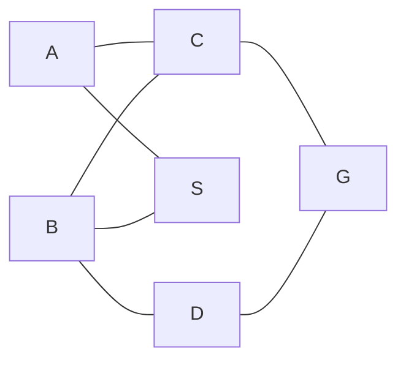
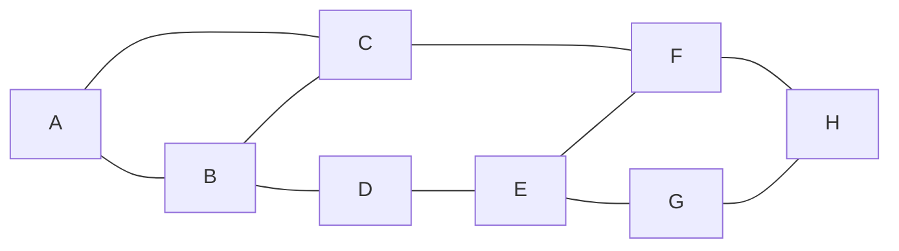

**English** | [Polski](README.pl.md)

# Lesson 2.6 — Iterative deepening

**Optional** · Requires: 2.5 Comparing search strategies (see the [course map](../../../COURSE_MAP.md)).

## Learning goals

After this lesson you will be able to:

- write depth-limited search (DLS) and tell a cutoff apart from a failure;
- build iterative deepening search (IDS) on top of it;
- count how much work IDS repeats, and explain why it is surprisingly little;
- say when IDS is the best choice and when it loses to BFS.

## The problem

In lesson 2.5 every strategy had its weakness. BFS finds the shortest route, but it keeps the whole wave in memory: with a branching factor of 10 and the goal at depth 10, that is ten billion nodes. DFS needs memory only for the current path, but it can go down a very long branch and find a route far from the shortest.

Can we combine the memory of DFS with the guarantee of BFS? We can, and in a very simple way.

## Intuition

Picture a dog on a lead searching the bushes for a ball. On a short lead it searches the nearest patch thoroughly. If the ball is not there, you call it back and let it go on a lead one metre longer. Each time the dog runs over places it has already seen, but it never runs further than it has to.

That is how iterative deepening works. It searches depth-first, but with a depth limit. First with limit 0, then 1, then 2 and so on, until it finds the goal. Each round is an ordinary DFS, so memory stays small. The rounds go in order of increasing depth, so the first goal found is the shallowest, as in BFS.

## Formal model and pseudocode

### Depth-limited search

DLS is a depth-first tree search that does not expand nodes at depth `limit` or deeper:

```text
DLS(problem, limit):
    frontier ← a stack holding Node(problem.initial)
    result ← None
    while the frontier is not empty:
        node ← take the LAST node off the frontier
        if problem.is_goal(node.state): return node
        if node.depth ≥ limit:
            result ← CUTOFF                    # cut off: there may be a goal deeper down
        else if node forms a cycle: skip it
        else:
            push the children from expand(problem, node) onto the frontier in REVERSE order
    return result
```

DLS has three possible results, and this is its most important feature:

- **a goal node**: it found a goal within the limit;
- **`CUTOFF`**: it found no goal, but at least one node stopped at the limit, so a goal may exist deeper down;
- **`None`** (failure): it found no goal and cut nothing off, so there is no goal at all.

You import the constant `CUTOFF` from `introai.search`.

**Cycles.** DLS does not remember visited states, because its whole advantage is small memory. It only checks whether the state of a node already appears on the node's own path: walking up the parents is enough. Such a node forms a cycle and is not expanded. Without this check DLS in the warehouse would drive back and forth up to the limit.

**A note for readers of the textbook.** In Russell and Norvig's pseudocode the cutoff condition reads *depth* > ℓ, so there a limit ℓ still lets nodes at depth ℓ be expanded. In this course a limit ℓ means that nodes at depth ℓ are already cut off, hence the condition ≥. Both describe the same algorithm, only with the limit shifted by one.

### Iterative deepening

```text
IDS(problem):
    for limit = 0, 1, 2, ...:
        result ← DLS(problem, limit)
        if result ≠ CUTOFF: return result
```

IDS ends when DLS finds a goal or returns `None`. The latter means that nothing was cut off at this limit and still there was no goal, so there is none anywhere.

### How much work is repeated?

Every round starts again from the root. Nodes on shallow levels are therefore expanded many times. What does that cost? In a full tree with branching factor *b* and the goal at depth *d*, a node at depth *k* is expanded in every round whose limit is greater than *k*, that is *d* − *k* times, and generated *d* − *k* + 1 times, because it is created as soon as its parent is expanded. The nodes of the deepest level, the most numerous, are generated only once.

An example for *b* = 10 and *d* = 5. We count **generated** nodes:

| Level | Nodes on the level | Generated in BFS | Generated in IDS |
|---|---|---|---|
| 1 | 10 | 10 | 5 · 10 = 50 |
| 2 | 100 | 100 | 4 · 100 = 400 |
| 3 | 1,000 | 1,000 | 3 · 1,000 = 3,000 |
| 4 | 10,000 | 10,000 | 2 · 10,000 = 20,000 |
| 5 | 100,000 | 100,000 | 1 · 100,000 = 100,000 |
| total | | 111,110 | 123,450 |

IDS does only 11% more work than BFS. In general the ratio tends to *b*/(*b* − 1): 1.11 for *b* = 10, 1.5 for *b* = 3, and 2 for *b* = 2. The work repeated is on the shallow levels, and they are small compared with the deepest one.

## Trace it by hand

### Worked example

The graph from lesson 2.2, from `S` to `G`. Neighbours are considered in alphabetical order. Children are pushed onto the stack in reverse order, so the child of the first neighbour is taken off first, as in the DFS of lesson 2.2.

<!-- generated:graph example=worked_example -->

<!-- /generated -->

Each row is one node taken off the stack. The column "Limit" says which round it belongs to:

<!-- generated:trace-table algorithm=ids example=worked_example lang=en -->
| Step | Limit | Popped (depth) | Outcome | Stack (top first) |
|---|---|---|---|---|
| 1 | 0 | S (0) | cut off | — |
| 2 | 1 | S (0) | expanded | A, B |
| 3 | 1 | A (1) | cut off | B |
| 4 | 1 | B (1) | cut off | — |
| 5 | 2 | S (0) | expanded | A, B |
| 6 | 2 | A (1) | expanded | C, S, B |
| 7 | 2 | C (2) | cut off | S, B |
| 8 | 2 | S (2) | cut off | B |
| 9 | 2 | B (1) | expanded | C, D, S |
| 10 | 2 | C (2) | cut off | D, S |
| 11 | 2 | D (2) | cut off | S |
| 12 | 2 | S (2) | cut off | — |
| 13 | 3 | S (0) | expanded | A, B |
| 14 | 3 | A (1) | expanded | C, S, B |
| 15 | 3 | C (2) | expanded | A, B, G, S, B |
| 16 | 3 | A (3) | cut off | B, G, S, B |
| 17 | 3 | B (3) | cut off | G, S, B |
| 18 | 3 | G (3) | goal | S, B |

Goal **G** found with limit 3. Path: S → A → C → G.
<!-- /generated -->

The numbers of expansions in successive rounds are 0, 1, 3, 3. A few things are worth noticing:

- **Limit 0.** The root already lies on the limit, so it is cut off and DLS returns `CUTOFF`. IDS goes on.
- **Limit 2, rows 8 and 12.** `S` at depth 2 forms a cycle (S → A → S), but the limit is checked first, so the node counts as cut off. The rule is the same in every round.
- **Limit 3.** DLS goes down S → A → C, and when it takes `G` off the stack, the goal test ends the search. The route S → A → C → G has 3 steps and is the shortest.

### Your turn

Trace IDS on the exercise graph, from `A` to `H`:

<!-- generated:graph example=exercise -->

<!-- /generated -->

The rules are exactly as in the example. For each node taken off the stack, in this order:

1. if it is a goal, the search ends;
2. if its depth is equal to the limit or greater, it is cut off;
3. if its state already appears among its ancestors, it is a cycle and is not expanded;
4. otherwise it is expanded, and its children go onto the stack in reverse alphabetical order.

Fill in the list `IDS_EXPANSIONS_PER_ITERATION` in Part A of `task.py`: how many nodes DLS expands with limit 0, 1, 2 and so on, up to the round in which IDS finds the goal.

## Properties

Notation: *b* is the branching factor, *d* is the depth of the shallowest goal.

| | IDS |
|---|---|
| Complete | yes, if *b* is finite |
| Optimal | yes, if every step costs the same |
| Time | O(*b*<sup>*d*</sup>) |
| Memory | O(*b*·*d*) |

**When is IDS the best choice?** When the state space is large, the depth of the goal unknown, and steps cost the same. Russell and Norvig say outright that in this situation iterative deepening is the preferred uninformed search method.

**Limitations.** IDS checks for cycles only on the current path, so it explores the redundant paths of lesson 2.1 again every time. In a tree that does no harm, but in the warehouse grid there are very many paths without repeats, and IDS expands many times more nodes than BFS. With different step costs IDS loses optimality. Then one can limit the path cost instead of the depth, which gives iterative lengthening, or use IDA\*, iterative deepening with a limit on *f* = *g* + *h*.

## Common mistakes

1. **No cycle check.** Without a cycle check, DLS on a graph with cycles and no goal always reaches the limit and returns `CUTOFF`, so IDS never ends.
2. **A cutoff reported as failure.** When DLS returns `None` instead of `CUTOFF`, IDS decides after the first round that there is no goal and gives up.
3. **Off by one at the limit.** The condition `depth > limit` instead of `depth >= limit` also expands the nodes on the limit itself. DLS then reaches one level deeper than the limit promises.

The lesson's tests catch each of these mistakes.

## Task

### Part A: counting expansions

Fill in the list `IDS_EXPANSIONS_PER_ITERATION` in `task.py` for the graph in "Your turn".

### Part B: implementation

Implement two functions in `task.py`:

- `depth_limited_search(problem, limit)` returns a goal node, `CUTOFF` or `None`. It does not expand nodes at depth `limit` or deeper, nor nodes whose state already appears on their path;
- `iterative_deepening_search(problem)` calls DLS with the limits 0, 1, 2, … and returns the first result that is not `CUTOFF`.

Generate children only with `expand(problem, node)`. You can write DLS with a stack or recursively; the tests accept both. `task.py` does not import `introai.search.reference`.

### How to check

From the repository root:

```bash
uv run pytest modules/02_search/06_iterative_deepening
```

The failure messages say which property is broken and on which example.

### Acceptance criteria

- All the lesson's tests pass.
- You can answer the review questions before you look at the answers.

## What the tests do not check

- **Understanding.** Passing tests do not prove that you know why the repeated work is cheap.
- **A particular order within a round.** The tests check the results, the limit, cycles, the shortest route and the total number of expansions on a tree without cycles. The rules of Part A apply only to tracing by hand.
- **Memory.** The test does not measure how much memory your version uses. If you quietly remembered every visited state, IDS would lose its main advantage.
- **Getting around the import ban.** The test detects a plain import of `introai.search.reference`, but not every trick.

## Experiments

Open [experiments.ipynb](experiments.ipynb). Before each experiment write down your prediction, then check it:

1. On full trees with branching factor 2, 3 and 4: how many times more nodes does IDS expand than BFS? How many nodes does each of them keep in memory?
2. On warehouse maps: how many nodes does IDS expand compared with BFS? On which map is the difference largest, and why?

## Review questions

1. How does the result `CUTOFF` differ from `None`? What would happen if DLS returned the same thing in both cases?
2. Why does IDS find the shortest route, although it searches depth-first in every round?
3. Why does repeating the shallow levels cost so little? Work out the ratio of IDS work to BFS work for *b* = 2.
4. Why does IDS expand many more nodes than BFS in the warehouse, but only a few more on a tree?
5. How much memory does IDS need, and how much does BFS, when *b* = 10 and the goal lies at depth 10?

## If you get stuck

<details>
<summary>Hint 1: where to start</summary>

Start from the DFS of lesson 2.2, but without the set of expanded states. Add a variable `result = None` and three conditions for the node taken off the stack: the goal test, the limit, the cycle. The order of these conditions matters.

</details>

<details>
<summary>Hint 2: how to check for a cycle</summary>

Walk from the node's parent upwards, along `parent`, up to the root. If some ancestor has the same state as the node, it is a cycle. You can also use `node.states()` and check whether the node's state appears among the earlier elements.

</details>

<details>
<summary>Hint 3: IDS never ends</summary>

Check two things. Does DLS return `None` when nothing was cut off at the given limit? Do you check for cycles? Without that, on a graph with cycles something is always cut off.

</details>

## Key takeaways

- DLS is DFS with a depth limit. It has three results: a goal, `CUTOFF` (the goal may be deeper) and `None` (there is no goal).
- IDS runs DLS with the limits 0, 1, 2, … and combines the memory of DFS, O(*b*·*d*), with the completeness and optimality of BFS for equal costs.
- The repeated work costs little, about *b*/(*b* − 1) times more than BFS, because most nodes lie on the deepest level.
- IDS checks only for cycles on the current path, so in spaces with many redundant paths it loses to BFS.

## What next

- After your own attempt, compare with the solution and answers in [solutions/02_search/06_iterative_deepening/](../../../solutions/02_search/06_iterative_deepening/).
- Lesson 2.7 goes back to heuristics and shows how to design them.

## References

- S. Russell, P. Norvig, *Artificial Intelligence: A Modern Approach*, 4th ed., Pearson, 2020, sections 3.4.4–3.4.5 (depth-limited search and iterative deepening).
- R. E. Korf, *Depth-first iterative-deepening: An optimal admissible tree search*, Artificial Intelligence 27(1), 1985, pp. 97–109.
