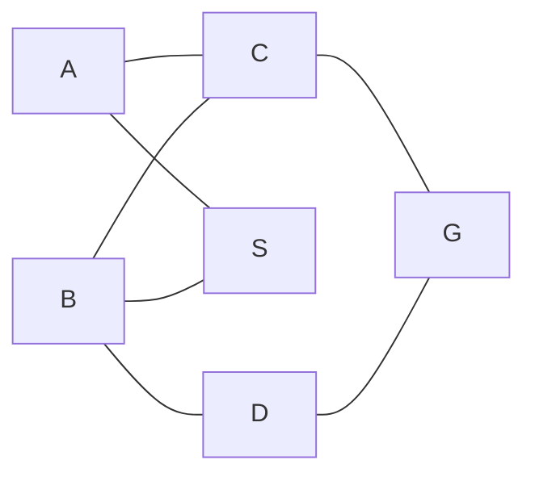
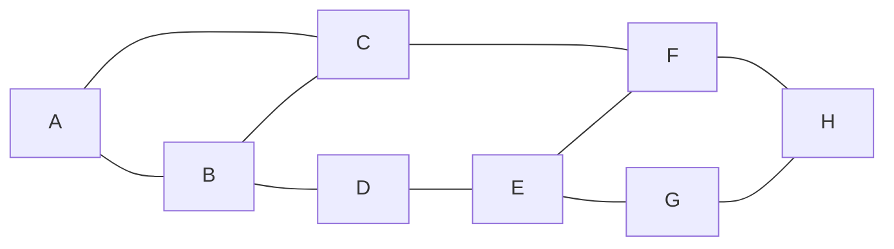

[English](README.md) | **Polski**

# Lekcja 2.6 — Iteracyjne pogłębianie

**Opcjonalna** · Wymagania: 2.5 Porównanie strategii przeszukiwania (zobacz [mapę kursu](../../../COURSE_MAP.pl.md)).

## Cele lekcji

Po tej lekcji:

- napiszesz przeszukiwanie w głąb z ograniczeniem głębokości (DLS, *depth-limited search*) i odróżnisz odcięcie od porażki;
- zbudujesz z niego iteracyjne pogłębianie (IDS, *iterative deepening search*);
- policzysz, ile pracy IDS powtarza, i wyjaśnisz, dlaczego to zaskakująco mało;
- wskażesz, kiedy IDS jest najlepszym wyborem, a kiedy przegrywa z BFS.

## Problem

W lekcji 2.5 każda strategia miała swoją słabość. BFS znajduje najkrótszą trasę, ale trzyma w pamięci całą falę: przy współczynniku rozgałęzienia 10 i celu na głębokości 10 to dziesięć miliardów węzłów. DFS potrzebuje pamięci tylko na bieżącą ścieżkę, ale może zejść w bardzo długą gałąź i znaleźć trasę daleką od najkrótszej.

Czy da się połączyć pamięć DFS z gwarancją BFS? Da się, i to bardzo prostym sposobem.

## Intuicja

Wyobraź sobie psa na smyczy, który szuka piłki w krzakach. Na krótkiej smyczy przeszuka dokładnie najbliższą okolicę. Jeśli piłki tam nie ma, wracasz i puszczasz go na smyczy dłuższej o metr. Pies za każdym razem obiega też miejsca, które już widział, ale za to nigdy nie odbiegnie dalej, niż trzeba.

Tak działa iteracyjne pogłębianie. Przeszukuje w głąb, ale z limitem głębokości. Najpierw z limitem 0, potem 1, potem 2 i tak dalej, aż znajdzie cel. Każda runda to zwykłe DFS, więc pamięć jest mała. Rundy idą w kolejności rosnącej głębokości, więc pierwszy znaleziony cel leży najpłycej, tak jak w BFS.

## Model formalny i pseudokod

### Przeszukiwanie z ograniczeniem głębokości

DLS to przeszukiwanie drzewa w głąb, które nie rozwija węzłów leżących na głębokości `limit` albo głębiej:

```text
DLS(problem, limit):
    frontier ← stos zawierający Node(problem.initial)
    wynik ← None
    dopóki frontier nie jest pusty:
        węzeł ← zdejmij OSTATNI węzeł z frontier
        jeśli problem.is_goal(węzeł.state): zwróć węzeł
        jeśli węzeł.depth ≥ limit:
            wynik ← CUTOFF                     # odcięcie: głębiej może być cel
        w przeciwnym razie, jeśli węzeł tworzy cykl: pomiń go
        w przeciwnym razie:
            połóż na frontier dzieci z expand(problem, węzeł) w ODWROTNEJ kolejności
    zwróć wynik
```

DLS ma trzy możliwe wyniki, i to jest jego najważniejsza cecha:

- **węzeł celu**: znalazł cel w granicach limitu;
- **`CUTOFF`** (odcięcie): celu nie znalazł, ale przynajmniej jeden węzeł zatrzymał się na limicie, więc głębiej cel może istnieć;
- **`None`** (porażka): celu nie znalazł i niczego nie odciął, więc celu nie ma w ogóle.

Stałą `CUTOFF` importujesz z `introai.search`.

**Cykle.** DLS nie pamięta odwiedzonych stanów, bo cała jego zaleta to mała pamięć. Sprawdza tylko, czy stan węzła nie występuje już na jego własnej ścieżce: wystarczy przejść po rodzicach. Taki węzeł tworzy cykl i nie jest rozwijany. Bez tego sprawdzania DLS w magazynie jeździłby tam i z powrotem aż do limitu.

### Iteracyjne pogłębianie

```text
IDS(problem):
    dla limit = 0, 1, 2, ...:
        wynik ← DLS(problem, limit)
        jeśli wynik ≠ CUTOFF: zwróć wynik
```

IDS kończy się, gdy DLS znajdzie cel albo zwróci `None`. To drugie oznacza, że przy tym limicie nic nie zostało odcięte, a mimo to celu nie było, więc nie ma go nigdzie.

### Ile pracy się powtarza?

Każda runda zaczyna od nowa, od korzenia. Węzły z płytkich poziomów są więc rozwijane wiele razy. Ile to kosztuje? W pełnym drzewie o współczynniku rozgałęzienia *b* z celem na głębokości *d* węzeł z głębokości *k* jest rozwijany w każdej rundzie z limitem większym niż *k*, czyli *d* − *k* razy. Na najgłębszym poziomie, gdzie jest najwięcej węzłów, IDS pracuje tylko raz.

Przykład dla *b* = 10 i *d* = 5. Liczymy węzły **wygenerowane**:

| Poziom | Węzłów na poziomie | Generacji w BFS | Generacji w IDS |
|---|---|---|---|
| 1 | 10 | 10 | 5 · 10 = 50 |
| 2 | 100 | 100 | 4 · 100 = 400 |
| 3 | 1 000 | 1 000 | 3 · 1 000 = 3 000 |
| 4 | 10 000 | 10 000 | 2 · 10 000 = 20 000 |
| 5 | 100 000 | 100 000 | 1 · 100 000 = 100 000 |
| razem | | 111 110 | 123 450 |

IDS wykonuje tylko o 11% więcej pracy niż BFS. Ogólnie stosunek dąży do *b*/(*b* − 1): dla *b* = 10 to 1,11, dla *b* = 3 to 1,5, a dla *b* = 2 to 2. Powtarza się praca na płytkich poziomach, a te są małe w porównaniu z najgłębszym.

## Prześledź ręcznie

### Przykład rozwiązany

Graf z lekcji 2.2, z `S` do `G`. Sąsiadów rozpatrujemy w kolejności alfabetycznej. Dzieci kładziemy na stos w odwrotnej kolejności, więc jako pierwsze zdejmujemy dziecko pierwszego sąsiada, tak jak w DFS z lekcji 2.2.

<!-- generated:graph example=worked_example -->

<!-- /generated -->

Każdy wiersz to jeden węzeł zdjęty ze stosu. Kolumna „Limit” mówi, w której rundzie to się dzieje:

<!-- generated:trace-table algorithm=ids example=worked_example lang=pl -->
| Krok | Limit | Zdjęty (głębokość) | Wynik | Stos (od wierzchu) |
|---|---|---|---|---|
| 1 | 0 | S (0) | odcięty | — |
| 2 | 1 | S (0) | rozwinięty | A, B |
| 3 | 1 | A (1) | odcięty | B |
| 4 | 1 | B (1) | odcięty | — |
| 5 | 2 | S (0) | rozwinięty | A, B |
| 6 | 2 | A (1) | rozwinięty | C, S, B |
| 7 | 2 | C (2) | odcięty | S, B |
| 8 | 2 | S (2) | odcięty | B |
| 9 | 2 | B (1) | rozwinięty | C, D, S |
| 10 | 2 | C (2) | odcięty | D, S |
| 11 | 2 | D (2) | odcięty | S |
| 12 | 2 | S (2) | odcięty | — |
| 13 | 3 | S (0) | rozwinięty | A, B |
| 14 | 3 | A (1) | rozwinięty | C, S, B |
| 15 | 3 | C (2) | rozwinięty | A, B, G, S, B |
| 16 | 3 | A (3) | odcięty | B, G, S, B |
| 17 | 3 | B (3) | odcięty | G, S, B |
| 18 | 3 | G (3) | cel | S, B |

Cel **G** znaleziony przy limicie 3. Ścieżka: S → A → C → G.
<!-- /generated -->

Liczba rozwinięć w kolejnych rundach to 0, 1, 3, 3. Kilka rzeczy wartych uwagi:

- **Limit 0.** Korzeń leży już na granicy, więc zostaje odcięty i DLS zwraca `CUTOFF`. IDS próbuje dalej.
- **Limit 2, wiersze 8 i 12.** `S` na głębokości 2 tworzy cykl (S → A → S), ale najpierw sprawdzamy limit, więc węzeł jest liczony jako odcięty. Reguła jest ta sama w każdej rundzie.
- **Limit 3.** DLS schodzi po S → A → C, a gdy zdejmuje `G`, test celu kończy przeszukiwanie. Trasa S → A → C → G ma 3 kroki i jest najkrótsza.

### Twoja kolej

Prześledź IDS na grafie z ćwiczenia, z `A` do `H`:

<!-- generated:graph example=exercise -->

<!-- /generated -->

Zasady są dokładnie takie jak w przykładzie. Dla każdego zdjętego węzła, w tej kolejności:

1. jeśli jest celem, przeszukiwanie się kończy;
2. jeśli jego głębokość jest równa limitowi albo większa, jest odcięty;
3. jeśli jego stan występuje już wśród przodków, jest cyklem i nie jest rozwijany;
4. w przeciwnym razie jest rozwijany, a jego dzieci trafiają na stos w odwrotnej kolejności alfabetycznej.

Wpisz w części A pliku `task.py` listę `IDS_EXPANSIONS_PER_ITERATION`: ile węzłów DLS rozwija przy limicie 0, 1, 2 i tak dalej, aż do rundy, w której IDS znajduje cel.

## Własności

Oznaczenia: *b* to współczynnik rozgałęzienia, *d* to głębokość najpłytszego celu.

| | IDS |
|---|---|
| Zupełność | tak, jeśli *b* jest skończone |
| Optymalność | tak, jeśli każdy krok kosztuje tyle samo |
| Czas | O(*b*<sup>*d*</sup>) |
| Pamięć | O(*b*·*d*) |

**Kiedy IDS jest najlepszym wyborem?** Gdy przestrzeń stanów jest duża, głębokość celu nieznana, a kroki kosztują tyle samo. Russell i Norvig piszą wprost, że w takiej sytuacji iteracyjne pogłębianie jest preferowaną metodą przeszukiwania bez informacji.

**Ograniczenia.** IDS sprawdza cykle tylko na bieżącej ścieżce, więc ścieżki nadmiarowe z lekcji 2.1 bada za każdym razem od nowa. W drzewie to nie szkodzi, ale w siatce magazynu dróg bez powtórzeń jest bardzo dużo i IDS rozwija wielokrotnie więcej węzłów niż BFS. Przy różnych kosztach kroków IDS traci optymalność. Wtedy można zamiast głębokości ograniczać koszt ścieżki, co daje iteracyjne wydłużanie (*iterative lengthening*), albo zastosować IDA\*, czyli iteracyjne pogłębianie z limitem na *f* = *g* + *h*.

## Częste błędy

1. **Brak sprawdzania cykli.** DLS bez sprawdzania cykli na grafie bez celu zawsze dochodzi do limitu i zwraca `CUTOFF`, więc IDS nigdy się nie kończy.
2. **Odcięcie zgłoszone jako porażka.** Gdy DLS zwraca `None` zamiast `CUTOFF`, IDS po pierwszej rundzie uznaje, że celu nie ma, i się poddaje.
3. **Błąd o jeden na granicy limitu.** Warunek `depth > limit` zamiast `depth >= limit` rozwija także węzły na samej granicy. DLS sięga wtedy o poziom głębiej, niż obiecuje limit.

Testy lekcji wykrywają każdy z tych błędów.

## Zadanie

### Część A: liczenie rozwinięć

Wypełnij w `task.py` listę `IDS_EXPANSIONS_PER_ITERATION` dla grafu z sekcji „Twoja kolej”.

### Część B: implementacja

Zaimplementuj w `task.py` dwie funkcje:

- `depth_limited_search(problem, limit)` zwraca węzeł celu, `CUTOFF` albo `None`. Nie rozwija węzłów na głębokości `limit` ani głębiej, a także węzłów, których stan występuje już na ich ścieżce;
- `iterative_deepening_search(problem)` wywołuje DLS z limitami 0, 1, 2, … i zwraca pierwszy wynik, który nie jest `CUTOFF`.

Dzieci generujesz wyłącznie funkcją `expand(problem, node)`. DLS możesz napisać ze stosem albo rekurencyjnie; testy przyjmą obie wersje. `task.py` nie importuje `introai.search.reference`.

### Jak sprawdzić

Z głównego katalogu repozytorium:

```bash
uv run pytest modules/02_search/06_iterative_deepening
```

Komunikaty błędów mówią, która własność jest złamana i na jakim przykładzie.

### Kryteria akceptacji

- Wszystkie testy lekcji przechodzą.
- Potrafisz odpowiedzieć na pytania kontrolne, zanim zajrzysz do odpowiedzi.

## Czego testy nie sprawdzają

- **Zrozumienia.** Przechodzące testy nie dowodzą, że wiesz, dlaczego powtórzona praca jest tania.
- **Konkretnej kolejności w rundzie.** Testy sprawdzają wyniki, limit, cykle, najkrótszą trasę i łączną liczbę rozwinięć na drzewie bez cykli. Zasady z części A obowiązują tylko przy ręcznym śledzeniu.
- **Pamięci.** Test nie mierzy, ile pamięci zużywa Twoja wersja. Gdybyś po cichu pamiętał wszystkie odwiedzone stany, IDS straciłby swoją główną zaletę.
- **Obejścia zakazu importu.** Test wykrywa zwykły import `introai.search.reference`, ale nie każdą sztuczkę.

## Eksperymenty

Otwórz [experiments.pl.ipynb](experiments.pl.ipynb). Przed każdym eksperymentem zapisz swoje przewidywanie, a potem je sprawdź:

1. Na pełnych drzewach o współczynniku rozgałęzienia 2, 3 i 4: ile razy więcej węzłów rozwija IDS niż BFS? Ile węzłów trzyma w pamięci każdy z nich?
2. Na mapach magazynu: ile węzłów rozwija IDS w porównaniu z BFS? Na której mapie różnica jest największa i dlaczego?

## Pytania kontrolne

1. Czym różni się wynik `CUTOFF` od `None`? Co by się stało, gdyby DLS zwracał w obu przypadkach to samo?
2. Dlaczego IDS znajduje najkrótszą trasę, choć w każdej rundzie przeszukuje w głąb?
3. Dlaczego powtarzanie płytkich poziomów kosztuje tak mało? Policz stosunek pracy IDS do BFS dla *b* = 2.
4. Dlaczego IDS rozwija w magazynie dużo więcej węzłów niż BFS, choć na drzewie tylko trochę więcej?
5. Ile pamięci potrzebuje IDS, a ile BFS, gdy *b* = 10, a cel leży na głębokości 10?

## Jeśli utkniesz

<details>
<summary>Podpowiedź 1: od czego zacząć</summary>

Zacznij od DFS z lekcji 2.2, ale bez zbioru rozwiniętych stanów. Dodaj zmienną `wynik = None` i trzy warunki dla zdjętego węzła: test celu, limit, cykl. Kolejność tych warunków jest ważna.

</details>

<details>
<summary>Podpowiedź 2: jak sprawdzić cykl</summary>

Przejdź od rodzica węzła w górę, po `parent`, aż do korzenia. Jeśli któryś przodek ma ten sam stan co węzeł, to jest cykl. Możesz też użyć `node.states()` i sprawdzić, czy stan węzła występuje wśród poprzednich elementów.

</details>

<details>
<summary>Podpowiedź 3: IDS nigdy się nie kończy</summary>

Sprawdź dwie rzeczy. Czy DLS zwraca `None`, gdy przy danym limicie nic nie zostało odcięte? Czy sprawdzasz cykle? Bez tego na grafie z cyklami zawsze coś zostaje odcięte.

</details>

## Co zapamiętać

- DLS to DFS z limitem głębokości. Ma trzy wyniki: cel, `CUTOFF` (cel może być głębiej) i `None` (celu nie ma).
- IDS uruchamia DLS z limitami 0, 1, 2, … i łączy pamięć DFS, O(*b*·*d*), z zupełnością i optymalnością BFS przy jednakowych kosztach.
- Powtórzona praca kosztuje niewiele, około *b*/(*b* − 1) razy więcej niż BFS, bo najwięcej węzłów leży na najgłębszym poziomie.
- IDS sprawdza tylko cykle na bieżącej ścieżce, więc w przestrzeniach z wieloma ścieżkami nadmiarowymi przegrywa z BFS.

## Co dalej

- Po własnej próbie porównaj się z rozwiązaniem i odpowiedziami w [solutions/02_search/06_iterative_deepening/](../../../solutions/02_search/06_iterative_deepening/).
- Lekcja 2.7 wraca do heurystyk i pokazuje, jak je projektować.

## Bibliografia

- S. Russell, P. Norvig, *Artificial Intelligence: A Modern Approach*, 4th ed., Pearson, 2020, rozdz. 3.4.4–3.4.5 (przeszukiwanie z ograniczeniem głębokości i iteracyjne pogłębianie).
- R. E. Korf, *Depth-first iterative-deepening: An optimal admissible tree search*, Artificial Intelligence 27(1), 1985, s. 97–109.
