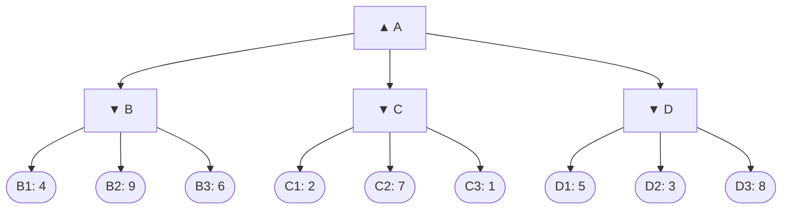
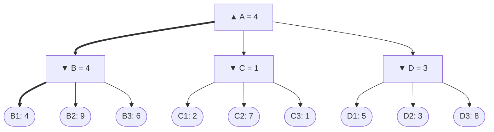
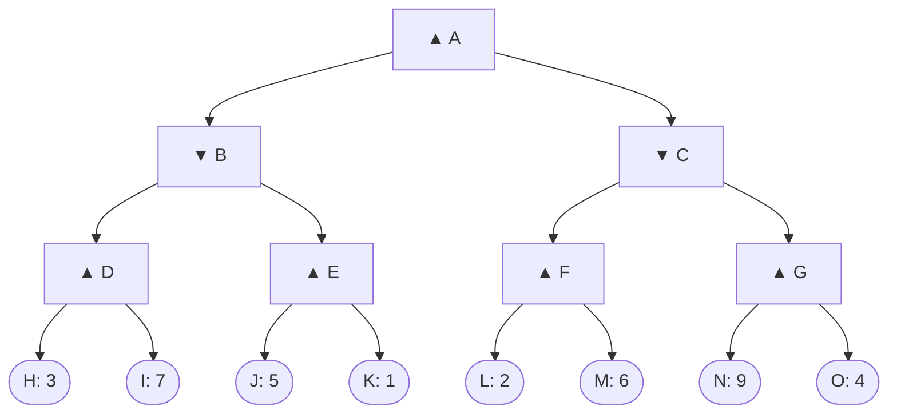

**English** | [Polski](README.pl.md)

# Lesson 3.1 — Games and minimax

**Core** · Prerequisites: 2.5 Comparing search strategies (see the [course map](../../../COURSE_MAP.md)).

## Learning goals

After this lesson you will be able to:

- describe a game as a search problem with six functions;
- compute minimax values by hand in a small game tree;
- write `minimax_search`, which plays tic-tac-toe without a single mistake;
- explain why minimax plays optimally and why it is too slow for chess.

## The problem

In module 2 the agent was alone in its world. The robot planned a route, and the warehouse did not try to get in its way. A game is different. After each of your moves the opponent moves, and the opponent wants to win, which means wanting you to lose. A plan like "first here, then there" is not enough, because you do not know what the other side will do.

You need a strategy: an answer to every possible move of the opponent. How do you find one? And how do you choose the best move when its worth depends on how the opponent replies?

## Intuition

Play a game of tic-tac-toe in your head. Before you place a cross, you check: "if I put it here, the opponent puts a nought there, and then…". You assume the opponent replies as well as they can. A move after which a good opponent can beat you is a bad move, even if a weak opponent would not notice.

Minimax does the same, only systematically and all the way to the end of the game. It writes out every possible game, scores the final positions and works its way back up. Where the opponent moves, it assumes the result that is worst for us; where we move, the best one.

## Formal model and pseudocode

### A game as a search problem

This module deals with games of two players who take turns. Both see the whole board, so they have **perfect information**, and there is no chance in the game. One player's win is the other's loss, so it is a **zero-sum game**. Tic-tac-toe, draughts, chess and go meet all these conditions.

Such a game is described by six elements (Russell and Norvig):

| Element | In the package `introai.games` | Meaning |
|---|---|---|
| *S*₀ | `game.initial` | the initial state |
| TO-MOVE(*s*) | `game.to_move(state)` | the player whose turn it is in *s* |
| ACTIONS(*s*) | `game.actions(state)` | the legal moves in *s* |
| RESULT(*s*, *a*) | `game.result(state, action)` | the state after move *a*: the transition model |
| IS-TERMINAL(*s*) | `game.is_terminal(state)` | whether the game is over |
| UTILITY(*s*, *p*) | `game.utility(state, player)` | the final score of player *p* |

In tic-tac-toe (`TIC_TAC_TOE` from `introai.games`) a state is a tuple of three rows, for example `("X..", ".O.", "...")`. A move is the `(row, col)` of an empty cell, and X starts. The winner gets +1, the loser −1, and in a draw both get 0. The scores of the two players always add up to zero.

You will run the same search function on the small trees of this lesson (`GameTree`). There a state is the name of a node and a move is the name of a child. The players are called `"MAX"` and `"MIN"`. The number at a leaf is MAX's score; MIN's score is the same number with a minus sign.

### The game tree

The initial state together with ACTIONS and RESULT defines the **game tree**. Nodes are states, edges are moves, leaves are terminal states. We call the players MAX and MIN. MAX moves at the root and wants the score as high as possible. MIN wants it as low as possible. In the drawings a MAX node is marked ▲ and a MIN node ▼.

One level of the tree is one move by one player, called a ply. A game of tic-tac-toe lasts at most 9 plies, and its game tree has 549,946 nodes.

### The minimax value

The **minimax value** of a state is the score MAX gets if both players play optimally from that state on:

$$
\text{MINIMAX}(s) =
\begin{cases}
\text{UTILITY}(s, \text{MAX}) & \text{if } s \text{ is terminal,} \\
\max_{a} \text{MINIMAX}(\text{RESULT}(s, a)) & \text{if MAX is to move,} \\
\min_{a} \text{MINIMAX}(\text{RESULT}(s, a)) & \text{if MIN is to move.}
\end{cases}
$$

It is computed bottom up: first the leaves, then their parents, and so on up to the root. MAX's optimal move at the root leads to the child with the largest value.

### Pseudocode

```text
MINIMAX-SEARCH(game, state):
    player ← game.to_move(state)
    return MAX-VALUE(state)

MAX-VALUE(s):
    if game.is_terminal(s): return (game.utility(s, player), no move)
    v ← −∞
    for each a in game.actions(s):
        v2 ← the value returned by MIN-VALUE(game.result(s, a))
        if v2 > v: v, move ← v2, a
    return (v, move)

MIN-VALUE(s):
    the same as MAX-VALUE, but v ← +∞, children go through MAX-VALUE, and the test is v2 < v
```

The tests follow two conventions:

- **The value is for the player to move.** `minimax_search(game, state)` computes the value for the player whose turn it is in `state`. That player is MAX here. If O is to move, a value of +1 means O will win. So every leaf is scored with `game.utility(leaf, player)` for the same `player`, not for the player who would move at the leaf.
- **The result is a pair `(value, move)`.** If the game in `state` is already over, there is no move. Return `(utility, None)`.

When several moves have the same value, the pseudocode keeps the first of them. The tests accept any optimal move, though.

## Trace it by hand

### Worked example

The tree has two plies. MAX chooses one of three moves, and MIN replies with one of three. The number at a leaf is MAX's score.

<!-- generated:game-tree example=worked_tree -->

<!-- /generated -->

At node B it is MIN's move, so MIN picks the smallest of 4, 9 and 6, which is 4. At C it picks 1, and at D it picks 3. MAX at the root takes the largest of the values 4, 1 and 3. The minimax value of the root is therefore 4, and the optimal move leads to B. The thick edges show the game in which both players play optimally:

<!-- generated:game-tree example=worked_tree values=minimax -->

<!-- /generated -->

Look at the leaves B2 = 9 and D3 = 8. They are the largest numbers in the tree, but MAX will not get them, because MIN never plays the move that leads there.

### Your turn

This tree has three plies: MAX moves, then MIN, then MAX again.

<!-- generated:game-tree example=minimax_exercise -->

<!-- /generated -->

In Part A of `task.py`, write the minimax values of the nodes A to G (the dictionary `MINIMAX_VALUES`, MAX's scores) and MAX's move at the root (`BEST_MOVE`).

## Properties

Notation: *b* is the number of legal moves in a state (the branching factor), *m* the maximum depth of the tree.

| | Minimax |
|---|---|
| Complete | yes, if the game tree is finite |
| Optimal | yes, against an optimal opponent |
| Time | O(*b*<sup>*m*</sup>) |
| Space | O(*b*·*m*), because it searches depth-first |

**Optimal against whom?** Minimax assumes the opponent plays as well as possible. Against a weaker opponent it always gets at least the minimax value, so it does not lose unless it has to. But it cannot count on the opponent's mistakes. It does not tell apart a move after which a draw is certain from a move after which a perfect opponent also draws but a weak one easily goes wrong. Both moves are worth 0.

**Time.** Minimax walks the whole game tree. In tic-tac-toe that is 549,946 nodes, about two seconds on a laptop. In chess a position has about 35 legal moves on average, and a game often lasts 50 moves by each player. The tree therefore has about 35<sup>100</sup> ≈ 10<sup>154</sup> nodes, and no computer will ever walk it. Lessons 3.2 and 3.3 show how to cope.

**Positions repeat.** Many move orders lead to the same position. A cross in a corner and a nought in the centre is the same board whatever order they were placed in. The tic-tac-toe tree has 549,946 nodes but only 5,478 distinct positions. It is the same situation as the redundant paths of lesson 2.1, with the same cure: remember the positions already solved. In games such a dictionary is called a transposition table.

## Common mistakes

1. **MAX everywhere.** The function takes the largest value at every level, as if the opponent played for us. Such a player counts on moves the opponent will never make.
2. **Whose utility?** A leaf is scored with `game.utility(leaf, game.to_move(leaf))`, for the player who would move at the leaf instead of the player at the root. Some leaves then get the wrong sign.
3. **Looking one move ahead.** The function only checks whether some move wins at once, and treats every other position as a draw. It misses a win that takes two or three moves.
4. **The value without the move.** The function computes the value correctly, but returns the first legal move instead of the one that achieves the value.

The lesson's tests catch each of these mistakes.

## Task

### Part A: minimax by hand

Fill in the dictionary `MINIMAX_VALUES` and the constant `BEST_MOVE` in `task.py` for the tree in "Your turn".

### Part B: implementation

Implement `minimax_search(game, state)` in `task.py`. It returns a pair `(value, move)`: the value of the state for the player to move there, and the move that achieves it. If the game is already over, the move is `None`.

Use only the game's functions: `to_move`, `actions`, `result`, `is_terminal` and `utility`. The same function must work for tic-tac-toe and for the trees of the lesson. You can write it as in the pseudocode, with two helper functions, or your own way. The tests check results, not the way the code is written. `task.py` does not import `introai.games.reference`.

### How to check

From the repository root:

```bash
uv run pytest modules/03_games_and_csp/01_minimax
```

The failure messages say which property is broken and in which position.

### Acceptance criteria

- All the lesson's tests pass.
- You can answer the review questions before looking at the answers.

## What the tests do not check

- **Understanding.** Passing tests do not prove you can explain why a move is optimal.
- **The choice between equally good moves.** The tests accept any optimal move.
- **Speed.** The tests run your function on small trees and on positions close to the end of the game. You measure the time for the whole tree yourself, in the notebook.
- **Ways around the import ban.** The test detects a plain import of `introai.games.reference`, not every trick.

## Experiments

Open [experiments.ipynb](experiments.ipynb). Before each experiment write down your prediction, then check it:

1. How many positions does your minimax visit when it looks for the first move on the empty board, and how long does it take? How many of those positions are distinct, and how much work does remembering solved positions save?
2. How many nodes does the game tree have at each level, and from which ply does their number start to fall?
3. How do games of minimax against minimax end, and how do games against a random player end?

## Review questions

1. Why do we take the smallest value at a MIN node when the numbers in the tree are MAX's scores?
2. What does the minimax value 0 of the empty tic-tac-toe board tell you?
3. A position is worth +1 to the player to move. What is it worth to the opponent, and why?
4. Minimax plays against an opponent who picks moves at random. Can it lose? Does it win every time a win is possible?
5. How many nodes does a game tree with branching factor 35 and depth 4 have? And with depth 100?

## If you get stuck

<details>
<summary>Hint 1: where to start</summary>

Start with the terminal state: if `game.is_terminal(state)`, return `(game.utility(state, player), None)`. Then write two helper functions, as in the pseudocode. Each returns a pair `(value, move)`; `max_value` computes the children with `min_value`, and `min_value` with `max_value`.

</details>

<details>
<summary>Hint 2: where the player comes from</summary>

Fix the player once, at the very start: `player = game.to_move(state)`. Helper functions defined inside `minimax_search` can see this variable. Score every leaf for the same player.

</details>

<details>
<summary>Hint 3: the value is right but the move is not</summary>

Remember the move at the same moment you improve the best value: `if v2 > v: v, move = v2, a`.

</details>

## Key takeaways

- A two-player zero-sum game with perfect information is a search problem described by six functions: `initial`, `to_move`, `actions`, `result`, `is_terminal` and `utility`.
- The minimax value is the result when both sides play optimally. MAX takes the largest value of the children, MIN the smallest.
- Minimax plays optimally but walks the whole game tree: time O(*b*<sup>*m*</sup>), space O(*b*·*m*).
- A value is always given from the point of view of the player to move.

## What next

- After your own attempt, compare with the solution and answers in [solutions/03_games_and_csp/01_minimax/](../../../solutions/03_games_and_csp/01_minimax/).
- Lesson 3.2 shows how to reach the same result while looking at only part of the tree.

## References

- S. Russell, P. Norvig, *Artificial Intelligence: A Modern Approach*, 4th ed., Pearson, 2020, sections 5.1–5.2 (games and minimax decisions).
- J. von Neumann, *Zur Theorie der Gesellschaftsspiele*, Mathematische Annalen 100, 1928, pp. 295–320.
