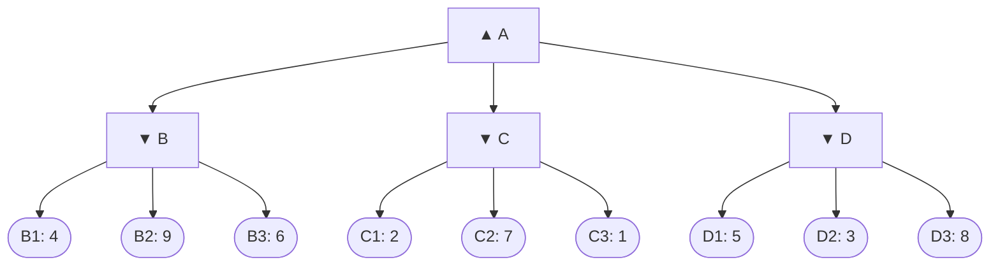
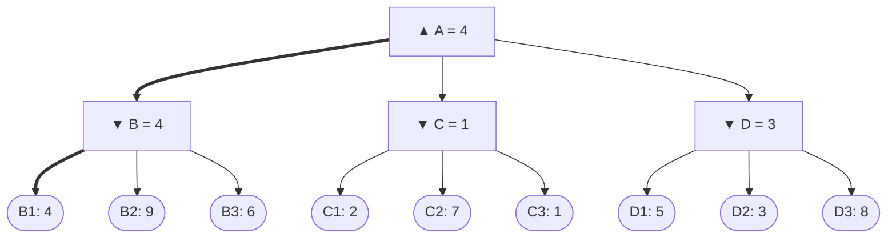
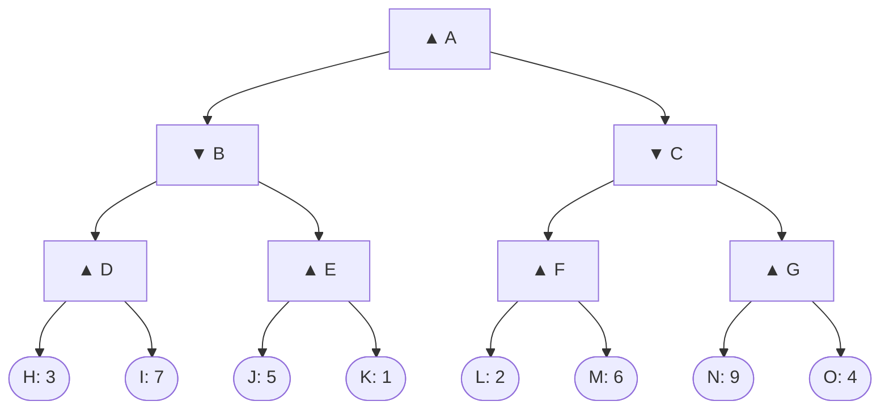

[English](README.md) | **Polski**

# Lekcja 3.1 — Gry i minimax

**Core** · Wymagania: 2.5 Porównanie strategii przeszukiwania (zobacz [mapę kursu](../../../COURSE_MAP.pl.md)).

## Cele lekcji

Po tej lekcji:

- opiszesz grę jako problem przeszukiwania za pomocą sześciu funkcji;
- policzysz ręcznie wartości minimaksowe w małym drzewie gry;
- napiszesz `minimax_search`, który bezbłędnie gra w kółko i krzyżyk;
- wyjaśnisz, dlaczego minimax gra optymalnie i dlaczego do szachów jest za wolny.

## Problem

W module 2 agent był w świecie sam. Robot planował trasę, a magazyn nie próbował mu przeszkadzać. W grze jest inaczej. Po każdym Twoim ruchu ruch wykonuje przeciwnik, a on chce wygrać, czyli chce, żebyś Ty przegrał. Plan „najpierw tu, potem tam” nie wystarczy, bo nie wiesz, co zrobi druga strona.

Potrzebujesz strategii, czyli odpowiedzi na każdy możliwy ruch przeciwnika. Jak ją znaleźć? I jak wybrać najlepszy ruch, skoro to, ile jest wart, zależy od odpowiedzi przeciwnika?

## Intuicja

Zagraj w myślach w kółko i krzyżyk. Zanim postawisz krzyżyk, sprawdzasz: „jeśli postawię tutaj, przeciwnik postawi kółko tam, a wtedy…”. Zakładasz przy tym, że przeciwnik odpowie najlepiej, jak potrafi. Ruch, po którym dobry przeciwnik może Cię pokonać, jest zły, nawet jeśli słaby przeciwnik by tego nie zauważył.

Minimax robi to samo, tylko systematycznie i do samego końca gry. Rozpisuje wszystkie możliwe partie, ocenia pozycje końcowe i cofa się w górę. Tam, gdzie ruch ma przeciwnik, przyjmuje wynik najgorszy dla nas, a tam, gdzie ruch mamy my, najlepszy.

## Model formalny i pseudokod

### Gra jako problem przeszukiwania

W tym module zajmujemy się grami dwóch graczy, którzy wykonują ruchy na zmianę. Obaj widzą całą planszę, czyli mają **pełną informację** (*perfect information*), a w grze nie ma losowości. Wygrana jednego gracza jest przegraną drugiego, więc to **gra o sumie zerowej** (*zero-sum game*). Kółko i krzyżyk, warcaby, szachy i go spełniają wszystkie te warunki.

Taką grę opisuje sześć elementów (Russell i Norvig):

| Element | W pakiecie `introai.games` | Znaczenie |
|---|---|---|
| *S*₀ | `game.initial` | stan początkowy |
| TO-MOVE(*s*) | `game.to_move(state)` | gracz, który ma ruch w stanie *s* |
| ACTIONS(*s*) | `game.actions(state)` | ruchy dozwolone w stanie *s* |
| RESULT(*s*, *a*) | `game.result(state, action)` | stan po ruchu *a*, czyli model przejść |
| IS-TERMINAL(*s*) | `game.is_terminal(state)` | czy gra się skończyła |
| UTILITY(*s*, *p*) | `game.utility(state, player)` | wynik końcowy gracza *p* |

W kółku i krzyżyku (`TIC_TAC_TOE` z `introai.games`) stan to krotka trzech wierszy, np. `("X..", ".O.", "...")`. Ruch to para `(wiersz, kolumna)` wolnego pola, a zaczyna X. Zwycięzca dostaje +1, przegrany −1, a przy remisie obaj dostają 0. Wyniki obu graczy zawsze sumują się do zera.

Tę samą funkcję przeszukiwania uruchomisz na małych drzewach z tej lekcji (`GameTree`). Stanem jest tam nazwa węzła, a ruchem nazwa dziecka. Gracze nazywają się `"MAX"` i `"MIN"`. Liczba przy liściu to wynik MAX, a wynik MIN to ta sama liczba ze znakiem minus.

### Drzewo gry

Stan początkowy razem z funkcjami ACTIONS i RESULT wyznacza **drzewo gry**. Węzły to stany, krawędzie to ruchy, a liście to stany końcowe. Graczy nazywamy MAX i MIN. MAX ma ruch w korzeniu i chce, żeby wynik był jak największy. MIN chce, żeby był jak najmniejszy. Na rysunkach węzeł MAX oznaczamy ▲, a węzeł MIN ▼.

Jeden poziom drzewa to jeden ruch jednego gracza, czyli półruch (*ply*). Partia kółka i krzyżyka trwa najwyżej 9 półruchów, a jej drzewo gry ma 549 946 węzłów.

### Wartość minimaksowa

**Wartość minimaksowa** stanu to wynik, który MAX osiągnie, jeśli od tego stanu obaj gracze grają optymalnie:

$$
\text{MINIMAX}(s) =
\begin{cases}
\text{UTILITY}(s, \text{MAX}) & \text{gdy } s \text{ jest stanem końcowym,} \\
\max_{a} \text{MINIMAX}(\text{RESULT}(s, a)) & \text{gdy ruch ma MAX,} \\
\min_{a} \text{MINIMAX}(\text{RESULT}(s, a)) & \text{gdy ruch ma MIN.}
\end{cases}
$$

Liczy się ją od dołu: najpierw liście, potem ich rodzice i tak aż do korzenia. Optymalny ruch MAX w korzeniu prowadzi do dziecka o największej wartości.

### Pseudokod

```text
MINIMAX-SEARCH(game, state):
    player ← game.to_move(state)
    zwróć MAX-VALUE(state)

MAX-VALUE(s):
    jeśli game.is_terminal(s): zwróć (game.utility(s, player), brak ruchu)
    v ← −∞
    dla każdego a w game.actions(s):
        v2 ← wartość zwrócona przez MIN-VALUE(game.result(s, a))
        jeśli v2 > v: v, ruch ← v2, a
    zwróć (v, ruch)

MIN-VALUE(s):
    tak samo jak MAX-VALUE, ale v ← +∞, dzieci liczy MAX-VALUE, a warunek to v2 < v
```

Testy trzymają się dwóch konwencji:

- **Wartość dla gracza, który ma ruch.** `minimax_search(game, state)` liczy wartość dla gracza, który ma ruch w `state`. To on jest tu MAX. Jeśli ruch ma O, wartość +1 oznacza, że wygra O. Każdy liść ocenia więc `game.utility(liść, player)` z tym samym `player`, a nie z graczem, który miałby ruch w liściu.
- **Wynik to para `(wartość, ruch)`.** Jeśli gra w `state` już się skończyła, nie ma żadnego ruchu. Zwróć wtedy `(użyteczność, None)`.

Gdy kilka ruchów ma tę samą wartość, pseudokod zostawia pierwszy z nich. Testy przyjmą jednak każdy ruch optymalny.

## Prześledź ręcznie

### Przykład rozwiązany

Drzewo ma dwa półruchy. MAX wybiera jeden z trzech ruchów, a MIN odpowiada jednym z trzech. Liczba przy liściu to wynik MAX.

<!-- generated:game-tree example=worked_tree -->

<!-- /generated -->

W węźle B ruch ma MIN, więc wybiera najmniejszą z liczb 4, 9 i 6, czyli 4. W C wybiera 1, a w D wybiera 3. MAX w korzeniu bierze największą z wartości 4, 1 i 3. Wartość minimaksowa korzenia wynosi więc 4, a optymalny ruch prowadzi do B. Pogrubione krawędzie pokazują partię, w której obaj gracze grają optymalnie:

<!-- generated:game-tree example=worked_tree values=minimax -->

<!-- /generated -->

Spójrz na liście B2 = 9 i D3 = 8. To największe liczby w drzewie, ale MAX ich nie dostanie, bo MIN nigdy nie zagra ruchu, który do nich prowadzi.

### Twoja kolej

To drzewo ma trzy półruchy: ruch ma MAX, potem MIN i znowu MAX.

<!-- generated:game-tree example=minimax_exercise -->

<!-- /generated -->

Wpisz w części A pliku `task.py` wartości minimaksowe węzłów od A do G (słownik `MINIMAX_VALUES`, wyniki MAX) i ruch MAX w korzeniu (`BEST_MOVE`).

## Własności

Oznaczenia: *b* to liczba ruchów dozwolonych w stanie (współczynnik rozgałęzienia), *m* to największa głębokość drzewa.

| | Minimax |
|---|---|
| Kompletność | tak, jeśli drzewo gry jest skończone |
| Optymalność | tak, przeciw optymalnemu przeciwnikowi |
| Czas | O(*b*<sup>*m*</sup>) |
| Pamięć | O(*b*·*m*), bo przeszukuje w głąb |

**Optymalność przeciw komu?** Minimax zakłada, że przeciwnik gra najlepiej, jak się da. Przeciw słabszemu przeciwnikowi zawsze osiągnie co najmniej wartość minimaksową, więc nie przegra, jeśli nie musi. Nie potrafi jednak liczyć na błędy przeciwnika. Nie odróżnia ruchu, po którym remis jest pewny, od ruchu, po którym idealny przeciwnik też zremisuje, ale słaby łatwo się pomyli. Oba ruchy mają wartość 0.

**Czas.** Minimax przechodzi całe drzewo gry. W kółku i krzyżyku to 549 946 węzłów, co na laptopie zajmuje około dwóch sekund. W szachach w każdej pozycji jest średnio około 35 dozwolonych ruchów, a partia często trwa po 50 ruchów każdego gracza. Drzewo ma więc około 35<sup>100</sup> ≈ 10<sup>154</sup> węzłów i nie przejdzie go żaden komputer. Lekcje 3.2 i 3.3 pokazują, jak sobie z tym poradzić.

**Pozycje się powtarzają.** Do tej samej pozycji prowadzi wiele kolejności ruchów. Krzyżyk w rogu i kółko w środku to ta sama plansza, niezależnie od tego, w jakiej kolejności je postawiono. Drzewo kółka i krzyżyka ma 549 946 węzłów, ale tylko 5 478 różnych pozycji. To ta sama sytuacja co ścieżki nadmiarowe z lekcji 2.1 i to samo lekarstwo: zapamiętywać pozycje już policzone. W grach taki słownik nazywa się tablicą transpozycji (*transposition table*).

## Częste błędy

1. **MAX wszędzie.** Funkcja na każdym poziomie wybiera największą wartość, jakby przeciwnik grał dla nas. Taki gracz liczy na ruchy, których przeciwnik nigdy nie zrobi.
2. **Czyja użyteczność?** Liść jest oceniany przez `game.utility(liść, game.to_move(liść))`, czyli dla gracza, który miałby ruch w liściu, zamiast dla gracza z korzenia. Część liści dostaje wtedy zły znak.
3. **Patrzenie tylko o jeden ruch do przodu.** Funkcja sprawdza jedynie, czy któryś ruch od razu wygrywa, a każdą inną pozycję uznaje za remis. Nie widzi wygranej, do której potrzeba dwóch albo trzech ruchów.
4. **Wartość bez ruchu.** Funkcja dobrze liczy wartość, ale zwraca pierwszy dozwolony ruch zamiast tego, który tę wartość daje.

Testy lekcji wykrywają każdy z tych błędów.

## Zadanie

### Część A: minimax ręcznie

Wypełnij w `task.py` słownik `MINIMAX_VALUES` i stałą `BEST_MOVE` dla drzewa z sekcji „Twoja kolej”.

### Część B: implementacja

Zaimplementuj w `task.py` funkcję `minimax_search(game, state)`. Zwraca ona parę `(wartość, ruch)`: wartość stanu dla gracza, który ma w nim ruch, i ruch, który tę wartość daje. Jeśli gra już się skończyła, ruch to `None`.

Korzystaj tylko z funkcji gry: `to_move`, `actions`, `result`, `is_terminal` i `utility`. Ta sama funkcja ma działać dla kółka i krzyżyka oraz dla drzew z lekcji. Możesz ją napisać tak jak w pseudokodzie, z dwiema funkcjami pomocniczymi, albo po swojemu. Testy sprawdzają wyniki, a nie sposób zapisu. `task.py` nie importuje `introai.games.reference`.

### Jak sprawdzić

Z głównego katalogu repozytorium:

```bash
uv run pytest modules/03_games_and_csp/01_minimax
```

Komunikaty błędów mówią, która własność jest złamana i w jakiej pozycji.

### Kryteria akceptacji

- Wszystkie testy lekcji przechodzą.
- Potrafisz odpowiedzieć na pytania kontrolne, zanim zajrzysz do odpowiedzi.

## Czego testy nie sprawdzają

- **Zrozumienia.** Przechodzące testy nie dowodzą, że umiesz wyjaśnić, dlaczego dany ruch jest optymalny.
- **Wyboru między równie dobrymi ruchami.** Testy przyjmują każdy ruch optymalny.
- **Szybkości.** Testy uruchamiają Twoją funkcję na małych drzewach i na pozycjach bliskich końca gry. Czas przeszukania całego drzewa zmierzysz sam w notebooku.
- **Obejścia zakazu importu.** Test wykrywa zwykły import `introai.games.reference`, ale nie każdą sztuczkę.

## Eksperymenty

Otwórz [experiments.pl.ipynb](experiments.pl.ipynb). Przed każdym eksperymentem zapisz swoje przewidywanie, a potem je sprawdź:

1. Ile pozycji odwiedza Twój minimax, gdy szuka pierwszego ruchu na pustej planszy, i ile to trwa? Ile z tych pozycji jest różnych i ile pracy oszczędza zapamiętywanie policzonych pozycji?
2. Ile węzłów ma drzewo gry na każdym poziomie i od którego półruchu ich liczba zaczyna maleć?
3. Jak kończą się partie minimaksu z minimaksem, a jak z graczem losowym?

## Pytania kontrolne

1. Dlaczego w węźle MIN wybieramy najmniejszą wartość, skoro liczby w drzewie to wyniki MAX?
2. Co mówi wartość minimaksowa 0 pustej planszy kółka i krzyżyka?
3. Pozycja ma wartość +1 dla gracza, który ma ruch. Ile jest warta dla jego przeciwnika i dlaczego?
4. Minimax gra z przeciwnikiem, który wybiera ruchy losowo. Czy może przegrać? Czy wygrywa za każdym razem, kiedy się da?
5. Ile węzłów ma drzewo gry o współczynniku rozgałęzienia 35 i głębokości 4? A przy głębokości 100?

## Jeśli utkniesz

<details>
<summary>Podpowiedź 1: od czego zacząć</summary>

Zacznij od stanu końcowego: jeśli `game.is_terminal(state)`, zwróć `(game.utility(state, player), None)`. Potem napisz dwie funkcje pomocnicze, tak jak w pseudokodzie. Każda zwraca parę `(wartość, ruch)`, przy czym `max_value` liczy dzieci przez `min_value`, a `min_value` przez `max_value`.

</details>

<details>
<summary>Podpowiedź 2: skąd wziąć gracza</summary>

Ustal gracza raz, na samym początku: `player = game.to_move(state)`. Funkcje pomocnicze zdefiniowane wewnątrz `minimax_search` widzą tę zmienną. Każdy liść oceniaj dla tego samego gracza.

</details>

<details>
<summary>Podpowiedź 3: wartość się zgadza, a ruch nie</summary>

Zapamiętuj ruch w tej samej chwili, w której poprawiasz najlepszą wartość: `if v2 > v: v, move = v2, a`.

</details>

## Co zapamiętać

- Dwuosobowa gra o sumie zerowej z pełną informacją to problem przeszukiwania opisany sześcioma funkcjami: `initial`, `to_move`, `actions`, `result`, `is_terminal` i `utility`.
- Wartość minimaksowa to wynik przy optymalnej grze obu stron. MAX bierze największą wartość dzieci, a MIN najmniejszą.
- Minimax gra optymalnie, ale przechodzi całe drzewo gry: czas O(*b*<sup>*m*</sup>), pamięć O(*b*·*m*).
- Wartość zawsze podajemy z perspektywy gracza, który ma ruch.

## Co dalej

- Po własnej próbie porównaj się z rozwiązaniem i odpowiedziami w [solutions/03_games_and_csp/01_minimax/](../../../solutions/03_games_and_csp/01_minimax/).
- Lekcja 3.2 pokazuje, jak dojść do tego samego wyniku, oglądając tylko część drzewa.

## Bibliografia

- S. Russell, P. Norvig, *Artificial Intelligence: A Modern Approach*, 4th ed., Pearson, 2020, rozdz. 5.1–5.2 (gry i decyzje minimaksowe).
- J. von Neumann, *Zur Theorie der Gesellschaftsspiele*, Mathematische Annalen 100, 1928, s. 295–320.
