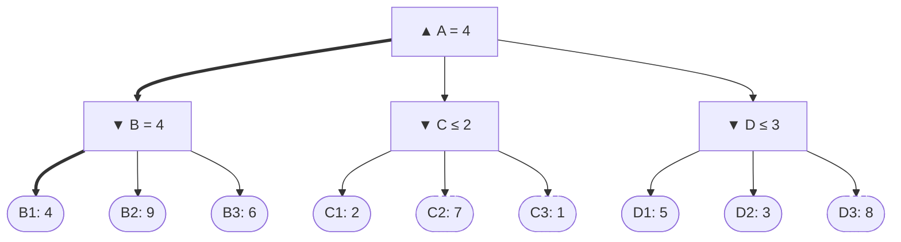
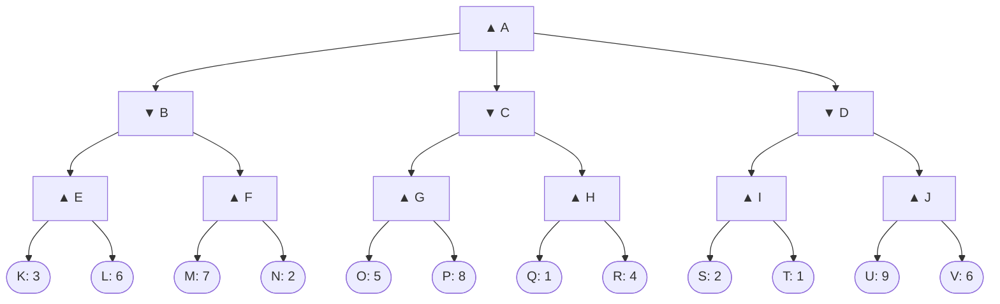

**English** | [Polski](README.pl.md)

# Lesson 3.2 — Alpha-beta pruning

**Core** · Prerequisites: 3.1 Games and minimax (see the [course map](../../../COURSE_MAP.md)).

## Learning goals

After this lesson you will be able to:

- explain what α and β mean and why pruning never changes the result of minimax;
- trace alpha-beta by hand and point out the leaves the algorithm never looks at;
- write `alpha_beta_search`, which visits dozens of times fewer tic-tac-toe positions than minimax;
- measure how much the order of moves decides how much can be pruned.

## The problem

The minimax of lesson 3.1 walks the whole game tree, 549,946 positions in tic-tac-toe. Do we really have to look at every leaf to know which move is best?

Go back to the example of lesson 3.1. MAX has already checked the move to B and knows it gives 4. Now it checks C. The first leaf under C is worth 2, so MIN at C can get down to 2 at least. That is less than 4, so MAX will not choose C, whatever the leaves C2 and C3 hold. Those leaves need not be looked at.

## Intuition

You are playing chess and considering a queen move. The first reply of the opponent that you check wins your queen. You need not check the other replies. You know this move is worse than another one you found earlier, after which the queen stays on the board. The opponent may have even better replies, but that would only make things worse.

Alpha-beta pruning does this systematically. While it searches, it remembers what each player already has secured elsewhere. As soon as it turns out that a sensible player would never let the game reach a node, it stops looking at that node's remaining children.

## Formal model and pseudocode

### Two guarantees: α and β

At every node alpha-beta keeps two numbers, both from MAX's point of view:

- **α** is the best value MAX already has secured somewhere on the path from the root to this node. MAX will not accept anything worse.
- **β** is the best value MIN already has secured, which means the smallest. MIN will not accept anything larger.

At the start α = −∞ and β = +∞. The result of the game can depend only on values between α and β. Hence two cutoff rules:

- **At a MAX node**, once its value v reaches β (v ≥ β), MIN higher up already has a move that gives MAX at most β. MIN will not let the game reach this node, so the remaining children can be skipped.
- **At a MIN node**, once v falls to α (v ≤ α), MAX higher up already has a move that gives it at least α. MAX will not enter this node.

### Pseudocode

```text
ALPHA-BETA-SEARCH(game, state):
    player ← game.to_move(state)
    return MAX-VALUE(state, −∞, +∞)

MAX-VALUE(s, α, β):
    if game.is_terminal(s): return (game.utility(s, player), no move)
    v ← −∞
    for each a in game.actions(s):
        v2 ← the value returned by MIN-VALUE(game.result(s, a), α, β)
        if v2 > v:
            v, move ← v2, a
            α ← max(α, v)
        if v ≥ β: return (v, move)        # cutoff: MIN will not allow this
    return (v, move)

MIN-VALUE(s, α, β):
    if game.is_terminal(s): return (game.utility(s, player), no move)
    v ← +∞
    for each a in game.actions(s):
        v2 ← the value returned by MAX-VALUE(game.result(s, a), α, β)
        if v2 < v:
            v, move ← v2, a
            β ← min(β, v)
        if v ≤ α: return (v, move)        # cutoff: MAX will not go here
    return (v, move)
```

This is the minimax of lesson 3.1 with two changes. Every call receives α and β, and the loop may end before the last child. The conventions stay the same: the function returns a pair `(value, move)`, and the value is computed for the player to move at `state`.

**≥ or >?** Russell and Norvig cut off at v ≥ β and v ≤ α, and so does this course. The version with strict inequalities (v > β, v < α) is correct too. When v = β, the remaining children can only raise v, and MIN will not allow this node anyway, so both versions give the same result. The strict version prunes less, though. In tic-tac-toe, where many positions are worth 0, the difference is huge. You met a similar choice between < and ≤ with the depth limit of lesson 2.6. The tests accept both versions.

### Why pruning never changes the result

Take a MIN node where v ≤ α. Its true value is at most v, because MIN can only lower it further. MAX has a move higher up on the path worth at least α, so it will not choose this node, whatever the node is really worth. The exact value is not needed. A MAX node where v ≥ β is symmetric.

The value of a node that broke off its loop is therefore only a bound: in the drawings we write "C ≤ 2", meaning "C is worth at most 2". Values that fit between α and β are computed exactly by alpha-beta. The root gets the window from −∞ to +∞, so its value is always exact, and so is the chosen move.

## Trace it by hand

### Worked example

The tree of lesson 3.1. Children are visited from left to right, in the order of `game.actions`. In every row of the table one node finishes: a leaf gets its value, an inner node returns v or breaks off its loop. The columns α and β show the bounds at that moment, from MAX's point of view.

<!-- generated:alpha-beta-table example=worked_tree lang=en -->
| Step | Node | α | β | v | What happened |
|---|---|---|---|---|---|
| 1 | B1 | −∞ | +∞ | 4 | leaf |
| 2 | B2 | −∞ | 4 | 9 | leaf |
| 3 | B3 | −∞ | 4 | 6 | leaf |
| 4 | ▼ B | −∞ | 4 | 4 | returns 4 |
| 5 | C1 | 4 | +∞ | 2 | leaf |
| 6 | ▼ C | 4 | 2 | 2 | cutoff: v ≤ α, skipped C2, C3 |
| 7 | D1 | 4 | +∞ | 5 | leaf |
| 8 | D2 | 4 | 5 | 3 | leaf |
| 9 | ▼ D | 4 | 3 | 3 | cutoff: v ≤ α, skipped D3 |
| 10 | ▲ A | 4 | +∞ | 4 | returns 4 |

Root value: **4**, move: **B**. Pruned leaves: C2, C3, D3.
<!-- /generated -->

Note three things:

- **Rows 1–4.** In B the bounds are only being formed. After leaf B1, MIN knows it will give at most 4 at B, so β = 4. Leaves B2 and B3 do not change v.
- **Row 6.** When alpha-beta enters C, MAX already has 4 secured, so α = 4. Leaf C1 gives v = 2 ≤ α. MAX will not choose C, so leaves C2 and C3 are not needed.
- **Row 9.** In D the first leaf, 5, does not settle anything yet, because 5 > α. Only D2 = 3 goes below α and prunes D3.

In the drawing the thick edges are the optimal game, and dashed outlines mark the nodes alpha-beta never looked at:

<!-- generated:game-tree example=worked_tree values=alpha-beta -->

<!-- /generated -->

Alpha-beta looked at 6 of the 9 leaves and found the same root value and the same move as minimax.

### Your turn

Trace alpha-beta on this tree:

<!-- generated:game-tree example=alpha_beta_exercise -->

<!-- /generated -->

The rules are the same as in the example:

1. visit the children from left to right;
2. a MAX node breaks off its loop when v ≥ β, a MIN node when v ≤ α;
3. a leaf is looked at when alpha-beta computes its utility.

In Part A of `task.py`, write the set `PRUNED_LEAVES` with the names of the leaves alpha-beta does not look at. Some cutoffs happen deep in the tree, so keep track of the α and β each node receives from its parent.

## Properties

| | Alpha-beta |
|---|---|
| Result | the same as minimax: the root value and an optimal move |
| Time, worst case | O(*b*<sup>*m*</sup>), like minimax |
| Time, perfect move order | O(*b*<sup>*m*/2</sup>) |
| Space | O(*b*·*m*) |

**The order of moves decides everything.** Alpha-beta prunes the most when at every node it looks at the best move first. Then it searches about *b*<sup>*m*/2</sup> nodes, as if the branching factor were √*b*. In the time minimax needs, it can search roughly twice as deep. With moves in random order it looks at about *b*<sup>3*m*/4</sup> nodes. With the worst order it prunes nothing.

We do not know the best move in advance; that is what we are looking for. In practice good guesses are enough:

- **Moves that are usually good go first.** In tic-tac-toe that means the centre and the corners, in chess captures and threats.
- **Killer moves.** A move that caused a cutoff in one branch often cuts off in the neighbouring ones too, so it is worth trying early.
- **The transposition table** of lesson 3.1. It remembers positions already searched and the best moves found in them.
- **Iterative deepening** from lesson 2.6. A shallower search suggests the move order for a deeper one (more on this in lesson 3.3).

In tic-tac-toe from the empty board minimax visits 549,946 positions, and alpha-beta with the cells in their natural order 18,297. When it looks at the centre first and then the corners, 7,275 are enough. The version with strict inequalities visits 146,120 positions.

## Common mistakes

1. **Bounds without a cutoff.** The function updates α and β but never breaks off the loop. The result is right, but the work is the same as minimax's.
2. **Bounds that stay at home.** Every child gets α = −∞ and β = +∞ afresh instead of its parent's bounds. Deeper nodes know nothing of what the players have secured higher up, so almost nothing is pruned.
3. **Swapped bounds.** The call passes `(β, α)` to the child instead of `(α, β)`. Cutoffs happen in the wrong places, and the root value no longer matches minimax.
4. **Comparing with your own bound.** A MAX node compares v with α instead of β, and a MIN node with β instead of α. Every node then stops after its first child.

The lesson's tests catch each of these mistakes.

## Task

### Part A: pruning by hand

Fill in the set `PRUNED_LEAVES` in `task.py` for the tree in "Your turn".

### Part B: implementation

Implement `alpha_beta_search(game, state)` in `task.py`. It has the same contract as `minimax_search` in lesson 3.1: it returns a pair `(value, move)`, the value for the player to move at `state`, and the move `None` when the game is over. Visit the moves in the order of `game.actions` and break off the loop when v ≥ β at a MAX node or v ≤ α at a MIN node.

You can start from your minimax of lesson 3.1. `task.py` does not import `introai.games.reference`.

### How to check

From the repository root:

```bash
uv run pytest modules/03_games_and_csp/02_alpha_beta
```

The failure messages say which property is broken and on which tree or in which position.

### Acceptance criteria

- All the lesson's tests pass.
- You can answer the review questions before looking at the answers.

## What the tests do not check

- **Understanding.** Passing tests do not prove you can explain why a cutoff is safe.
- **The rule for equal values.** The tests accept a cutoff at v ≥ β as well as at v > β.
- **Time.** The test only checks that from the empty board your version calls `game.result` less than half as often as minimax. You measure the time in the notebook.
- **Ways around the import ban.** The test detects a plain import of `introai.games.reference`, not every trick.

## Experiments

Open [experiments.ipynb](experiments.ipynb). Before each experiment write down your prediction, then check it:

1. How many positions do minimax, your alpha-beta, an alpha-beta that looks at the centre and the corners first, and an alpha-beta with strict inequalities visit from the empty board?
2. How much does the number of positions visited depend on the order of the cells? Compare 200 random orders with the natural order and with "centre first".
3. How do the savings of alpha-beta depend on the number of empty cells on the board?

## Review questions

1. What do α and β mean at a node? What happens when α ≥ β?
2. Why does pruning never change the root value, even though the values of some nodes, such as "C ≤ 2", are not exact?
3. In what order should alpha-beta look at the moves to prune as much as possible? Why?
4. Why does the version with strict inequalities visit eight times as many tic-tac-toe positions as the version with ≥?
5. With a perfect move order alpha-beta looks at about *b*<sup>*m*/2</sup> nodes. How much deeper than minimax can it search in the same time?

## If you get stuck

<details>
<summary>Hint 1: where to start</summary>

Copy your `minimax_search` from lesson 3.1. Add the parameters `alpha` and `beta` to both helper functions, and pass `-math.inf` and `math.inf` in the first call.

</details>

<details>
<summary>Hint 2: when to update α and β</summary>

At a MAX node, after improving v, set `alpha = max(alpha, v)`; at a MIN node, `beta = min(beta, v)`. Call every child with the current `alpha` and `beta`, not with the values the node started with.

</details>

<details>
<summary>Hint 3: the values are right, but it prunes too little or too much</summary>

Check what you compare v with. A MAX node stops when v ≥ β, because β is the opponent's guarantee. A MIN node stops when v ≤ α. Also make sure you visit the moves in the order of `game.actions`.

</details>

## Key takeaways

- α is the value MAX already has secured on the path, β the value MIN has secured. A node whose value falls outside the window from α to β cannot change the result.
- Alpha-beta gives the same root value and the same move as minimax.
- How much gets pruned depends on the move order: from O(*b*<sup>*m*</sup>) down to O(*b*<sup>*m*/2</sup>).
- Cutting off at ≥ and at > are both correct, but ≥ prunes more when values repeat.

## What next

- After your own attempt, compare with the solution and answers in [solutions/03_games_and_csp/02_alpha_beta/](../../../solutions/03_games_and_csp/02_alpha_beta/).
- Lesson 3.3 shows what to do when even alpha-beta cannot reach the end of the game.

## References

- S. Russell, P. Norvig, *Artificial Intelligence: A Modern Approach*, 4th ed., Pearson, 2020, sections 5.2.3–5.2.4 (alpha-beta pruning and move ordering).
- D. E. Knuth, R. W. Moore, *An analysis of alpha-beta pruning*, Artificial Intelligence 6(4), 1975, pp. 293–326.
