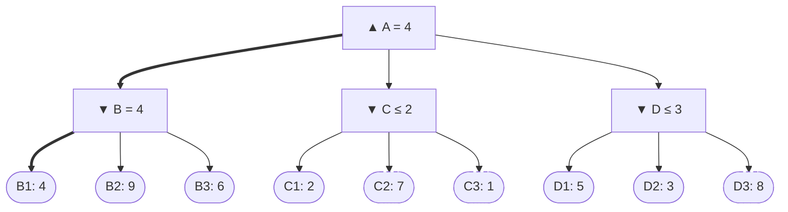
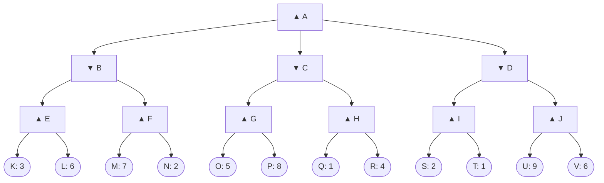

[English](README.md) | **Polski**

# Lekcja 3.2 — Przycinanie alfa-beta

**Core** · Wymagania: 3.1 Gry i minimax (zobacz [mapę kursu](../../../COURSE_MAP.pl.md)).

## Cele lekcji

Po tej lekcji:

- wyjaśnisz, co oznaczają α i β i dlaczego przycinanie nie zmienia wyniku minimaksu;
- prześledzisz alfa-beta ręcznie i wskażesz liście, których algorytm w ogóle nie ogląda;
- napiszesz `alpha_beta_search`, który w kółku i krzyżyku odwiedza kilkadziesiąt razy mniej pozycji niż minimax;
- zmierzysz, jak bardzo kolejność ruchów wpływa na to, ile da się przyciąć.

## Problem

Minimax z lekcji 3.1 przechodzi całe drzewo gry, w kółku i krzyżyku 549 946 pozycji. Czy naprawdę trzeba obejrzeć każdy liść, żeby wiedzieć, który ruch jest najlepszy?

Wróć do przykładu z lekcji 3.1. MAX sprawdził już ruch do B i wie, że da mu on 4. Teraz sprawdza C. Pierwszy liść pod C ma wartość 2, więc MIN w C może zejść co najmniej do 2. To mniej niż 4, więc MAX nie wybierze C, cokolwiek kryje się w liściach C2 i C3. Tych liści nie trzeba oglądać.

## Intuicja

Grasz w szachy i zastanawiasz się nad ruchem hetmanem. Pierwsza odpowiedź przeciwnika, którą sprawdzasz, zabiera Ci hetmana. Pozostałych odpowiedzi nie musisz już sprawdzać. Wiesz, że ten ruch jest gorszy od innego, znalezionego wcześniej, po którym hetman zostaje na planszy. Przeciwnik może mieć jeszcze lepsze odpowiedzi, ale to tylko pogorszyłoby sprawę.

Przycinanie alfa-beta (*alpha-beta pruning*) robi to systematycznie. Podczas przeszukiwania pamięta, co każdy z graczy ma już zapewnione gdzie indziej. Gdy okazuje się, że do jakiegoś węzła rozsądny gracz nigdy nie dopuści, przestaje oglądać jego pozostałe dzieci.

## Model formalny i pseudokod

### Dwie gwarancje: α i β

Na każdym węźle alfa-beta pamięta dwie liczby, obie z perspektywy MAX:

- **α** to najlepsza wartość, jaką MAX ma już zapewnioną gdzieś na ścieżce od korzenia do tego węzła. Na nic gorszego MAX się nie zgodzi.
- **β** to najlepsza wartość, jaką ma już zapewnioną MIN, czyli najmniejsza. Na nic większego MIN się nie zgodzi.

Na początku α = −∞, a β = +∞. Wynik gry może zależeć tylko od wartości, które leżą między α a β. Stąd dwie reguły odcięcia:

- **W węźle MAX**, gdy jego wartość v osiągnie β (v ≥ β), MIN wyżej ma już ruch, który daje MAX najwyżej β. Do tego węzła MIN nie dopuści, więc pozostałe dzieci można pominąć.
- **W węźle MIN**, gdy v spadnie do α (v ≤ α), MAX wyżej ma już ruch, który daje mu co najmniej α. W ten węzeł MAX nie wejdzie.

### Pseudokod

```text
ALPHA-BETA-SEARCH(game, state):
    player ← game.to_move(state)
    zwróć MAX-VALUE(state, −∞, +∞)

MAX-VALUE(s, α, β):
    jeśli game.is_terminal(s): zwróć (game.utility(s, player), brak ruchu)
    v ← −∞
    dla każdego a w game.actions(s):
        v2 ← wartość zwrócona przez MIN-VALUE(game.result(s, a), α, β)
        jeśli v2 > v:
            v, ruch ← v2, a
            α ← max(α, v)
        jeśli v ≥ β: zwróć (v, ruch)        # odcięcie: MIN tu nie dopuści
    zwróć (v, ruch)

MIN-VALUE(s, α, β):
    jeśli game.is_terminal(s): zwróć (game.utility(s, player), brak ruchu)
    v ← +∞
    dla każdego a w game.actions(s):
        v2 ← wartość zwrócona przez MAX-VALUE(game.result(s, a), α, β)
        jeśli v2 < v:
            v, ruch ← v2, a
            β ← min(β, v)
        jeśli v ≤ α: zwróć (v, ruch)        # odcięcie: MAX tu nie wejdzie
    zwróć (v, ruch)
```

To jest minimax z lekcji 3.1 z dwiema zmianami. Każde wywołanie dostaje α i β, a pętla może skończyć się przed ostatnim dzieckiem. Konwencje się nie zmieniają: funkcja zwraca parę `(wartość, ruch)`, a wartość jest liczona dla gracza, który ma ruch w `state`.

**≥ czy >?** Russell i Norvig odcinają przy v ≥ β i v ≤ α i tak samo robi ten kurs. Wersja z nierównościami ostrymi (v > β, v < α) też jest poprawna. Gdy v = β, pozostałe dzieci mogą tylko podnieść v, a MIN i tak tu nie dopuści, więc obie wersje dają ten sam wynik. Wersja ostra przycina jednak mniej. W kółku i krzyżyku, gdzie wiele pozycji ma wartość 0, różnica jest ogromna. Podobny wybór między < a ≤ widziałeś przy limicie głębokości w lekcji 2.6. Testy przyjmą obie wersje.

### Dlaczego przycinanie nie zmienia wyniku

Weź węzeł MIN, w którym v ≤ α. Jego prawdziwa wartość jest co najwyżej v, bo MIN może tylko jeszcze ją obniżyć. MAX ma wyżej na ścieżce ruch wart co najmniej α, więc tego węzła nie wybierze, niezależnie od tego, ile on naprawdę jest wart. Dokładna wartość nie jest potrzebna. Z węzłem MAX, w którym v ≥ β, jest symetrycznie.

Wartość węzła, który przeciął pętlę, jest więc tylko oszacowaniem: na rysunkach piszemy „C ≤ 2”, czyli „C jest warte najwyżej 2”. Wartości, które mieszczą się między α a β, alfa-beta liczy dokładnie. Korzeń dostaje przedział od −∞ do +∞, więc jego wartość zawsze jest dokładna, tak samo jak wybrany ruch.

## Prześledź ręcznie

### Przykład rozwiązany

Drzewo z lekcji 3.1. Dzieci oglądamy od lewej do prawej, czyli w kolejności `game.actions`. W każdym wierszu tabeli jeden węzeł kończy pracę: liść dostaje swoją wartość, a węzeł wewnętrzny zwraca v albo przerywa pętlę. Kolumny α i β pokazują granice w tej chwili, z perspektywy MAX.

<!-- generated:alpha-beta-table example=worked_tree lang=pl -->
| Krok | Węzeł | α | β | v | Co się stało |
|---|---|---|---|---|---|
| 1 | B1 | −∞ | +∞ | 4 | liść |
| 2 | B2 | −∞ | 4 | 9 | liść |
| 3 | B3 | −∞ | 4 | 6 | liść |
| 4 | ▼ B | −∞ | 4 | 4 | zwraca 4 |
| 5 | C1 | 4 | +∞ | 2 | liść |
| 6 | ▼ C | 4 | 2 | 2 | odcięcie: v ≤ α, pominięte C2, C3 |
| 7 | D1 | 4 | +∞ | 5 | liść |
| 8 | D2 | 4 | 5 | 3 | liść |
| 9 | ▼ D | 4 | 3 | 3 | odcięcie: v ≤ α, pominięte D3 |
| 10 | ▲ A | 4 | +∞ | 4 | zwraca 4 |

Wartość korzenia: **4**, ruch: **B**. Pominięte liście: C2, C3, D3.
<!-- /generated -->

Zwróć uwagę na trzy rzeczy:

- **Wiersze 1–4.** W B granice dopiero powstają. Po liściu B1 MIN wie, że w B da najwyżej 4, więc β = 4. Liście B2 i B3 nie zmieniają v.
- **Wiersz 6.** Gdy alfa-beta wchodzi do C, MAX ma już zapewnione 4, więc α = 4. Liść C1 daje v = 2 ≤ α. MAX nie wybierze C, więc liście C2 i C3 nie są potrzebne.
- **Wiersz 9.** W D pierwszy liść, 5, jeszcze niczego nie przesądza, bo 5 > α. Dopiero D2 = 3 schodzi poniżej α i przycina D3.

Na rysunku pogrubione krawędzie to partia optymalna, a linie przerywane oznaczają węzły, których alfa-beta nie obejrzał:

<!-- generated:game-tree example=worked_tree values=alpha-beta -->

<!-- /generated -->

Alfa-beta obejrzał 6 liści z 9 i znalazł tę samą wartość korzenia i ten sam ruch co minimax.

### Twoja kolej

Prześledź alfa-beta na tym drzewie:

<!-- generated:game-tree example=alpha_beta_exercise -->

<!-- /generated -->

Zasady są takie same jak w przykładzie:

1. dzieci oglądasz od lewej do prawej;
2. węzeł MAX przerywa pętlę, gdy v ≥ β, a węzeł MIN, gdy v ≤ α;
3. liść jest obejrzany, gdy alfa-beta liczy jego użyteczność.

Wpisz w części A pliku `task.py` zbiór `PRUNED_LEAVES` z nazwami liści, których alfa-beta nie obejrzy. Niektóre odcięcia zachodzą głęboko w drzewie, więc pilnuj, jakie α i β dostaje każdy węzeł od swojego rodzica.

## Własności

| | Alfa-beta |
|---|---|
| Wynik | taki sam jak minimax: wartość korzenia i optymalny ruch |
| Czas, najgorszy przypadek | O(*b*<sup>*m*</sup>), jak minimax |
| Czas, idealna kolejność ruchów | O(*b*<sup>*m*/2</sup>) |
| Pamięć | O(*b*·*m*) |

**Kolejność ruchów decyduje o wszystkim.** Alfa-beta przycina najwięcej, gdy w każdym węźle najpierw ogląda najlepszy ruch. Wtedy przeszukuje około *b*<sup>*m*/2</sup> węzłów, tak jakby współczynnik rozgałęzienia wynosił √*b*. W tym samym czasie co minimax może więc szukać mniej więcej dwa razy głębiej. Przy losowej kolejności ruchów ogląda około *b*<sup>3*m*/4</sup> węzłów. Przy najgorszej kolejności nie przycina nic.

Najlepszego ruchu nie znamy z góry, bo właśnie go szukamy. W praktyce wystarczy dobre zgadywanie:

- **Ruchy, które zwykle są dobre, idą pierwsze.** W kółku i krzyżyku to środek i rogi, w szachach bicia i groźby.
- **Ruchy-zabójcy** (*killer moves*). Ruch, który spowodował odcięcie w jednej gałęzi, często odcina też w sąsiednich, więc warto go sprawdzić wcześnie.
- **Tablica transpozycji** z lekcji 3.1. Pamięta pozycje już przeszukane i najlepsze ruchy w nich znalezione.
- **Iteracyjne pogłębianie** z lekcji 2.6. Płytsze przeszukanie podpowiada kolejność ruchów dla głębszego (wrócimy do tego w lekcji 3.3).

W kółku i krzyżyku z pustej planszy minimax odwiedza 549 946 pozycji, a alfa-beta w naturalnej kolejności pól 18 297. Gdy najpierw ogląda środek, a potem rogi, wystarcza mu 7 275. Wersja z nierównościami ostrymi odwiedza 146 120 pozycji.

## Częste błędy

1. **Granice bez odcięcia.** Funkcja aktualizuje α i β, ale nigdy nie przerywa pętli. Wynik jest dobry, ale pracy tyle samo co w minimaksie.
2. **Granice zostają w domu.** Każde dziecko dostaje od nowa α = −∞ i β = +∞ zamiast granic rodzica. Głębsze węzły nic nie wiedzą o tym, co gracze mają zapewnione wyżej, więc nic się nie przycina: zostaje zwykły minimaks z dodatkowymi parametrami.
3. **Zamienione granice.** Wywołanie przekazuje dziecku `(β, α)` zamiast `(α, β)`. Odcięcia zachodzą w złych miejscach i wartość korzenia przestaje się zgadzać z minimaksem.
4. **Porównanie z własną granicą.** Węzeł MAX porównuje v z α zamiast z β, a węzeł MIN z β zamiast z α. Każdy węzeł kończy wtedy pracę po pierwszym dziecku.

Testy lekcji wykrywają każdy z tych błędów.

## Zadanie

### Część A: przycinanie ręcznie

Wypełnij w `task.py` zbiór `PRUNED_LEAVES` dla drzewa z sekcji „Twoja kolej”.

### Część B: implementacja

Zaimplementuj w `task.py` funkcję `alpha_beta_search(game, state)`. Ma tę samą umowę co `minimax_search` z lekcji 3.1: zwraca parę `(wartość, ruch)`, wartość dla gracza, który ma ruch w `state`, a gdy gra się skończyła, ruch `None`. Ruchy oglądaj w kolejności `game.actions` i przerywaj pętlę, gdy v ≥ β w węźle MAX albo v ≤ α w węźle MIN.

Możesz zacząć od swojego minimaksu z lekcji 3.1. `task.py` nie importuje `introai.games.reference`.

### Jak sprawdzić

Z głównego katalogu repozytorium:

```bash
uv run pytest modules/03_games_and_csp/02_alpha_beta
```

Komunikaty błędów mówią, która własność jest złamana i na jakim drzewie albo w jakiej pozycji.

### Kryteria akceptacji

- Wszystkie testy lekcji przechodzą.
- Potrafisz odpowiedzieć na pytania kontrolne, zanim zajrzysz do odpowiedzi.

## Czego testy nie sprawdzają

- **Zrozumienia.** Przechodzące testy nie dowodzą, że umiesz wyjaśnić, dlaczego dane odcięcie jest bezpieczne.
- **Reguły przy równych wartościach.** Testy przyjmują zarówno odcięcie przy v ≥ β, jak i przy v > β.
- **Czasu.** Test sprawdza tylko, że z pustej planszy Twoja wersja wywołuje `game.result` mniej niż połowę razy tego, co minimax. Czas zmierzysz w notebooku.
- **Obejścia zakazu importu.** Test wykrywa zwykły import `introai.games.reference`, ale nie każdą sztuczkę.

## Eksperymenty

Otwórz [experiments.pl.ipynb](experiments.pl.ipynb). Przed każdym eksperymentem zapisz swoje przewidywanie, a potem je sprawdź:

1. Ile pozycji odwiedzają z pustej planszy minimax, Twój alfa-beta, alfa-beta, który najpierw ogląda środek i rogi, oraz alfa-beta z nierównościami ostrymi?
2. Jak bardzo liczba odwiedzonych pozycji zależy od kolejności pól? Porównaj 200 losowych kolejności z kolejnością naturalną i z „najpierw środek”.
3. Jak oszczędność alfa-beta zależy od liczby wolnych pól na planszy?

## Pytania kontrolne

1. Co oznaczają α i β w danym węźle? Co się dzieje, gdy α ≥ β?
2. Dlaczego przycinanie nie zmienia wartości korzenia, choć wartości niektórych węzłów, na przykład „C ≤ 2”, nie są dokładne?
3. W jakiej kolejności alfa-beta powinien oglądać ruchy, żeby przyciąć jak najwięcej? Dlaczego?
4. Dlaczego w kółku i krzyżyku wersja z nierównościami ostrymi odwiedza ośmiokrotnie więcej pozycji niż wersja z ≥?
5. Przy idealnej kolejności ruchów alfa-beta ogląda około *b*<sup>*m*/2</sup> węzłów. O ile głębiej niż minimax może szukać w tym samym czasie?

## Jeśli utkniesz

<details>
<summary>Podpowiedź 1: od czego zacząć</summary>

Skopiuj swój `minimax_search` z lekcji 3.1. Dodaj do obu funkcji pomocniczych parametry `alpha` i `beta`, a w pierwszym wywołaniu podaj `-math.inf` i `math.inf`.

</details>

<details>
<summary>Podpowiedź 2: kiedy poprawiać α i β</summary>

W węźle MAX po poprawie v ustaw `alpha = max(alpha, v)`, a w węźle MIN `beta = min(beta, v)`. Każde dziecko wywołuj z bieżącymi `alpha` i `beta`, nie z wartościami, z którymi węzeł zaczynał.

</details>

<details>
<summary>Podpowiedź 3: wartości się zgadzają, ale przycina za mało albo za dużo</summary>

Sprawdź, z czym porównujesz v. Węzeł MAX przerywa, gdy v ≥ β, bo β to gwarancja przeciwnika. Węzeł MIN przerywa, gdy v ≤ α. Upewnij się też, że ruchy oglądasz w kolejności `game.actions`.

</details>

## Co zapamiętać

- α to wartość, którą MAX ma już zapewnioną na ścieżce, β to wartość, którą ma zapewnioną MIN. Węzeł, którego wartość wychodzi poza przedział od α do β, nie może zmienić wyniku.
- Alfa-beta daje tę samą wartość korzenia i ten sam ruch co minimax.
- O tym, ile się przytnie, decyduje kolejność ruchów: od O(*b*<sup>*m*</sup>) do O(*b*<sup>*m*/2</sup>).
- Odcięcie przy ≥ i przy > jest poprawne, ale ≥ przycina więcej, gdy wartości się powtarzają.

## Co dalej

- Po własnej próbie porównaj się z rozwiązaniem i odpowiedziami w [solutions/03_games_and_csp/02_alpha_beta/](../../../solutions/03_games_and_csp/02_alpha_beta/).
- Lekcja 3.3 pokazuje, co zrobić, gdy nawet alfa-beta nie może zejść do końca gry.

## Bibliografia

- S. Russell, P. Norvig, *Artificial Intelligence: A Modern Approach*, 4th ed., Pearson, 2020, rozdz. 5.2.3–5.2.4 (przycinanie alfa-beta i kolejność ruchów).
- D. E. Knuth, R. W. Moore, *An analysis of alpha-beta pruning*, Artificial Intelligence 6(4), 1975, s. 293–326.
