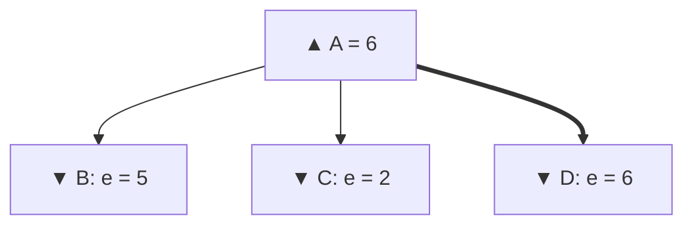
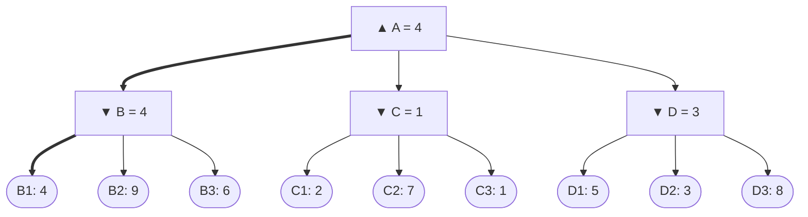

**English** | [Polski](README.pl.md)

# Lesson 3.3 — Evaluation functions and depth limits

**Core** · Prerequisites: 3.2 Alpha-beta pruning (see the [course map](../../../COURSE_MAP.md)).

## Learning goals

After this lesson you will be able to:

- stop a search at a given depth and replace the result of the game with an estimate;
- compute a simple evaluation function by hand and check which move a shallow search chooses;
- design your own evaluation function for "four in a row" on a 5 × 5 board and test it in a match;
- explain the horizon effect and how iterative deepening with a time limit helps.

## The problem

The alpha-beta of lesson 3.2 searches the tic-tac-toe tree in a fraction of a second. Now take a game that is only slightly bigger: a 5 × 5 board, where the first to place four marks in a line wins. The empty board can be filled in 25! ≈ 1.6 · 10<sup>25</sup> ways. Even alpha-beta with a perfect move order will not reach the end of this game, and chess is far bigger still.

A program that has to play a move in reasonable time must therefore stop searching before the game ends. But how do you score a position in which nobody has won yet?

## Intuition

A chess player does not count every game through to mate. They look a few moves ahead and judge the positions they reach by eye: "I am a piece up", "my king is safer". That judgement can be wrong, but it usually shows who stands better.

A computer does the same. It searches the tree only to a certain depth, and scores the state at that boundary with an **evaluation function**, a quick estimate of how good the position is. Beyond that it is ordinary minimax with alpha-beta pruning, only with estimates where the leaves used to be.

## Formal model and pseudocode

### A cutoff at a depth

Depth-limited minimax, H-MINIMAX (*heuristic minimax*) in the textbook, differs from the plain one in one case. Let *d* be the number of moves left to the boundary:

$$
\text{H-MINIMAX}(s, d) =
\begin{cases}
\text{UTILITY}(s, \text{MAX}) & \text{if } s \text{ is terminal,} \\
\text{EVAL}(s, \text{MAX}) & \text{if } d = 0, \\
\max_{a} \text{H-MINIMAX}(\text{RESULT}(s, a), d - 1) & \text{if MAX is to move,} \\
\min_{a} \text{H-MINIMAX}(\text{RESULT}(s, a), d - 1) & \text{if MIN is to move.}
\end{cases}
$$

The order of the cases matters. A terminal state always gets its utility, even right at the boundary, because a sure result beats an estimate. Only a state in which the game goes on and the depth has run out gets an estimate.

In code it is the alpha-beta of lesson 3.2 with one more parameter:

```text
H-ALPHA-BETA-SEARCH(game, state, depth, evaluate):
    player ← game.to_move(state)
    return MAX-VALUE(state, −∞, +∞, depth)

MAX-VALUE(s, α, β, d):
    if game.is_terminal(s): return (game.utility(s, player), no move)
    if d = 0: return (evaluate(game, s, player), no move)
    ... as in lesson 3.2, children go through MIN-VALUE(game.result(s, a), α, β, d − 1)

MIN-VALUE(s, α, β, d):
    the same, with the same two tests at the start
```

Depth is counted in plies: with `depth = 1` the search scores the states after one move, with `depth = 2` after a move and a reply. The evaluation function always gets the player to move in the start state, just like `utility` in lessons 3.1 and 3.2.

### The evaluation function

A good evaluation function:

- **agrees with the result of the game** where the result is known: it scores won positions above drawn ones, and drawn ones above lost ones;
- **is fast**, because it is called thousands of times per move;
- **is strongly tied to the chance of winning**: the higher the score, the more often such positions are won.

Most often it is a **weighted linear function** of features:

$$
\text{EVAL}(s) = w_1 f_1(s) + w_2 f_2(s) + \dots + w_n f_n(s).
$$

In chess the classic feature is material: a pawn worth 1, a knight or a bishop 3, a rook 5, a queen 9. In "k in a row" the natural features are lines, the rows of *k* cells where a win is still possible. A line is **open** for a player if the opponent has no mark on it. A line with three of my marks and none of the opponent's is much more dangerous than a line with one, so it deserves a much larger weight.

### The range of the evaluation

In this course a win is worth 1 and a loss −1. An evaluation function must return numbers in [−1, 1]. Otherwise the search could rate a promising but unfinished position worth, say, 37 above a sure win worth 1. A sum of features is easy to squeeze into this range, for example with *x* / (1 + |*x*|) or by dividing by the largest possible value.

The evaluation of Part A is a whole number: the difference of open lines can range from −8 to 8. When we use it in a search, we divide it by 9.

### The horizon effect

A depth-limited search sees nothing beyond its boundary, the horizon. If a loss cannot be avoided but can be delayed, for example by a series of checks, the program happily plays moves that push it past the horizon. It looks as if the problem has gone, though it has only become invisible. Any position in which an exchange is under way or a threat is hanging right at the boundary suffers from the same trouble. The usual cure is quiescence search: in unquiet positions the search goes on until things calm down.

### Depth and time

A program playing in a tournament has a time limit, not a depth limit. The answer is the iterative deepening of lesson 2.6. Search to depth 1, then 2, then 3 and so on until time runs out, and play the best move of the last completed search. The repeated work costs little, for the same reason as in lesson 2.6. A shallower search also supplies the move order for a deeper one, and the move order decides how much alpha-beta prunes (lesson 3.2).

### The game "four in a row" on a 5 × 5 board

The tests and the notebook use the game `KInARow(5, 5, 4)` from `introai.games`. The players place marks in turn, X starts, and the first to make four marks in a row horizontally, vertically or diagonally wins. The board has 28 such lines, and `game.lines` lists them as tuples of cells `(row, col)`. A state looks as in tic-tac-toe, only with five rows: `state[row][col]` is `"X"`, `"O"` or `"."`.

## Trace it by hand

### Worked example

**Scoring by open lines.** Let *e*(*s*) = (number of lines open for X) − (number of lines open for O), always from X's point of view. A 3 × 3 board has 8 lines: 3 rows, 3 columns and 2 diagonals. An empty line is open for both players.

```text
. . .        O . .
. X .        . X .
. . .        . . .
```

- **Left board.** O has no marks, so all 8 lines are open for X. For O the lines without an X are open, and the cross in the centre lies on 4 lines (the middle row, the middle column, both diagonals). That leaves 4. So *e* = 8 − 4 = 4.
- **Right board.** The nought in the corner lies on 3 lines, so 8 − 3 = 5 lines are open for X. For O it is still 4. So *e* = 5 − 4 = 1. The reply in the corner cut X's advantage from 4 to 1.

**A shallow search can go wrong.** The tree of lesson 3.1 now has estimates at the nodes B, C and D. A depth-1 search sees only them:

<!-- generated:game-tree example=evaluation_tree values=minimax depth=1 -->

<!-- /generated -->

MAX chooses D, because the estimate 6 is the highest. The full search shows, however, that MIN answers at D with leaf D2 and MAX gets only 3, while the move to B gives 4:

<!-- generated:game-tree example=evaluation_tree values=minimax -->

<!-- /generated -->

The estimate of D was too optimistic. The deeper the search goes, the less such mistakes hurt, because the estimates are applied to positions closer to the end of the game.

### Your turn

Compute *e* for three positions. Whoever is to move, *e* is always computed from X's point of view:

```text
X . .        X . O        X . .
. O .        . X .        . O .
. . .        . . .        . . X
```

Write the results, in this order, into the list `EVAL_VALUES` in Part A of `task.py`.

Then take this position, where X is to move:

```text
X . .
. O X
. O .
```

X searches to depth 1 with the evaluation *e*: for each of its moves it computes *e* of the position that move creates, and it chooses the move with the largest *e*. If several moves have the same value, it chooses the first in row order. Write this move as a pair `(row, col)` into `DEPTH_ONE_MOVE`. Rows and columns are numbered from 0.

## Properties

| | Depth-limited alpha-beta |
|---|---|
| Time | O(*b*<sup>*d*</sup>) in the worst case, O(*b*<sup>*d*/2</sup>) with a perfect move order, where *d* is the depth |
| Space | O(*b*·*d*) |
| Optimal | no guarantee: the move is as good as the evaluation function and the depth |
| Full depth | gives exactly the result of the alpha-beta of lesson 3.2 |

On the empty 5 × 5 board a search with the weighted-lines evaluation visits 26 positions at depth 1, 236 at 2, 2,360 at 3 and 21,788 at 4. Every further ply costs roughly ten times more.

## Common mistakes

1. **A win that is only estimated.** The function checks the depth before checking whether the game is over. At the boundary a won position then gets an ordinary estimate instead of 1, and the search can miss a win in one move.
2. **A depth that is never used.** The parameter `depth` is passed on, but nothing tests it. On a small board the result is right; on the 5 × 5 board the search never finishes.
3. **An estimate from the wrong side.** At the boundary the call is `evaluate(game, s, game.to_move(s))`, which scores the position for the player to move in that state, not for the player of the start state. Every other layer then has the wrong sign.
4. **Off by one at the depth.** The search starts with `depth − 1` or stops at `d = 1`. The cutoff then comes one ply too early.
5. **The wrong sign.** The evaluation function rewards positions that are good for the opponent. A player with such an evaluation helps the opponent.
6. **A promise bigger than a win.** The evaluation function returns the raw sum of features, which can reach, say, 300. An unfinished position then looks better than a sure win.

The lesson's tests catch each of these mistakes.

## Task

### Part A: evaluation by hand

Fill in the list `EVAL_VALUES` and the constant `DEPTH_ONE_MOVE` in `task.py` for the positions in "Your turn".

### Part B: implementation

Implement two functions in `task.py`:

- `h_alpha_beta_search(game, state, depth, evaluate)` is the alpha-beta of lesson 3.2 with a depth limit. A terminal state gets `game.utility(s, player)`, and a state at depth `depth` in which the game goes on gets `evaluate(game, s, player)`. In both cases `player` is the player to move at `state`. The function returns a pair `(value, move)`.
- `evaluate(game, state, player)` is your evaluation function for "k in a row". It must work for any board, because it uses `game.lines`, and return a number from −1 to 1. A positive value means a position good for `player`.

You design the evaluation function yourself. The tests check its range and whether you win with it. Your search, at depth 2, plays 12 games on the 5 × 5 board against the same search with an evaluation that always returns 0. Each of 6 fixed openings is played twice, once with crosses and once with noughts. To pass, win at least 6 games and win more than you lose. The games are deterministic, so the result of the match is always the same.

`task.py` does not import `introai.games.reference`.

### How to check

From the repository root:

```bash
uv run pytest modules/03_games_and_csp/03_evaluation_functions
```

The failure messages say which property is broken. The match test reports your wins, draws and losses.

### Acceptance criteria

- All the lesson's tests pass.
- You can answer the review questions before looking at the answers.

## What the tests do not check

- **The quality of the evaluation beyond one match.** The test checks the range and the result of 12 games against one opponent at one depth. An evaluation that passes may play badly in other conditions. The tournament in the notebook shows more.
- **The speed of the evaluation.** A slow evaluation passes if it fits in the step limit, but it will get in your way in the tournament.
- **Understanding.** Passing tests do not prove you can explain why your evaluation works.
- **Ways around the import ban.** The test detects a plain import of `introai.games.reference`, not every trick.

## Experiments

Open [experiments.ipynb](experiments.ipynb). Before each experiment write down your prediction, then check it:

1. A tournament on the 5 × 5 board: how do the zero evaluation, open lines, weighted lines and yours do at depths 1, 2 and 3?
2. In a position with a threat: which move does the search choose at depths 1, 2, 3 and 4, and how does its score change?
3. How many positions does the search visit, and how long does one move take, at depths 1 to 4?

## Review questions

1. Why does a terminal state at the depth boundary get its utility and not an evaluation?
2. Why must the evaluation stay between −1 and 1? What would happen if it were, say, 50?
3. Is the move you wrote in `DEPTH_ONE_MOVE` a good one? What would a depth-2 search change?
4. What is the horizon effect? Give an example from tic-tac-toe or from the 5 × 5 game.
5. A program has 1 second per move. How should it choose the search depth?

## If you get stuck

<details>
<summary>Hint 1: where to start the search</summary>

Copy your `alpha_beta_search` from lesson 3.2. Add a parameter `d` to the helper functions, pass `depth` in the first call, and `d - 1` to the children. At the start of each helper function test first for the end of the game, and only then for `d == 0`.

</details>

<details>
<summary>Hint 2: where to start the evaluation</summary>

Go through `game.lines`. For each line count the player's marks and the opponent's: `marks = [state[r][c] for r, c in line]`. A line with only the player's marks is a chance for them, a line with only the opponent's marks is a threat. Start with the difference of the numbers of such lines and check the result of the match.

</details>

<details>
<summary>Hint 3: the match is still lost</summary>

Check the sign: the score must be positive when the position is good for `player`, whether that is X or O. Then give lines with more marks a much larger weight, for example 1, 10 and 100 for one, two and three marks. Finally squeeze the sum into the range from −1 to 1.

</details>

## Key takeaways

- A depth-limited search replaces the result of the game with an estimate at the boundary. A terminal state always gets its utility.
- An evaluation function should agree with the result of the game, be fast and be tied to the chance of winning. Most often it is a weighted sum of features.
- The evaluation must stay between a loss and a win, so that a promise never outweighs a sure result.
- A shallow search sees nothing beyond the horizon. Iterative deepening lets the search go as deep as time allows.

## What next

- After your own attempt, compare with the solution and answers in [solutions/03_games_and_csp/03_evaluation_functions/](../../../solutions/03_games_and_csp/03_evaluation_functions/).
- The next lessons of module 3 turn to constraint satisfaction problems. The idea of scoring a position by its features returns in module 4, in local search.

## References

- S. Russell, P. Norvig, *Artificial Intelligence: A Modern Approach*, 4th ed., Pearson, 2020, section 5.3 (heuristic alpha-beta tree search).
- C. E. Shannon, *Programming a computer for playing chess*, Philosophical Magazine 41(314), 1950, pp. 256–275.
