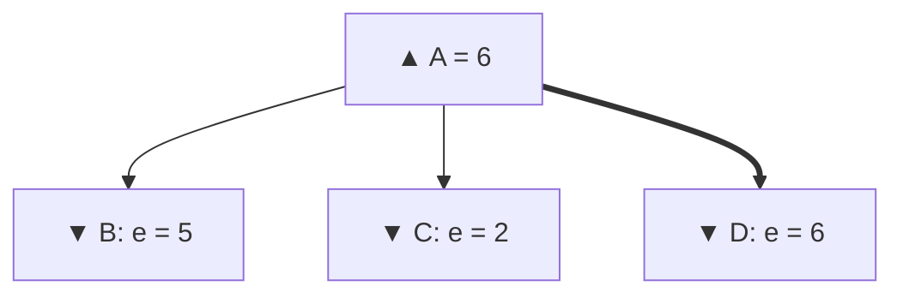
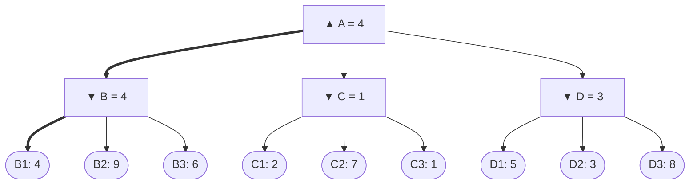

[English](README.md) | **Polski**

# Lekcja 3.3 — Funkcje oceny i ograniczona głębokość

**Core** · Wymagania: 3.2 Przycinanie alfa-beta (zobacz [mapę kursu](../../../COURSE_MAP.pl.md)).

## Cele lekcji

Po tej lekcji:

- przerwiesz przeszukiwanie na zadanej głębokości i zastąpisz wynik gry oszacowaniem;
- policzysz ręcznie prostą funkcję oceny i sprawdzisz, jaki ruch wybiera płytkie przeszukiwanie;
- zaprojektujesz własną funkcję oceny dla gry „cztery w rzędzie” na planszy 5 × 5 i sprawdzisz ją w meczu;
- wyjaśnisz, czym jest efekt horyzontu i jak pomaga iteracyjne pogłębianie z limitem czasu.

## Problem

Alfa-beta z lekcji 3.2 przeszukuje drzewo kółka i krzyżyka w ułamku sekundy. Weźmy jednak niewiele większą grę: plansza 5 × 5, a wygrywa, kto pierwszy ułoży cztery znaki w linii. Pustą planszę można zapełnić na 25! ≈ 1,6 · 10<sup>25</sup> sposobów. Nawet alfa-beta z idealną kolejnością ruchów nie zejdzie tu do końca gry, a szachy są jeszcze o wiele większe.

Program, który ma zagrać ruch w rozsądnym czasie, musi więc przerwać przeszukiwanie, zanim gra się skończy. Tylko jak ocenić pozycję, w której nikt jeszcze nie wygrał?

## Intuicja

Szachista nie liczy wszystkich partii do mata. Patrzy kilka ruchów do przodu, a pozycje, do których dotarł, ocenia na oko: „mam figurę więcej”, „mój król jest bezpieczniejszy”. Ta ocena może się mylić, ale zwykle wskazuje, kto stoi lepiej.

Komputer robi tak samo. Przeszukuje drzewo tylko do pewnej głębokości, a stan na tej granicy ocenia **funkcją oceny** (*evaluation function*), czyli szybkim oszacowaniem, jak dobra jest pozycja. Dalej działa zwykły minimax z przycinaniem alfa-beta, tylko że w miejscu liści stoją oszacowania.

## Model formalny i pseudokod

### Odcięcie na głębokości

Minimax z ograniczoną głębokością, w podręczniku H-MINIMAX (*heuristic minimax*), różni się od zwykłego jednym przypadkiem. Oznaczmy przez *d* liczbę ruchów, które zostały do granicy:

$$
\text{H-MINIMAX}(s, d) =
\begin{cases}
\text{UTILITY}(s, \text{MAX}) & \text{gdy } s \text{ jest stanem końcowym,} \\
\text{EVAL}(s, \text{MAX}) & \text{gdy } d = 0, \\
\max_{a} \text{H-MINIMAX}(\text{RESULT}(s, a), d - 1) & \text{gdy ruch ma MAX,} \\
\min_{a} \text{H-MINIMAX}(\text{RESULT}(s, a), d - 1) & \text{gdy ruch ma MIN.}
\end{cases}
$$

Kolejność przypadków ma znaczenie. Stan końcowy zawsze dostaje swoją użyteczność, nawet na samej granicy, bo pewny wynik jest lepszy od oszacowania. Oszacowanie dostaje tylko stan, w którym gra trwa, a głębokość się skończyła.

W kodzie to alfa-beta z lekcji 3.2 z jednym parametrem więcej:

```text
H-ALPHA-BETA-SEARCH(game, state, depth, evaluate):
    player ← game.to_move(state)
    zwróć MAX-VALUE(state, −∞, +∞, depth)

MAX-VALUE(s, α, β, d):
    jeśli game.is_terminal(s): zwróć (game.utility(s, player), brak ruchu)
    jeśli d = 0: zwróć (evaluate(game, s, player), brak ruchu)
    ... jak w lekcji 3.2, dzieci liczy MIN-VALUE(game.result(s, a), α, β, d − 1)

MIN-VALUE(s, α, β, d):
    tak samo, z tymi samymi dwoma warunkami na początku
```

Głębokość liczymy w półruchach: przy `depth = 1` przeszukiwanie ocenia stany po jednym ruchu, przy `depth = 2` po ruchu i odpowiedzi. Funkcja oceny zawsze dostaje gracza, który ma ruch w stanie początkowym, tak jak `utility` w lekcjach 3.1 i 3.2.

### Funkcja oceny

Dobra funkcja oceny:

- **zgadza się z wynikiem gry** tam, gdzie wynik jest znany: pozycje wygrane ocenia wyżej niż remisowe, a remisowe wyżej niż przegrane;
- **jest szybka**, bo wywołuje się ją tysiące razy na jeden ruch;
- **mocno wiąże się z szansą na wygraną**: im wyższa ocena, tym częściej z takiej pozycji się wygrywa.

Najczęściej to **ważona suma cech** (*weighted linear function*):

$$
\text{EVAL}(s) = w_1 f_1(s) + w_2 f_2(s) + \dots + w_n f_n(s).
$$

W szachach klasyczną cechą jest materiał: pion wart 1, skoczek i goniec po 3, wieża 5, hetman 9. W grze „k w rzędzie” naturalne cechy to linie, czyli rzędy *k* pól, na których da się jeszcze wygrać. Linia jest **otwarta** dla gracza, jeśli przeciwnik nie ma na niej żadnego znaku. Linia z trzema moimi znakami i bez znaków przeciwnika jest dużo groźniejsza niż linia z jednym, więc warto ważyć ją znacznie mocniej.

### Zakres oceny

W tym kursie wygrana jest warta 1, a przegrana −1. Funkcja oceny musi zwracać liczby z przedziału [−1, 1]. Inaczej przeszukiwanie mogłoby uznać obiecującą, ale niezakończoną pozycję wartą, powiedzmy, 37 za lepszą od pewnej wygranej wartej 1. Sumę cech łatwo ścisnąć do tego przedziału, na przykład wzorem *x* / (1 + |*x*|) albo dzieląc przez największą możliwą wartość.

Ocena z części A jest liczbą całkowitą: różnica linii otwartych może wynosić od −8 do 8. Gdy używamy jej w przeszukiwaniu, dzielimy ją przez 9.

### Efekt horyzontu

Przeszukiwanie z ograniczoną głębokością nie widzi niczego za swoją granicą, czyli za horyzontem. Jeśli strata jest nieunikniona, ale da się ją odwlec, na przykład kolejnymi szachami, program chętnie gra ruchy, które przesuwają ją za horyzont. Wygląda to tak, jakby problem zniknął, choć tylko przestał być widoczny. Efekt horyzontu trudno usunąć całkowicie. Russell i Norvig opisują jeden ze sposobów jego łagodzenia, po angielsku *singular extensions*: ruch wyraźnie lepszy od wszystkich innych sprawdza się dalej, nawet gdy przeszukiwanie normalnie by się tam zatrzymało.

Pokrewny kłopot dotyczy samej oceny. Pozycja, w której na granicy trwa wymiana albo wisi groźba, nie nadaje się do oceniania na oko. Dlatego funkcję oceny stosuje się tylko w pozycjach spokojnych, a w niespokojnych szuka się dalej, aż sytuacja się uspokoi. To przeszukiwanie stabilizujące (*quiescence search*).

### Głębokość a czas

Program grający w turnieju ma limit czasu, a nie limit głębokości. Rozwiązaniem jest iteracyjne pogłębianie z lekcji 2.6. Szukamy na głębokość 1, potem 2, potem 3 i tak dalej, aż skończy się czas, a gramy najlepszy ruch z ostatniego ukończonego przeszukiwania. Powtórzona praca kosztuje niewiele, z tego samego powodu co w lekcji 2.6. Płytsze przeszukiwanie dostarcza przy tym kolejności ruchów dla głębszego, a od niej zależy, ile przytnie alfa-beta (lekcja 3.2).

### Gra „cztery w rzędzie” na planszy 5 × 5

Testy i notebook używają gry `KInARow(5, 5, 4)` z `introai.games`. Gracze stawiają znaki na zmianę, zaczyna X, a wygrywa ten, kto pierwszy ułoży cztery znaki w poziomie, w pionie albo po skosie. Nie ma tu grawitacji: znak można postawić na dowolnym wolnym polu, a nie tylko na dnie kolumny, jak w znanej grze z krążkami. Na planszy jest 28 takich linii, a `game.lines` podaje je jako krotki pól `(wiersz, kolumna)`. Stan wygląda jak w kółku i krzyżyku, tylko wierszy jest pięć: `state[wiersz][kolumna]` to `"X"`, `"O"` albo `"."`.

## Prześledź ręcznie

### Przykład rozwiązany

**Ocena przez linie otwarte.** Niech *e*(*s*) = (liczba linii otwartych dla X) − (liczba linii otwartych dla O), zawsze z perspektywy X. Plansza 3 × 3 ma 8 linii: 3 wiersze, 3 kolumny i 2 przekątne. Pusta linia jest otwarta dla obu graczy.

```text
. . .        O . .
. X .        . X .
. . .        . . .
```

- **Lewa plansza.** O nie ma znaków, więc wszystkie 8 linii jest otwartych dla X. Dla O otwarte są linie bez X, a krzyżyk w środku leży na 4 liniach (środkowy wiersz, środkowa kolumna, obie przekątne). Zostają 4. Stąd *e* = 8 − 4 = 4.
- **Prawa plansza.** Kółko w rogu leży na 3 liniach, więc dla X otwartych jest 8 − 3 = 5 linii. Dla O wciąż 4. Stąd *e* = 5 − 4 = 1. Odpowiedź w rogu zmniejszyła przewagę X z 4 do 1.

**Płytkie przeszukiwanie może się pomylić.** Drzewo z lekcji 3.1 ma teraz przy węzłach B, C i D oszacowania. Przeszukiwanie na głębokość 1 widzi tylko je:

<!-- generated:game-tree example=evaluation_tree values=minimax depth=1 -->

<!-- /generated -->

MAX wybiera D, bo oszacowanie 6 jest najwyższe. Pełne przeszukiwanie pokazuje jednak, że MIN odpowie w D liściem D2 i MAX dostanie tylko 3, a ruch do B daje 4:

<!-- generated:game-tree example=evaluation_tree values=minimax -->

<!-- /generated -->

Oszacowanie D było zbyt optymistyczne. Im głębiej sięga przeszukiwanie, tym mniej takie błędy szkodzą, bo oszacowania trafiają do pozycji bliższych końca gry.

### Twoja kolej

Policz *e* dla trzech pozycji. Niezależnie od tego, kto ma ruch, *e* liczymy zawsze z perspektywy X:

```text
X . .        X . O        X . .
. O .        . X .        . O .
. . .        . . .        . . X
```

Wpisz wyniki, w tej kolejności, w liście `EVAL_VALUES` w części A pliku `task.py`.

Następnie weź tę pozycję, w której ruch ma X:

```text
X . .
. O X
. O .
```

X przeszukuje na głębokość 1 z oceną *e*: dla każdego swojego ruchu liczy *e* pozycji, która po nim powstanie, i wybiera ruch o największym *e*. Jeśli kilka ruchów ma tę samą wartość, wybiera pierwszy w kolejności wierszy. Wpisz ten ruch jako parę `(wiersz, kolumna)` w `DEPTH_ONE_MOVE`. Wiersze i kolumny numerujemy od 0.

## Własności

| | Alfa-beta z ograniczoną głębokością |
|---|---|
| Czas | O(*b*<sup>*d*</sup>) w najgorszym razie, O(*b*<sup>*d*/2</sup>) przy idealnej kolejności ruchów, gdzie *d* to głębokość |
| Pamięć | O(*b*·*d*) |
| Optymalność | brak gwarancji: ruch jest tak dobry jak funkcja oceny i głębokość |
| Pełna głębokość | daje dokładnie wynik alfa-beta z lekcji 3.2 |

Na pustej planszy 5 × 5 przeszukiwanie z oceną przez linie ważone odwiedza 26 pozycji przy głębokości 1, 236 przy 2, 2 360 przy 3 i 21 788 przy 4. Każdy kolejny półruch kosztuje mniej więcej dziesięć razy więcej.

## Częste błędy

1. **Wygrana tylko oszacowana.** Funkcja sprawdza głębokość przed sprawdzeniem końca gry. Na granicy pozycja wygrana dostaje wtedy zwykłe oszacowanie zamiast 1 i przeszukiwanie potrafi przegapić wygraną w jednym ruchu.
2. **Głębokość, której nikt nie używa.** Parametr `depth` jest przekazywany, ale nic go nie sprawdza. Na małej planszy wynik jest dobry, a na planszy 5 × 5 przeszukiwanie nigdy się nie kończy.
3. **Ocena z niewłaściwej strony.** Na granicy wywołanie ma postać `evaluate(game, s, game.to_move(s))`, a wynik trafia do porównań bez zmiany znaku. Ocena jest wtedy liczona dla gracza, który ma ruch na granicy, a nie dla gracza ze stanu początkowego. Przy nieparzystej głębokości to przeciwnik, więc każde oszacowanie ma odwrócony znak. W wersji negamax takie wywołanie jest poprawne, bo rodzic zmienia znak wyniku.
4. **Błąd o jeden w głębokości.** Przeszukiwanie zaczyna od `depth − 1` albo kończy przy `d = 1`. Odcięcie wypada wtedy o jeden półruch za płytko.
5. **Odwrócony znak oceny.** Funkcja oceny nagradza pozycje dobre dla przeciwnika. Gracz z taką oceną sam pomaga przeciwnikowi.
6. **Obietnica większa od wygranej.** Funkcja oceny zwraca surową sumę cech, która może wynieść na przykład 300. Niezakończona pozycja wygląda wtedy lepiej niż pewna wygrana.
7. **Ocena zawsze z perspektywy X.** W części A *e* liczymy zawsze z perspektywy X, ale `evaluate` ma oceniać pozycję dla gracza `player`. Ocena, która ten parametr pomija, prowadzi kółka do pozycji najlepszych dla przeciwnika.

Testy lekcji wykrywają każdy z tych błędów.

## Zadanie

### Część A: ocena ręcznie

Wypełnij w `task.py` listę `EVAL_VALUES` i stałą `DEPTH_ONE_MOVE` dla pozycji z sekcji „Twoja kolej”.

### Część B: implementacja

Zaimplementuj w `task.py` dwie funkcje:

- `h_alpha_beta_search(game, state, depth, evaluate)` to alfa-beta z lekcji 3.2 z limitem głębokości. Stan końcowy dostaje `game.utility(s, player)`, a stan na głębokości `depth`, w którym gra trwa, dostaje `evaluate(game, s, player)`. W obu przypadkach `player` to gracz, który ma ruch w `state`. Funkcja zwraca parę `(wartość, ruch)`.
- `evaluate(game, state, player)` to Twoja funkcja oceny dla gry „k w rzędzie”. Ma działać dla dowolnej planszy, bo korzysta z `game.lines`, i zwracać liczbę od −1 do 1. Dodatnia wartość oznacza pozycję dobrą dla `player`.

Funkcję oceny projektujesz sam. Testy sprawdzają jej zakres, to, czy ocenia pozycję dla właściwego gracza, i to, czy z nią wygrywasz. Twoje przeszukiwanie na głębokość 2 rozgrywa 12 partii na planszy 5 × 5 z tym samym przeszukiwaniem, ale z oceną, która zawsze zwraca 0. Każde z 6 ustalonych otwarć jest grane dwa razy, raz krzyżykami i raz kółkami. Żeby test przeszedł, trzeba wygrać co najmniej 6 partii i wygrać więcej, niż się przegra. Partie są deterministyczne, więc wynik meczu jest zawsze taki sam.

`task.py` nie importuje `introai.games.reference`.

### Jak sprawdzić

Z głównego katalogu repozytorium:

```bash
uv run pytest modules/03_games_and_csp/03_evaluation_functions
```

Komunikaty błędów mówią, która własność jest złamana. Test meczu podaje Twój bilans wygranych, remisów i porażek.

### Kryteria akceptacji

- Wszystkie testy lekcji przechodzą.
- Potrafisz odpowiedzieć na pytania kontrolne, zanim zajrzysz do odpowiedzi.

## Czego testy nie sprawdzają

- **Jakości oceny poza jednym meczem.** Test sprawdza zakres i wynik 12 partii z jednym przeciwnikiem na jednej głębokości. Ocena, która przechodzi test, może grać słabo w innych warunkach. Turniej w notebooku pokazuje więcej.
- **Szybkości oceny.** Wolna ocena przejdzie test, jeśli zmieści się w limicie kroków, ale w turnieju będzie Ci przeszkadzać.
- **Zrozumienia.** Przechodzące testy nie dowodzą, że umiesz wyjaśnić, dlaczego Twoja ocena działa.
- **Obejścia zakazu importu.** Test wykrywa zwykły import `introai.games.reference`, ale nie każdą sztuczkę.

## Eksperymenty

Otwórz [experiments.pl.ipynb](experiments.pl.ipynb). Przed każdym eksperymentem zapisz swoje przewidywanie, a potem je sprawdź:

1. Turniej na planszy 5 × 5: jak wypadają oceny zerowa, przez linie otwarte, przez linie ważone i Twoja przy głębokościach 1, 2 i 3?
2. W pozycji z groźbą: który ruch wybiera przeszukiwanie na głębokość 1, 2, 3 i 4 i jak zmienia się jego ocena?
3. Ile pozycji odwiedza przeszukiwanie i ile trwa jeden ruch przy głębokościach od 1 do 4?

## Pytania kontrolne

1. Dlaczego stan końcowy na granicy głębokości dostaje użyteczność, a nie ocenę?
2. Dlaczego ocena musi mieścić się w przedziale od −1 do 1? Co by się stało, gdyby wynosiła na przykład 50?
3. Czy ruch zapisany w `DEPTH_ONE_MOVE` jest dobry? Co zmieniłoby przeszukiwanie na głębokość 2?
4. Czym jest efekt horyzontu? Podaj przykład z kółka i krzyżyka albo z gry 5 × 5.
5. Program ma 1 sekundę na ruch. Jak wybrać głębokość przeszukiwania?

## Jeśli utkniesz

<details>
<summary>Podpowiedź 1: od czego zacząć przeszukiwanie</summary>

Skopiuj swój `alpha_beta_search` z lekcji 3.2. Dodaj do funkcji pomocniczych parametr `d`, w pierwszym wywołaniu podaj `depth`, a dzieciom przekazuj `d - 1`. Na początku każdej funkcji pomocniczej sprawdź najpierw koniec gry, a dopiero potem `d == 0`.

</details>

<details>
<summary>Podpowiedź 2: od czego zacząć ocenę</summary>

Przejdź po `game.lines`. Dla każdej linii policz znaki gracza i przeciwnika: `marks = [state[r][c] for r, c in line]`. Linia, na której są tylko znaki gracza, jest dla niego szansą, a linia ze znakami tylko przeciwnika jest zagrożeniem. Zacznij od różnicy liczby takich linii i sprawdź wynik meczu.

</details>

<details>
<summary>Podpowiedź 3: mecz wciąż przegrany</summary>

Sprawdź znak: ocena musi być dodatnia, gdy pozycja jest dobra dla `player`, niezależnie od tego, czy to X, czy O. Potem nadaj liniom z większą liczbą znaków dużo większą wagę, na przykład 1, 10 i 100 za jeden, dwa i trzy znaki. Na koniec ściśnij sumę do przedziału od −1 do 1.

</details>

## Co zapamiętać

- Przeszukiwanie z ograniczoną głębokością zastępuje wynik gry oszacowaniem na granicy. Stan końcowy zawsze dostaje swoją użyteczność.
- Funkcja oceny powinna zgadzać się z wynikiem gry, być szybka i wiązać się z szansą na wygraną. Najczęściej to ważona suma cech.
- Ocena musi mieścić się między przegraną a wygraną, żeby obietnica nie przeważyła nad pewnym wynikiem.
- Płytkie przeszukiwanie nie widzi niczego za horyzontem. Iteracyjne pogłębianie pozwala szukać tak głęboko, jak pozwala czas.

## Co dalej

- Po własnej próbie porównaj się z rozwiązaniem i odpowiedziami w [solutions/03_games_and_csp/03_evaluation_functions/](../../../solutions/03_games_and_csp/03_evaluation_functions/).
- Następne lekcje modułu 3 przechodzą do problemów z ograniczeniami. Pomysł oceny pozycji na podstawie cech wróci w module 4, przy przeszukiwaniu lokalnym.

## Bibliografia

- S. Russell, P. Norvig, *Artificial Intelligence: A Modern Approach*, 4th ed., Pearson, 2020, rozdz. 5.3 (heurystyczne przeszukiwanie alfa-beta).
- C. E. Shannon, *Programming a computer for playing chess*, Philosophical Magazine 41(314), 1950, s. 256–275.
