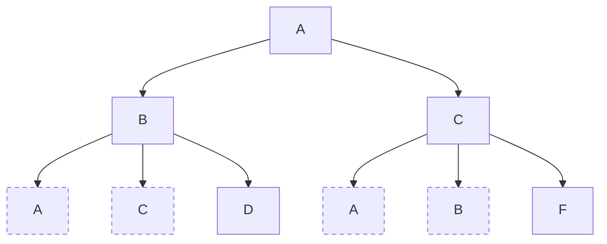

**English** | [Polski](answers.pl.md)

# Lesson 2.1 — answers

Look here only after your own attempt. The tasks are in the [lesson](../../../modules/02_search/01_state_space/README.md).

## Part A

The search tree of the exercise graph down to depth 2. A dashed outline marks the nodes whose state has already appeared in the tree earlier:

<!-- generated:search-tree example=exercise depth=2 -->

<!-- /generated -->

<!-- generated:tree-levels example=exercise depth=2 lang=en -->
| Depth | Nodes (their states) | Nodes | Distinct states |
|---|---|---|---|
| 0 | A | 1 | 1 |
| 1 | B, C | 2 | 2 |
| 2 | A, C, D, A, B, F | 6 | 5 |
<!-- /generated -->

Answers: `TREE_NODES_AT_DEPTH_2 = 6` and `STATES_AT_DEPTH_2 = 5`.

`A` has two neighbours, so `B` and `C` lie at depth 1. `B` has three neighbours (`A`, `C`, `D`) and so does `C` (`A`, `B`, `F`), so there are 3 + 3 = 6 nodes at depth 2. The state `A` appears twice among them (the cycles A → B → A and A → C → A) and the other states once each: `A`, `B`, `C`, `D`, `F`, that is 5 different states. Typical mistakes are leaving out the returns to `A` because "we have been there already" (which gives 4 nodes), or leaving out every state that appeared higher up in the tree, as a graph search would (which leaves only `D` and `F` at depth 2).

## Part B

The reference solution builds the tree level by level and counts the nodes on each level. This version is closest to the definition, but it creates every node separately, so it is very slow for large depths.

The alternative [count_paths_per_state.py](alternatives/count_paths_per_state.py) uses the observation that two nodes at the same depth with the same state have identical subtrees. It is therefore enough to remember how many nodes on the current level hold each state, that is a dictionary `state → number of paths`. The work then depends on the number of different states on a level, not on the number of nodes. On the open floor at depth 12 that is about 70 states instead of more than 4 million nodes.

The alternative [recursive_count.py](alternatives/recursive_count.py) walks the tree depth-first with recursion and increments the counter at the depth of every node it visits.

## Review questions

### 1. Nodes and states

A state describes the world, for example the cell the robot stands on. A node describes a way of getting to that state: it has a parent, an action, a path cost and a depth. Two different nodes can hold the same state. On the open floor the robot can reach a cell diagonally away from it by going right and then down, or down and then right: these are two nodes with the same state but with different parents. One node always holds exactly one state.

A good answer includes:

- the distinction: a state describes the world, a node is a state together with the way of getting to it;
- the fact that the same state can appear in many nodes;
- a concrete example of two paths to one cell.

### 2. An infinite tree

Moves in the warehouse are reversible: after a move east the robot can go back west. In the tree every path is a separate node, and paths can go back and forth for as long as you like. So for every depth there are nodes at that depth, which means the tree has no end. There are finitely many cells, but infinitely many paths between them.

A good answer includes:

- the observation that the graph has cycles (reversible moves);
- the fact that the tree contains every path, including the ones with cycles;
- the conclusion that there are infinitely many paths, and so nodes, even though there are finitely many states.

### 3. The size of the tree

A full tree with branching factor *b* has 1 + *b* + … + *b**d* = (*b**d*+1 − 1)/(*b* − 1) nodes down to depth *d*, that is O(*b**d*). The last level alone has *b**d* nodes, and all the levels above it together (*b**d* − 1)/(*b* − 1), which is fewer when *b* ≥ 2. For *b* = 10 the last level is about 90% of the whole tree.

A good answer includes:

- the formula for the sum or the estimate O(*b**d*);
- a comparison of the last level with the sum of the levels above it;
- the conclusion that the cost of a search is set mainly by its deepest level.

### 4. When to use tree search

Tree search is sensible when there are hardly any redundant paths, that is when one path or only a few lead to each state. An example is placing queens column by column. It also pays off when the state space is so large that the reached set would not fit in memory. It leads to disaster when there are many redundant paths, as in the warehouse grid: the work grows exponentially even though there are few states, and on a graph with cycles the algorithm may never stop.

A good answer includes:

- the condition: few redundant paths, or no memory for reached;
- an example of a problem without redundant paths;
- the consequences on a graph with cycles: exponentially much repeated work, or no termination.

### 5. Uniform-cost search as best-first search

Uniform-cost search is what you get for *f*(*n*) = *g*(*n*), the cost of the path from the root to the node. Reached stores a cost because several paths with different costs can lead to a state. When a cheaper path to an already reached state turns up, it has to be remembered and added to the frontier, otherwise the algorithm would return a more expensive route. "I have been here" alone is enough only when the first path found is always the best one, as in BFS with equal step costs.

A good answer includes:

- *f*(*n*) = *g*(*n*);
- the observation that paths with different costs can lead to a state;
- the conclusion that a cheaper path has to be accepted even if the state has already been reached.

## Experiments

Results of the reference implementation. Your implementation should give exactly the same numbers, because they do not depend on how you count.

| Map | Depth | Tree nodes at this depth | Different states at this depth | States reached down to this depth |
|---|---|---|---|---|
| `aisles` | 8 | 641 | 24 | 40 |
| `aisles` | 12 | 17,107 | 47 | 80 |
| `open_floor` | 8 | 22,399 | 43 | 78 |

- **Experiment 1.** The number of tree nodes grows 2–2.6 times with every level, so on a logarithmic scale it is almost a straight line. There are only 47 different states at depth 12. Down to depth 12 the tree has almost 30 thousand nodes in total, and there are only 80 different cells among them: an algorithm that does not remember states does hundreds of times more work than it needs to.
- **Experiment 2.** Every move changes the sum of the row and the column by 1, so it takes the robot to a square of "the other colour" of the chessboard. At an even depth the robot always stands on squares of the start's colour, and at an odd depth on squares of the other colour, so the sets of states at depths 11 and 12 are disjoint. The number of states at a depth depends on how many squares of that colour are within reach, which is why it sometimes grows and sometimes drops. The reached column, on the other hand, grows all the time, and its size is what bounds the work of a graph search: down to depth 12 BFS would expand at most 80 states.
- **Experiment 3.** On the open floor the number of nodes grows about 3.6 times with every level, so the blue line is much steeper: at depth 8 there are more than 22 thousand nodes instead of 641, more than 30 times as many. There are only about twice as many different states (43 instead of 24). A larger branching factor multiplies redundant paths above all, not new cells. The BFS of lesson 2.2 would explore all cells down to depth 8 in 78 expansions.
