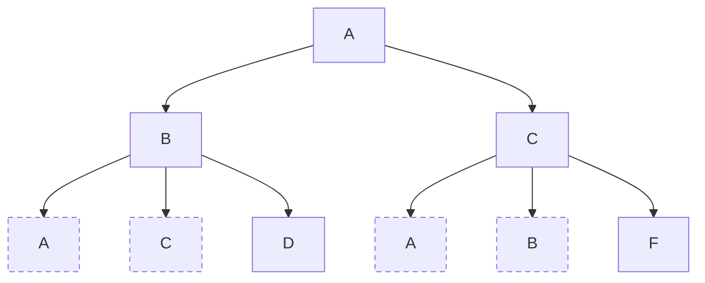

[English](answers.md) | **Polski**

# Lekcja 2.1 — odpowiedzi

Zajrzyj tutaj dopiero po własnej próbie. Treść zadań znajdziesz w [lekcji](../../../modules/02_search/01_state_space/README.pl.md).

## Część A

Drzewo przeszukiwania grafu z ćwiczenia do głębokości 2. Linią przerywaną obrysowano węzły, których stan pojawił się w drzewie już wcześniej:

<!-- generated:search-tree example=exercise depth=2 -->

<!-- /generated -->

<!-- generated:tree-levels example=exercise depth=2 lang=pl -->
| Głębokość | Węzły (ich stany) | Liczba węzłów | Różne stany |
|---|---|---|---|
| 0 | A | 1 | 1 |
| 1 | B, C | 2 | 2 |
| 2 | A, C, D, A, B, F | 6 | 5 |
<!-- /generated -->

Odpowiedzi: `TREE_NODES_AT_DEPTH_2 = 6` i `STATES_AT_DEPTH_2 = 5`.

`A` ma dwóch sąsiadów, więc na głębokości 1 leżą `B` i `C`. `B` ma trzech sąsiadów (`A`, `C`, `D`), `C` też trzech (`A`, `B`, `F`), więc na głębokości 2 jest 3 + 3 = 6 węzłów. Stan `A` występuje wśród nich dwa razy (cykle A → B → A i A → C → A), a pozostałe stany po razie: `A`, `B`, `C`, `D`, `F`, czyli 5 różnych stanów. Typowe pomyłki to pominięcie powrotów do `A`, bo „tam już byliśmy” (wtedy wychodzą 4 węzły), albo pomijanie wszystkich stanów, które pojawiły się wyżej w drzewie, jak w przeszukiwaniu grafu (wtedy na głębokości 2 zostają tylko `D` i `F`).

## Część B

Rozwiązanie wzorcowe buduje drzewo poziom po poziomie i liczy węzły na każdym poziomie. Ta wersja jest najbliższa definicji, ale tworzy każdy węzeł osobno, więc dla dużych głębokości jest bardzo wolna.

Alternatywa [count_paths_per_state.py](alternatives/count_paths_per_state.py) korzysta z obserwacji, że dwa węzły na tej samej głębokości z tym samym stanem mają identyczne poddrzewa. Wystarczy więc pamiętać, ile węzłów na bieżącym poziomie ma dany stan, czyli słownik `stan → liczba dróg`. Pracy jest wtedy tyle, ile różnych stanów na poziomie, a nie tyle, ile węzłów. Na otwartej podłodze na głębokości 12 to około 70 stanów zamiast ponad 4 milionów węzłów.

Alternatywa [recursive_count.py](alternatives/recursive_count.py) przechodzi drzewo w głąb rekurencją i zwiększa licznik na głębokości każdego odwiedzonego węzła.

## Pytania kontrolne

### 1. Węzeł a stan

Stan opisuje świat, na przykład pole, na którym stoi robot. Węzeł opisuje drogę do tego stanu: ma rodzica, akcję, koszt ścieżki i głębokość. Dwa różne węzły mogą przechowywać ten sam stan. Na otwartej podłodze do pola leżącego po skosie od robota można dojechać najpierw w prawo, a potem w dół, albo najpierw w dół, a potem w prawo: to dwa węzły z tym samym stanem, ale z różnymi rodzicami. Jeden węzeł zawsze przechowuje dokładnie jeden stan.

Dobra odpowiedź zawiera:

- rozróżnienie: stan to opis świata, węzeł to stan wraz z drogą do niego;
- informację, że ten sam stan może wystąpić w wielu węzłach;
- konkretny przykład dwóch dróg do jednego pola.

### 2. Nieskończone drzewo

Ruchy w magazynie są odwracalne: po ruchu na wschód można wrócić na zachód. W drzewie każda droga jest osobnym węzłem, a drogi mogą krążyć tam i z powrotem dowolnie długo. Dla każdej głębokości istnieją więc węzły na tej głębokości, czyli drzewo nie ma końca. Pól jest skończenie wiele, ale dróg między nimi nieskończenie wiele.

Dobra odpowiedź zawiera:

- uwagę, że w grafie są cykle (ruchy odwracalne);
- informację, że drzewo zawiera każdą drogę, także z cyklami;
- wniosek, że dróg, a więc węzłów, jest nieskończenie wiele, choć stanów skończenie wiele.

### 3. Rozmiar drzewa

Pełne drzewo o współczynniku *b* ma do głębokości *d* łącznie 1 + *b* + … + *b**d* = (*b**d*+1 − 1)/(*b* − 1) węzłów, czyli O(*b**d*). Sam ostatni poziom ma *b**d* węzłów, a wszystkie poprzednie razem (*b**d* − 1)/(*b* − 1), czyli mniej, gdy *b* ≥ 2. Dla *b* = 10 ostatni poziom to około 90% całego drzewa.

Dobra odpowiedź zawiera:

- wzór na sumę albo oszacowanie O(*b**d*);
- porównanie ostatniego poziomu z sumą poprzednich;
- wniosek, że koszt przeszukiwania wyznacza głównie najgłębszy poziom.

### 4. Kiedy przeszukiwanie drzewa

Przeszukiwanie drzewa jest rozsądne, gdy ścieżek nadmiarowych prawie nie ma, czyli gdy do każdego stanu prowadzi jedna droga albo niewiele dróg. Przykładem jest układanie hetmanów kolumna po kolumnie. Opłaca się też, gdy przestrzeń stanów jest tak wielka, że zbiór reached nie zmieściłby się w pamięci. Prowadzi do katastrofy, gdy ścieżek nadmiarowych jest dużo, jak w siatce magazynu: praca rośnie wykładniczo, choć stanów jest niewiele, a na grafie z cyklami algorytm może się nigdy nie zatrzymać.

Dobra odpowiedź zawiera:

- warunek: mało ścieżek nadmiarowych albo brak pamięci na reached;
- przykład problemu bez ścieżek nadmiarowych;
- skutki w grafie z cyklami: wykładniczo wiele powtórzonej pracy albo brak zatrzymania.

### 5. Przeszukiwanie kosztowe jako best-first

Przeszukiwanie kosztowe otrzymujemy dla *f*(*n*) = *g*(*n*), czyli kosztu ścieżki od korzenia do węzła. Reached przechowuje koszt, bo do stanu może prowadzić kilka dróg o różnych kosztach. Gdy znajdzie się tańsza droga do stanu, który już był osiągnięty, trzeba ją zapamiętać i dodać do frontier, inaczej algorytm zwróciłby droższą trasę. Sama informacja „byłem tu” wystarcza tylko wtedy, gdy pierwsza znaleziona droga jest zawsze najlepsza, jak w BFS przy jednakowych kosztach kroków.

Dobra odpowiedź zawiera:

- *f*(*n*) = *g*(*n*);
- uwagę, że do stanu mogą prowadzić drogi o różnych kosztach;
- wniosek, że tańszą drogę trzeba przyjąć, nawet jeśli stan był już osiągnięty.

## Eksperymenty

Wyniki implementacji wzorcowej. Twoja implementacja powinna dać dokładnie te same liczby, bo nie zależą one od sposobu liczenia.

| Mapa | Głębokość | Węzły drzewa na tej głębokości | Różne stany na tej głębokości | Stany osiągnięte do tej głębokości |
|---|---|---|---|---|
| `aisles` | 8 | 641 | 24 | 40 |
| `aisles` | 12 | 17 107 | 47 | 80 |
| `open_floor` | 8 | 22 399 | 43 | 78 |

- **Eksperyment 1.** Liczba węzłów drzewa rośnie 2–2,6 razy z każdym poziomem, więc na skali logarytmicznej jest prawie linią prostą. Różnych stanów na głębokości 12 jest tylko 47. Do głębokości 12 drzewo ma razem prawie 30 tysięcy węzłów, a różnych pól jest wśród nich tylko 80: algorytm, który nie zapamiętuje stanów, wykonuje setki razy więcej pracy, niż trzeba.
- **Eksperyment 2.** Każdy ruch zmienia sumę wiersza i kolumny o 1, czyli przenosi robota na pole „innego koloru” szachownicy. Na głębokości parzystej robot stoi zawsze na polach koloru startu, a na nieparzystej na polach drugiego koloru, więc zbiory stanów na głębokościach 11 i 12 są rozłączne. Liczba stanów na danej głębokości zależy od tego, ile pól danego koloru mieści się w zasięgu, dlatego raz rośnie, a raz maleje. Kolumna reached rośnie za to cały czas i to jej rozmiar ogranicza pracę przeszukiwania grafu: do głębokości 12 BFS rozwinąłby najwyżej 80 stanów.
- **Eksperyment 3.** Na otwartej podłodze liczba węzłów rośnie około 3,6 razy z każdym poziomem, więc niebieska linia jest dużo bardziej stroma: na głębokości 8 jest ponad 22 tysiące węzłów zamiast 641, czyli ponad 30 razy więcej. Różnych stanów jest tylko mniej więcej dwa razy więcej (43 zamiast 24). Większe rozgałęzienie mnoży przede wszystkim ścieżki nadmiarowe, a nie nowe pola. BFS z lekcji 2.2 zbadałby wszystkie pola do głębokości 8 w 78 rozwinięciach.
