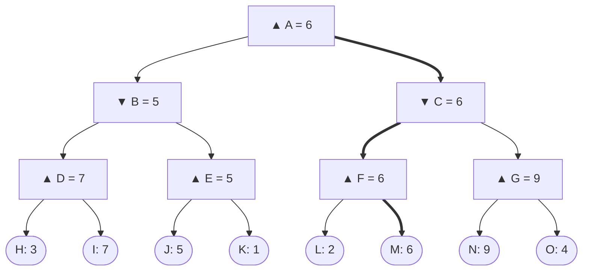

**English** | [Polski](answers.pl.md)

# Lesson 3.1 — answers

Look here only after your own attempt. The tasks are in the [lesson](../../../modules/03_games_and_csp/01_minimax/README.md).

## Part A

<!-- generated:game-tree example=minimax_exercise values=minimax -->

<!-- /generated -->

Answer:

```python
MINIMAX_VALUES = {"A": 6, "B": 5, "C": 6, "D": 7, "E": 5, "F": 6, "G": 9}
BEST_MOVE = "C"
```

Work bottom up. Nodes D, E, F and G belong to MAX, so they take the largest value of their children: D = max(3, 7) = 7, E = max(5, 1) = 5, F = max(2, 6) = 6, G = max(9, 4) = 9. Nodes B and C belong to MIN and take the smallest: B = min(7, 5) = 5, C = min(6, 9) = 6. MAX at the root chooses A = max(5, 6) = 6, the move to C.

The largest leaf, N = 9, lies under C, and still MAX will not get it, because MIN at C chooses F. MAX chooses C not because of the nine, but because the worst MIN can do to it at C (6) is better than the worst at B (5).

Common slips:

- swapping the levels (MIN at D–G, MAX at B and C), which gives B = 3 and C = 4;
- choosing the move by the largest leaf instead of by the value of the child;
- computing values from the top before the children are known.

## Part B

The reference solution follows the pseudocode: two helper functions `max_value` and `min_value` that call each other, and a player fixed once, at the start. The move is remembered only on a strict improvement, so of equally good moves the first one stays.

Alternatives:

- [negamax.py](alternatives/negamax.py) is one function for both players. In a zero-sum game a position worth *v* to one player is worth −*v* to the other, so the value for the player to move is the largest of the negated values of the children.
- [memoized.py](alternatives/memoized.py) remembers every position it has solved in a dictionary. In tic-tac-toe it visits 16,168 positions instead of 549,946.

## Review questions

### 1. Why MIN takes the smallest value

The game is zero-sum: what MAX gains, MIN loses. MIN's score is MAX's score with a minus sign. The smallest number in the tree, MAX's worst result, is therefore MIN's best. Taking the minimum, MIN simply plays its best.

A good answer includes:

- the zero sum: MIN's score = −MAX's score;
- the conclusion that the minimum for MAX is the maximum for MIN.

### 2. The value 0 of the empty board

If both players play optimally, tic-tac-toe ends in a draw. Neither player can force a win. X cannot beat an opponent who makes no mistakes, and O does not lose unless it makes one.

A good answer includes:

- the meaning: a draw when both sides play optimally;
- the remark that it is a guarantee for both players, not a prediction of every game.

### 3. The value for the opponent

It is −1. In every terminal state the players' scores add up to zero. One player's optimal play is the same game in which the other plays optimally, so the minimax values of the two players add up to zero as well: if the player to move can force a win, the opponent cannot avoid losing.

A good answer includes:

- the value −1;
- the reason: the zero sum.

### 4. Minimax against a random player

Minimax cannot lose, because it guarantees at least the minimax value against any opponent, and from the empty board that value is 0. In the experiment it lost 0 games out of 100. But it does not win every game that could be won. When several moves are worth 0, it picks the first, not the one that makes a weak opponent most likely to go wrong. It wins only once the opponent makes a mistake after which the win is forced. Then it always wins.

A good answer includes:

- the guarantee of at least the minimax value against any opponent;
- the remark that minimax assumes an optimal opponent and does not look for chances;
- the observation that it always converts a forced win.

### 5. The size of the tree

At depth 4 there are 35<sup>4</sup> = 1,500,625 leaves, and the whole tree has 1 + 35 + 35<sup>2</sup> + 35<sup>3</sup> + 35<sup>4</sup> = 1,544,761 nodes, about one and a half million. A computer walks that in a few seconds. At depth 100 there are 35<sup>100</sup> ≈ 10<sup>154</sup> leaves. Even at a billion nodes per second, walking such a tree would take incomparably longer than the age of the universe (about 4 · 10<sup>17</sup> s).

A good answer includes:

- both numbers, at least roughly;
- the remark that almost all nodes are on the last level;
- the conclusion that full minimax is impossible in chess.

## Experiments

Results of the reference implementation. Every correct minimax without a memory visits the same number of positions, because it always walks the whole tree. The time depends on the computer.

| Search from the empty board | Positions visited | Time |
|---|---|---|
| minimax | 549,946 | about 2.2 s |
| minimax with a transposition table | 16,168 | about 0.03 s |
| distinct positions in the game | 5,478 | |

| Ply | 0 | 1 | 2 | 3 | 4 | 5 | 6 | 7 | 8 | 9 |
|---|---|---|---|---|---|---|---|---|---|---|
| Tree nodes | 1 | 9 | 72 | 504 | 3,024 | 15,120 | 54,720 | 148,176 | 200,448 | 127,872 |
| Distinct positions | 1 | 9 | 72 | 252 | 756 | 1,260 | 1,520 | 1,140 | 390 | 78 |

| Minimax plays | Wins | Draws | Losses |
|---|---|---|---|
| crosses (50 games) | 50 | 0 | 0 |
| noughts (50 games) | 39 | 11 | 0 |

- **Experiment 1.** A position appears in the tree 100 times on average, because many move orders lead to it. The version with a memory solves each position once, but it calls `game.result` for every move, including moves that lead to a position already solved. That is why there are 16,167 calls, as many as the position graph has edges. It is the same idea as the reached set of lesson 2.1: it turns a tree full of repetitions back into a graph.
- **Experiment 2.** The most nodes are at ply 8, not 9, because from ply 5 on some games end in a win and have no further moves. Distinct positions peak at ply 6. The gap is largest at ply 8: 200,448 nodes and only 390 positions. Four crosses can be placed in 4! orders and four noughts in another 4!, so the same board appears up to 576 times.
- **Experiment 3.** Minimax against minimax is a draw, as the value 0 of the empty board says. Against the random player minimax never loses. With crosses it wins every game, because it moves first and soon faces the opponent with threats that a random player rarely answers well. With noughts it starts from a position that is a draw under best play, and it wins only when the opponent goes wrong.
