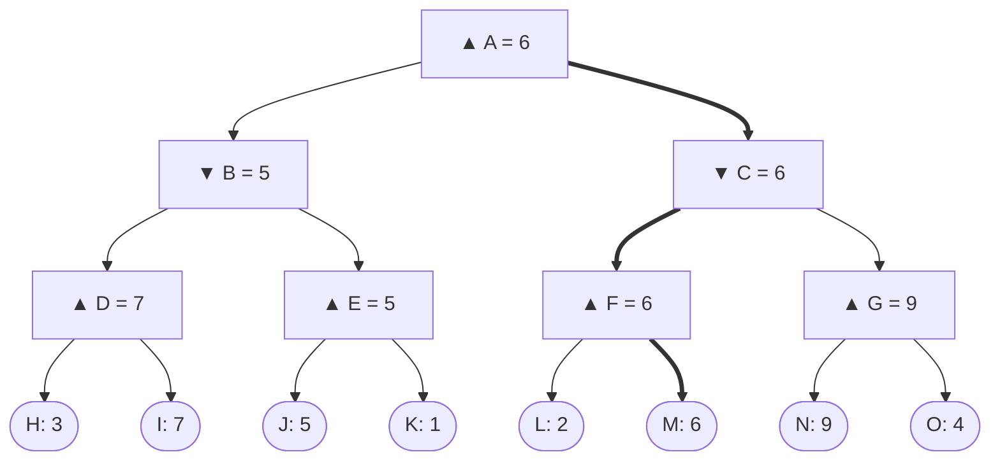

[English](answers.md) | **Polski**

# Lekcja 3.1 — odpowiedzi

Zajrzyj tutaj dopiero po własnej próbie. Treść zadań znajdziesz w [lekcji](../../../modules/03_games_and_csp/01_minimax/README.pl.md).

## Część A

<!-- generated:game-tree example=minimax_exercise values=minimax -->

<!-- /generated -->

Odpowiedź:

```python
MINIMAX_VALUES = {"A": 6, "B": 5, "C": 6, "D": 7, "E": 5, "F": 6, "G": 9}
BEST_MOVE = "C"
```

Liczymy od dołu. Węzły D, E, F i G należą do MAX, więc biorą największą wartość dzieci: D = max(3, 7) = 7, E = max(5, 1) = 5, F = max(2, 6) = 6, G = max(9, 4) = 9. Węzły B i C należą do MIN i biorą najmniejszą: B = min(7, 5) = 5, C = min(6, 9) = 6. MAX w korzeniu wybiera A = max(5, 6) = 6, czyli ruch do C.

Największy liść, N = 9, leży pod C, a mimo to MAX go nie dostanie, bo MIN w C wybierze F. MAX wybiera C nie z powodu dziewiątki, ale dlatego, że najgorsze, co MIN może mu zrobić w C (6), jest lepsze niż najgorsze w B (5).

Typowe pomyłki:

- zamiana poziomów (MIN w D–G, MAX w B i C), która daje B = 3 i C = 4;
- wybór ruchu po największym liściu, a nie po wartości dziecka;
- liczenie wartości od góry, zanim policzy się dzieci.

## Część B

Rozwiązanie wzorcowe ma postać z pseudokodu: dwie funkcje pomocnicze `max_value` i `min_value`, które wywołują się nawzajem, i gracza ustalonego raz, na początku. Ruch jest zapamiętywany tylko przy ścisłej poprawie wartości, więc z ruchów równie dobrych zostaje pierwszy.

Alternatywy:

- [negamax.py](alternatives/negamax.py) to jedna funkcja dla obu graczy. W grze o sumie zerowej pozycja warta *v* dla jednego gracza jest warta −*v* dla drugiego, więc wartość dla gracza na ruchu to największa z zanegowanych wartości dzieci.
- [memoized.py](alternatives/memoized.py) zapamiętuje w słowniku każdą pozycję, którą już rozwiązała. W kółku i krzyżyku odwiedza 16 168 pozycji zamiast 549 946.

## Pytania kontrolne

### 1. Dlaczego MIN bierze najmniejszą wartość

Gra ma sumę zerową: to, co zyskuje MAX, traci MIN. Wynik MIN to wynik MAX ze znakiem minus. Najmniejsza liczba w drzewie, czyli najgorszy wynik MAX, jest więc najlepszym wynikiem MIN. Wybierając minimum, MIN po prostu gra najlepiej dla siebie.

Dobra odpowiedź zawiera:

- sumę zerową: wynik MIN = −wynik MAX;
- wniosek, że minimum dla MAX to maksimum dla MIN.

### 2. Wartość 0 pustej planszy

Jeśli obaj gracze grają optymalnie, kółko i krzyżyk kończy się remisem. Żaden z graczy nie może wymusić wygranej. X nie wygra z przeciwnikiem, który się nie myli, a O nie przegra, jeśli sam się nie pomyli.

Dobra odpowiedź zawiera:

- interpretację: remis przy optymalnej grze obu stron;
- uwagę, że to gwarancja dla obu graczy, a nie przewidywanie wyniku każdej partii.

### 3. Wartość dla przeciwnika

Wynosi −1. W każdym stanie końcowym wyniki graczy sumują się do zera. Optymalna gra jednego gracza to ta sama partia, w której drugi gra optymalnie, więc wartości minimaksowe obu graczy też sumują się do zera: jeśli gracz na ruchu może wymusić wygraną, jego przeciwnik nie uniknie przegranej.

Dobra odpowiedź zawiera:

- wartość −1;
- uzasadnienie z sumy zerowej.

### 4. Minimax z graczem losowym

Minimax nie może przegrać, bo każdemu przeciwnikowi gwarantuje co najmniej wartość minimaksową, a z pustej planszy wynosi ona 0. W eksperymencie przegrał 0 partii ze 100. Nie wygrywa jednak każdej partii, którą dałoby się wygrać. Gdy kilka ruchów ma wartość 0, wybiera pierwszy, a nie taki, przy którym słaby przeciwnik najłatwiej się pomyli. Wygrywa dopiero wtedy, gdy przeciwnik sam popełni błąd, po którym wygrana jest wymuszona. Wtedy wygrywa zawsze.

Dobra odpowiedź zawiera:

- gwarancję co najmniej wartości minimaksowej przeciw każdemu przeciwnikowi;
- uwagę, że minimax zakłada optymalnego przeciwnika i nie szuka okazji;
- obserwację, że wymuszoną wygraną zawsze doprowadzi do końca.

### 5. Rozmiar drzewa

Na głębokości 4 jest 35<sup>4</sup> = 1 500 625 liści, a całe drzewo ma 1 + 35 + 35<sup>2</sup> + 35<sup>3</sup> + 35<sup>4</sup> = 1 544 761 węzłów, czyli około półtora miliona. To komputer przejdzie w kilka sekund. Przy głębokości 100 liści jest 35<sup>100</sup> ≈ 10<sup>154</sup>. Nawet przy miliardzie węzłów na sekundę przejście takiego drzewa trwałoby nieporównanie dłużej niż istnieje Wszechświat (około 4 · 10<sup>17</sup> s).

Dobra odpowiedź zawiera:

- obie liczby, choćby w przybliżeniu;
- uwagę, że prawie wszystkie węzły leżą na ostatnim poziomie;
- wniosek, że pełny minimax w szachach jest niewykonalny.

## Eksperymenty

Wyniki implementacji wzorcowej. Każdy poprawny minimax bez pamięci odwiedza tyle samo pozycji, bo zawsze przechodzi całe drzewo. Czas zależy od komputera.

| Przeszukiwanie z pustej planszy | Odwiedzone pozycje | Czas |
|---|---|---|
| minimax | 549 946 | ok. 2,2 s |
| minimax z tablicą transpozycji | 16 168 | ok. 0,03 s |
| różnych pozycji w grze | 5 478 | |

| Półruch | 0 | 1 | 2 | 3 | 4 | 5 | 6 | 7 | 8 | 9 |
|---|---|---|---|---|---|---|---|---|---|---|
| Węzły drzewa | 1 | 9 | 72 | 504 | 3 024 | 15 120 | 54 720 | 148 176 | 200 448 | 127 872 |
| Różne pozycje | 1 | 9 | 72 | 252 | 756 | 1 260 | 1 520 | 1 140 | 390 | 78 |

| Minimax gra | Wygrane | Remisy | Porażki |
|---|---|---|---|
| krzyżykami (50 partii) | 50 | 0 | 0 |
| kółkami (50 partii) | 39 | 11 | 0 |

- **Eksperyment 1.** Pozycja powtarza się w drzewie średnio 100 razy, bo prowadzi do niej wiele kolejności ruchów. Wersja z pamięcią rozwiązuje każdą pozycję raz, ale `game.result` wywołuje dla każdego ruchu, także takiego, który prowadzi do pozycji już rozwiązanej. Dlatego wywołań jest 16 167, tyle, ile krawędzi ma graf pozycji. To ten sam pomysł co zbiór osiągniętych stanów z lekcji 2.1: zamienia drzewo z powtórzeniami z powrotem w graf.
- **Eksperyment 2.** Najwięcej węzłów jest na półruchu 8, a nie 9, bo od półruchu 5 część partii kończy się wygraną i nie ma dalszych ruchów. Różnych pozycji najwięcej jest na półruchu 6. Różnica jest największa na półruchu 8: 200 448 węzłów i tylko 390 pozycji. Cztery krzyżyki można postawić w 4! kolejnościach, a cztery kółka w kolejnych 4!, więc ta sama plansza pojawia się nawet 576 razy.
- **Eksperyment 3.** Minimax z minimaksem remisuje, zgodnie z wartością 0 pustej planszy. Z graczem losowym minimax nigdy nie przegrywa. Krzyżykami wygrywa wszystkie partie, bo zaczyna i szybko stawia przeciwnika przed groźbami, na które losowy gracz rzadko odpowiada dobrze. Kółkami zaczyna od pozycji, która przy najlepszej grze jest remisowa, i wygrywa tylko wtedy, gdy przeciwnik się pomyli.
