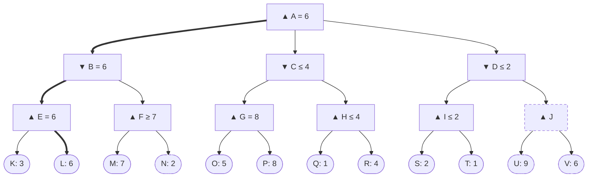

**English** | [Polski](answers.pl.md)

# Lesson 3.2 — answers

Look here only after your own attempt. The tasks are in the [lesson](../../../modules/03_games_and_csp/02_alpha_beta/README.md).

## Part A

<!-- generated:alpha-beta-table example=alpha_beta_exercise lang=en -->
| Step | Node | α | β | v | What happened |
|---|---|---|---|---|---|
| 1 | K | −∞ | +∞ | 3 | leaf |
| 2 | L | 3 | +∞ | 6 | leaf |
| 3 | ▲ E | 6 | +∞ | 6 | returns 6 |
| 4 | M | −∞ | 6 | 7 | leaf |
| 5 | ▲ F | 7 | 6 | 7 | cutoff: v ≥ β, skipped N |
| 6 | ▼ B | −∞ | 6 | 6 | returns 6 |
| 7 | O | 6 | +∞ | 5 | leaf |
| 8 | P | 6 | +∞ | 8 | leaf |
| 9 | ▲ G | 8 | +∞ | 8 | returns 8 |
| 10 | Q | 6 | 8 | 1 | leaf |
| 11 | R | 6 | 8 | 4 | leaf |
| 12 | ▲ H | 6 | 8 | 4 | returns 4 |
| 13 | ▼ C | 6 | 4 | 4 | cutoff at the last child (v ≤ α): nothing to skip |
| 14 | S | 6 | +∞ | 2 | leaf |
| 15 | T | 6 | +∞ | 1 | leaf |
| 16 | ▲ I | 6 | +∞ | 2 | returns 2 |
| 17 | ▼ D | 6 | 2 | 2 | cutoff: v ≤ α, skipped J |
| 18 | ▲ A | 6 | +∞ | 6 | returns 6 |

Root value: **6**, move: **B**. Pruned leaves: N, U, V.
<!-- /generated -->

<!-- generated:game-tree example=alpha_beta_exercise values=alpha-beta -->

<!-- /generated -->

Answer: `PRUNED_LEAVES = {"N", "U", "V"}`.

Two cutoffs, each of a different kind:

- **N, a β cutoff at a MAX node.** After the subtree E, the MIN node B knows it will give at most 6, so F receives β = 6. F's first leaf, M = 7, gives v = 7 ≥ β. MIN at B will not choose F, because E gives it 6, so leaf N need not be looked at.
- **U and V, an α cutoff at a MIN node.** After B the root has 6 secured, so D receives α = 6. D's first child, node I, returns 2. Then v = 2 ≤ α, so MAX will not enter D, and the whole subtree J with the leaves U and V is dropped.

There is a cutoff at C too, but only at its last child, H, so nothing is skipped. The result is the same with the ≥ rule and the > rule, because no values repeat in this tree.

Common slips:

- **A cutoff at H after leaf Q.** Q = 1 is smaller than α = 6, but H is a MAX node. A MAX node breaks off its loop only at v ≥ β, because the next child can still raise v. That is why R is looked at.
- **Missing the cutoff at F.** β = 6 has to be passed from B to F. Whoever always passes −∞ and +∞ to the children looks at N.
- **Writing J instead of U and V.** J is an inner node, and the question is about leaves.

## Part B

The reference solution is the pseudocode of the lesson: the minimax of lesson 3.1 with the parameters α and β and two conditions that break off the loop.

Alternatives:

- [strict_cutoff.py](alternatives/strict_cutoff.py) cuts off only at v > β and v < α. It gives the same results, but from the empty tic-tac-toe board it visits 146,120 positions instead of 18,297.
- [eager_children.py](alternatives/eager_children.py) first creates all the children of a node and only then searches them. It looks at the same leaves, but it calls `game.result` also for children it never looks into: 25,226 times instead of 18,296.
- [fail_hard.py](alternatives/fail_hard.py) clamps the returned values into the window [α, β]. After a cutoff a MAX node returns β itself, and a MIN node α itself. The root gets the window from −∞ to +∞, so its value is exact.
- [negamax_alpha_beta.py](alternatives/negamax_alpha_beta.py) is one function for both players. The window (α, β) of one player is (−β, −α) for the other.

## Review questions

### 1. α and β

α is the best value MAX already has secured on the path from the root to the node, and β is the best (smallest) value secured by MIN. The result of the game depends only on values between them. When α ≥ β the window is empty: whatever comes out at this node, one of the players will choose something else higher up. That is exactly when a cutoff happens. At a MAX node the condition v ≥ β is equivalent to α ≥ β after the update.

A good answer includes:

- the meaning of α and β as values the players have already secured;
- the observation that an empty window means a cutoff.

### 2. Why the result does not change

A node that is cut off has a value outside the window (α, β). A MIN node with v ≤ α is worth at most v, and MAX has a move higher up worth at least α, so it will not choose this node. The exact value does not affect any choice above. A MAX node with v ≥ β is symmetric. Values that fit in the window are computed exactly by alpha-beta, and the root gets the window from −∞ to +∞. "C ≤ 2" is only a bound (in fact C = 1), but it is enough to know that C loses to B = 4.

A good answer includes:

- the argument that a node cut off would not be chosen;
- the remark that the values of nodes cut off are bounds, not exact values;
- the remark that the root has the full window, so its value is exact.

### 3. The best move order

The best moves first: at a MAX node the move with the largest value, at a MIN node the one with the smallest. The best move at once sets α (or β) to a value the other moves cannot beat. The following children then get the narrowest possible window and are cut off after the first leaf that falls outside it. With a perfect order alpha-beta looks at O(*b**m*/2) nodes. In experiment 2 the order "centre and corners first" gave 7,275 positions, and the worst of the random orders 45,166.

A good answer includes:

- the rule "best move first" for both players;
- the explanation that an early good bound cuts off earlier;
- an example of a good order, such as the centre and corners in tic-tac-toe.

### 4. Strict inequalities in tic-tac-toe

With good play most tic-tac-toe positions are worth 0, so v very often equals β or α. The ≥ rule cuts off already on a tie of values, while the > rule waits for a strict improvement and looks at the remaining children, even though they cannot change the result. That is why from the empty board it takes 146,120 positions against 18,297, about 8 times as many. In trees without repeated values both rules prune the same.

A good answer includes:

- the remark that values in tic-tac-toe are often equal (usually 0);
- the difference between the rules exactly at equality;
- the conclusion that both are correct, but ≥ prunes more.

### 5. How deep in the same time

*b**m*/2 = (√*b*)*m*, so alpha-beta behaves as if the branching factor were √*b*. With the same number of nodes *N*, minimax reaches depth log*b* *N* and alpha-beta depth 2 log*b* *N*, twice as deep. In chess (*b* ≈ 35) it is as if every position had only about 6 moves.

A good answer includes:

- the rewriting *b**m*/2 = (√*b*)*m*;
- the conclusion: about twice as deep;
- the caveat that this needs a perfect move order.

## Experiments

Results of the reference implementation. Your alpha-beta should give the same numbers if it visits the moves in the order of `game.actions` and cuts off at ≥. With strict inequalities the numbers will be larger.

| From the empty board | Value | Positions visited | Time |
|---|---|---|---|
| minimax | 0 | 549,946 | about 2.3 s |
| alpha-beta | 0 | 18,297 | about 0.07 s |
| alpha-beta, centre and corners first | 0 | 7,275 | about 0.03 s |
| alpha-beta, strict inequalities | 0 | 146,120 | about 0.6 s |

| Empty cells | 2 | 3 | 4 | 5 | 6 | 7 | 8 | 9 |
|---|---|---|---|---|---|---|---|---|
| Minimax, mean | 4 | 10 | 36 | 177 | 1,134 | 7,399 | 60,965 | 549,946 |
| Alpha-beta, mean | 4 | 8 | 22 | 75 | 340 | 826 | 3,693 | 18,297 |
| Ratio | 1.00 | 0.86 | 0.61 | 0.42 | 0.30 | 0.11 | 0.061 | 0.033 |

- **Experiment 1.** All four searches give the value 0, because pruning does not change the result. Alpha-beta visits 30 times fewer positions than minimax, and with the order "centre and corners first" 76 times fewer. The centre and the corners lie on the most lines, so they are usually the best moves, and the best move looked at first gives a good bound at once. Strict inequalities cost 8 times as many positions, because almost all values are 0 and ties of values happen all the time.
- **Experiment 2.** The random orders gave from 6,709 to 45,166 positions, 18,496 on average. The natural order (18,297) falls roughly in the middle. A few random orders slightly beat "centre and corners first", because a fixed order of the cells is not perfect in every position. The spread is almost sevenfold, and in games with a bigger tree the difference between a good and a bad order grows exponentially with depth.
- **Experiment 3.** With two empty cells a node has at most two children, and the position ends after one or two moves. There is nothing to prune. With every extra empty cell the advantage grows, because a cutoff high in the tree removes ever larger subtrees. Alpha-beta in the natural order lies roughly halfway (on the logarithmic scale) between minimax and the square root of its count, the case of a perfect order.
