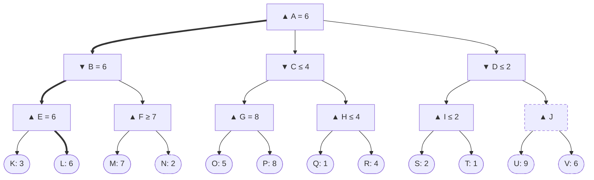

[English](answers.md) | **Polski**

# Lekcja 3.2 — odpowiedzi

Zajrzyj tutaj dopiero po własnej próbie. Treść zadań znajdziesz w [lekcji](../../../modules/03_games_and_csp/02_alpha_beta/README.pl.md).

## Część A

<!-- generated:alpha-beta-table example=alpha_beta_exercise lang=pl -->
| Krok | Węzeł | α | β | v | Co się stało |
|---|---|---|---|---|---|
| 1 | K | −∞ | +∞ | 3 | liść |
| 2 | L | 3 | +∞ | 6 | liść |
| 3 | ▲ E | 6 | +∞ | 6 | zwraca 6 |
| 4 | M | −∞ | 6 | 7 | liść |
| 5 | ▲ F | 7 | 6 | 7 | odcięcie: v ≥ β, pominięte N |
| 6 | ▼ B | −∞ | 6 | 6 | zwraca 6 |
| 7 | O | 6 | +∞ | 5 | liść |
| 8 | P | 6 | +∞ | 8 | liść |
| 9 | ▲ G | 8 | +∞ | 8 | zwraca 8 |
| 10 | Q | 6 | 8 | 1 | liść |
| 11 | R | 6 | 8 | 4 | liść |
| 12 | ▲ H | 6 | 8 | 4 | zwraca 4 |
| 13 | ▼ C | 6 | 4 | 4 | odcięcie przy ostatnim dziecku (v ≤ α): nic do pominięcia |
| 14 | S | 6 | +∞ | 2 | liść |
| 15 | T | 6 | +∞ | 1 | liść |
| 16 | ▲ I | 6 | +∞ | 2 | zwraca 2 |
| 17 | ▼ D | 6 | 2 | 2 | odcięcie: v ≤ α, pominięte J |
| 18 | ▲ A | 6 | +∞ | 6 | zwraca 6 |

Wartość korzenia: **6**, ruch: **B**. Pominięte liście: N, U, V.
<!-- /generated -->

<!-- generated:game-tree example=alpha_beta_exercise values=alpha-beta -->

<!-- /generated -->

Odpowiedź: `PRUNED_LEAVES = {"N", "U", "V"}`.

Dwa odcięcia, każde innego rodzaju:

- **N, odcięcie β w węźle MAX.** Po poddrzewie E węzeł MIN B wie, że da najwyżej 6, więc F dostaje β = 6. Pierwszy liść F, M = 7, daje v = 7 ≥ β. MIN w B nie wybierze F, bo E daje mu 6, więc liścia N nie trzeba oglądać.
- **U i V, odcięcie α w węźle MIN.** Po B korzeń ma zapewnione 6, więc D dostaje α = 6. Pierwsze dziecko D, węzeł I, zwraca 2. Wtedy v = 2 ≤ α, więc MAX nie wejdzie do D, a całe poddrzewo J z liśćmi U i V odpada.

W C też zachodzi odcięcie, ale dopiero przy ostatnim dziecku, H, więc nic nie zostaje pominięte. Wynik jest taki sam przy regule z ≥ i z >, bo w tym drzewie żadne wartości się nie powtarzają.

Typowe pomyłki:

- **Odcięcie w H po liściu Q.** Q = 1 jest mniejsze niż α = 6, ale H to węzeł MAX. Węzeł MAX przerywa pętlę tylko przy v ≥ β, bo następne dziecko może jeszcze podnieść v. Dlatego R jest oglądany.
- **Pominięcie odcięcia w F.** β = 6 trzeba przekazać z B do F. Kto przekazuje dzieciom zawsze −∞ i +∞, ogląda N.
- **Wpisanie J zamiast U i V.** J to węzeł wewnętrzny, a pytanie dotyczy liści.

## Część B

Rozwiązanie wzorcowe to pseudokod z lekcji: minimax z lekcji 3.1 z parametrami α i β i z dwoma warunkami przerwania pętli.

Alternatywy:

- [strict_cutoff.py](alternatives/strict_cutoff.py) odcina tylko przy v > β i v < α. Daje te same wyniki, ale w kółku i krzyżyku z pustej planszy odwiedza 146 120 pozycji zamiast 18 297.
- [eager_children.py](alternatives/eager_children.py) najpierw tworzy wszystkie dzieci węzła, a dopiero potem je przeszukuje. Ogląda te same liście, ale wywołuje `game.result` także dla dzieci, do których nigdy nie zajrzy: 25 226 razy zamiast 18 296.
- [fail_hard.py](alternatives/fail_hard.py) obcina zwracane wartości do przedziału [α, β]. Po odcięciu węzeł MAX zwraca samo β, a węzeł MIN samo α. Korzeń dostaje przedział od −∞ do +∞, więc jego wartość jest dokładna.
- [negamax_alpha_beta.py](alternatives/negamax_alpha_beta.py) to jedna funkcja dla obu graczy. Przedział (α, β) jednego gracza to dla drugiego (−β, −α).

## Pytania kontrolne

### 1. α i β

α to najlepsza wartość, jaką MAX ma już zapewnioną na ścieżce od korzenia do węzła, a β to najlepsza (najmniejsza) wartość zapewniona przez MIN. Wynik gry zależy tylko od wartości między nimi. Gdy α ≥ β, przedział jest pusty: cokolwiek wyjdzie w tym węźle, jeden z graczy wybierze wyżej coś innego. Właśnie wtedy zachodzi odcięcie. W węźle MAX warunek v ≥ β jest równoważny temu, że po aktualizacji α ≥ β.

Dobra odpowiedź zawiera:

- znaczenie α i β jako wartości już zapewnionych graczom;
- obserwację, że pusty przedział oznacza odcięcie.

### 2. Dlaczego wynik się nie zmienia

Odcinany węzeł ma wartość poza przedziałem (α, β). Węzeł MIN z v ≤ α jest wart najwyżej v, a MAX ma wyżej ruch wart co najmniej α, więc tego węzła nie wybierze. Dokładna wartość nie wpływa na żaden wybór powyżej. Dla węzła MAX z v ≥ β jest symetrycznie. Wartości mieszczące się w przedziale alfa-beta liczy dokładnie, a korzeń dostaje przedział od −∞ do +∞. „C ≤ 2” to tylko ograniczenie (naprawdę C = 1), ale wystarcza, żeby wiedzieć, że C przegrywa z B = 4.

Dobra odpowiedź zawiera:

- argument, że odcięty węzeł nie zostałby wybrany;
- uwagę, że wartości odciętych węzłów to ograniczenia, a nie dokładne wartości;
- uwagę, że korzeń ma pełny przedział, więc jego wartość jest dokładna.

### 3. Najlepsza kolejność ruchów

Najpierw najlepsze ruchy: w węźle MAX ruch o największej wartości, w węźle MIN o najmniejszej. Najlepszy ruch od razu ustawia α (albo β) na wartość, której pozostałe ruchy nie pobiją. Kolejne dzieci dostają wtedy najwęższy możliwy przedział i odcinają się po pierwszym liściu, który wypada poza niego. Przy idealnej kolejności alfa-beta ogląda O(*b**m*/2) węzłów. W eksperymencie 2 kolejność „najpierw środek i rogi” dała 7 275 pozycji, a najgorsza z losowych kolejności 45 166.

Dobra odpowiedź zawiera:

- zasadę „najlepszy ruch najpierw” dla obu graczy;
- wyjaśnienie, że wcześnie dobra granica wcześniej odcina;
- przykład dobrego porządku, np. środek i rogi w kółku i krzyżyku.

### 4. Nierówności ostre w kółku i krzyżyku

Większość pozycji w kółku i krzyżyku ma przy dobrej grze wartość 0, więc v bardzo często jest równe β albo α. Reguła z ≥ odcina już przy remisie wartości, a reguła z > dopiero przy ścisłej poprawie i ogląda resztę dzieci, choć nie mogą one zmienić wyniku. Dlatego z pustej planszy wychodzi 146 120 pozycji wobec 18 297, czyli około 8 razy więcej. W drzewach bez powtarzających się wartości obie reguły przycinają tak samo.

Dobra odpowiedź zawiera:

- uwagę, że wartości w kółku i krzyżyku często są równe (zwykle 0);
- różnicę między regułami właśnie przy równości;
- wniosek, że obie są poprawne, ale ≥ przycina więcej.

### 5. Jak głęboko w tym samym czasie

*b**m*/2 = (√*b*)*m*, więc alfa-beta zachowuje się tak, jakby współczynnik rozgałęzienia wynosił √*b*. Przy tej samej liczbie węzłów *N* minimax sięga na głębokość log*b* *N*, a alfa-beta na głębokość 2 log*b* *N*, czyli dwa razy głębiej. W szachach (*b* ≈ 35) to tak, jakby w każdej pozycji było tylko około 6 ruchów.

Dobra odpowiedź zawiera:

- przekształcenie *b**m*/2 = (√*b*)*m*;
- wniosek: około dwa razy głębiej;
- zastrzeżenie, że chodzi o idealną kolejność ruchów.

## Eksperymenty

Wyniki implementacji wzorcowej. Twój alfa-beta powinien dać te same liczby, jeśli ogląda ruchy w kolejności `game.actions` i odcina przy ≥. Z nierównościami ostrymi liczby będą większe.

| Z pustej planszy | Wartość | Odwiedzone pozycje | Czas |
|---|---|---|---|
| minimax | 0 | 549 946 | ok. 2,3 s |
| alfa-beta | 0 | 18 297 | ok. 0,07 s |
| alfa-beta, najpierw środek i rogi | 0 | 7 275 | ok. 0,03 s |
| alfa-beta, nierówności ostre | 0 | 146 120 | ok. 0,6 s |

| Wolne pola | 2 | 3 | 4 | 5 | 6 | 7 | 8 | 9 |
|---|---|---|---|---|---|---|---|---|
| Minimax, średnio | 4 | 10 | 36 | 177 | 1 134 | 7 399 | 60 965 | 549 946 |
| Alfa-beta, średnio | 4 | 8 | 22 | 75 | 340 | 826 | 3 693 | 18 297 |
| Stosunek | 1,00 | 0,86 | 0,61 | 0,42 | 0,30 | 0,11 | 0,061 | 0,033 |

- **Eksperyment 1.** Wszystkie cztery przeszukiwania dają wartość 0, bo przycinanie nie zmienia wyniku. Alfa-beta odwiedza 30 razy mniej pozycji niż minimax, a przy kolejności „najpierw środek i rogi” 76 razy mniej. Środek i rogi leżą na największej liczbie linii, więc zwykle to najlepsze ruchy, a najlepszy ruch obejrzany jako pierwszy daje od razu dobrą granicę. Nierówności ostre kosztują 8 razy więcej pozycji, bo prawie wszystkie wartości to 0 i remisy wartości zdarzają się bez przerwy.
- **Eksperyment 2.** Losowe kolejności dały od 6 709 do 45 166 pozycji, średnio 18 496. Kolejność naturalna (18 297) wypada mniej więcej pośrodku. Kilka losowych kolejności nieznacznie pobiło „najpierw środek i rogi”, bo stała kolejność pól nie jest idealna w każdej pozycji. Rozrzut sięga prawie siedmiu razy, a w grach z większym drzewem różnice między dobrą a złą kolejnością rosną wykładniczo z głębokością.
- **Eksperyment 3.** Przy dwóch wolnych polach węzeł ma najwyżej dwoje dzieci, a pozycja kończy się po jednym albo dwóch ruchach. Nie ma czego przycinać. Z każdym kolejnym wolnym polem przewaga rośnie, bo odcięcie wysoko w drzewie usuwa coraz większe poddrzewa. Alfa-beta w kolejności naturalnej leży mniej więcej w połowie drogi (na skali logarytmicznej) między minimaksem a pierwiastkiem z jego liczby pozycji, czyli przypadkiem idealnej kolejności.
